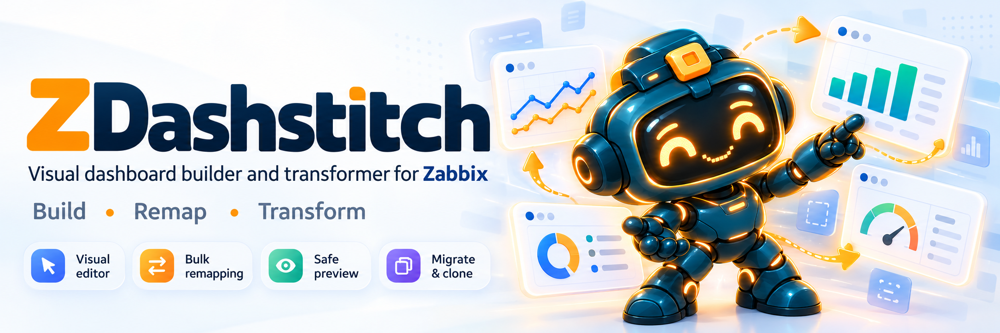

# ZDashstitch


[](https://github.com/kroxiksut/zdashstitch/actions/workflows/spec-tests.yml)
[](https://github.com/kroxiksut/zdashstitch/actions/workflows/build.yml)


[](LICENSING.md)
[](LICENSE-DOCS)

**Build, reuse and safely maintain Zabbix dashboards — without repeating the same manual work.**



> The banner and other images in `assets/` describe the intended visual direction. They are not screenshots of an implemented application.

[Русский](README.ru.md) · [Roadmap](ROADMAP.md) · [Documentation](docs/README.md) · [Architecture](docs/architecture/ARCHITECTURE_MAP.md) · [Contributing](CONTRIBUTING.md)

> **Project status (24 October 2026):** P0-01—07 evidence remains complete for the legacy v1 formats, transport and publisher. O-025 reopened the format part of G0 as P0-08: typed dashboard/page projects and legacy `project/v1` migration depend on O-026. The user-facing editor and HTTP/UI publishing flow are **not implemented**.

## Why ZDashstitch?

Maintaining dashboards in Zabbix can become repetitive: a PostgreSQL dashboard is recreated for the pilot environment; a ClickHouse page combines metrics from ClickHouse, Keeper, HAProxy and Linux templates; a retired host must be replaced across many widgets; a whole page needs to be copied without breaking existing content.

ZDashstitch aims to solve these cases with a **local graphical dashboard builder** and explicit, reviewable operations. It is not a monitoring backend, a replacement for Zabbix, or a clone of Grafana.

## Planned MVP 0.1.0

The first release targets **global dashboards on Zabbix 7.4 only**.

### User outcomes

1. Replace a retired host across supported widgets in one selected dashboard; unresolved references block publication.
2. Within one Zabbix connection, clone a global dashboard from Prod to Pilot host groups, explicitly bind new hosts/metrics and leave the source dashboard unchanged.
3. Build a DB Pilot dashboard with PostgreSQL, ClickHouse, OS and Backup pages; the ClickHouse page may combine ClickHouse, Keeper, HAProxy and Linux catalogs.
4. Import Zabbix 7.4 template exports offline, create a portable YAML/data-only ZIP project, then bind real hosts and create or extend a dashboard inside the target environment.

### Required capabilities

| Area | MVP result |
|---|---|
| Offline import | YAML/JSON/XML exports from standard or custom Zabbix 7.4 templates become normalized metric catalogs with explicit diagnostics |
| Typed offline drafts | A dashboard project or page project opens on another computer without Zabbix or internet access; the existing multi-dashboard `project/v1` container remains legacy until P0-08 implements the decided O-026 format (`project/v2` with `kind: dashboard|page`; a single page is a first-class exchange file, O-027) and migration |
| Authentication | API token or username/password where server policy permits `user.login`; no MFA bypasses or stored passwords |
| Five operations | CreateDashboard, AppendPage, AppendWidgets, CloneDashboard and ReplaceHost for global dashboards |
| Initial widgets | Create modern Graph (`svggraph`) and Item value (`item`); other widget changes require separate proof |
| Mixed sources | Multiple templates on one page, multiple hosts in a graph and per-host item cards |
| Safe publishing | Read → resolve → preflight → preview → confirm → re-read → write → verify; unknown outcomes are reconciled, never blindly retried |
| Local GUI | Rust + Axum on loopback with a Svelte/TypeScript UI; no end-user CLI/TUI or required company server |
| Languages and themes | All user-visible Rust/TypeScript/Svelte messages come from data-only catalogs; English source plus complete Russian translation; system/light/dark themes use semantic tokens |

### Quality gates

| Gate | Evidence required |
|---|---|
| G0 | Rust foundation plus read/write contracts proven on an explicitly permitted test Zabbix 7.4 and a closed `VerifiedPlan` publisher |
| G1 | Staged: G1a — approved layouts, states, localizable copy, and implementation handoff for connections, import, ReplaceHost, Clone, and publishing; G1b — for the remaining MVP flows |
| G2 | ReplaceHost preserves unrelated widget data and safely refuses unsupported references |
| G3 | CloneDashboard produces a verified copy without changing the source |
| G4 | Offline project creation and transfer work without Zabbix or internet access |
| G5 | A dashboard project creates a dashboard and a page project appends to an explicitly selected dashboard without damaging existing content |
| G6 | End-to-end Windows/Linux GUI acceptance, documented support matrix and known limitations |

Passing a schema test does not satisfy any live Zabbix gate.

### Not in the MVP

Adapters for Zabbix 7.0/6.0/8.0/5.x, template dashboards, automatic bidirectional synchronization, a community catalog, built-in AI/MCP, arbitrary CSS/JS/PHP, server-side Custom Widgets, a shared multi-user service and an end-user CLI/TUI are excluded. See the [post-MVP roadmap](ROADMAP.md).

**Target platforms:** Windows 10+ and tested Linux desktops with a browser. macOS builds and support are deferred until the post-MVP multi-version Zabbix work. The planned implementation is Rust + Axum on local loopback with a Svelte/TypeScript UI.

## Offline design and data boundaries

```text
Zabbix template exports / normalized catalogs
                  ↓
         Portable dashboard project
                  ↓                 (may be created using AI externally)
      project.yaml + metrics/*.yaml
                  ↓  transfer via approved channel
         Local binding to real hosts
                  ↓
    validation → preview → confirmation
                  ↓
           Zabbix API adapter
```

**Portable is not synonymous with anonymized.** Template names, item keys and free text may reveal internal details. Real host IDs, connection credentials, raw dashboard snapshots and deployment state are stored separately and must not be included in portable packages. Whether external AI may receive any project data is subject to the organization's policy.

The first release targets **global dashboards on Zabbix 7.4 only**. Later adapters for 7.0 LTS, 6.0 LTS, 8.0 and possibly 5.x are planned, but **must** be tested separately. Unknown or unverified write capabilities fail closed.

## Implementation direction

- Rust 1.94.1 / edition 2024 workspace: `core`, `template_import`, `zabbix`, `application`, `apps/local_server`.
- Axum already serves a read-only health endpoint and the built UI on loopback; session, Origin/Host, CSRF and DNS-rebinding protections are required before any mutating route is introduced.
- Svelte/TypeScript provides the GUI and never talks to Zabbix directly.

P0-01 provides only a runnable shell, not a dashboard editor. Build and local-run commands are documented in [`DEVELOPMENT.md`](DEVELOPMENT.md). Future product directions are consolidated in the bilingual [roadmap](ROADMAP.md). Concrete user stories remain in [project goals](docs/product/PROJECT_GOALS.md) and [acceptance use cases](docs/product/USE_CASES.md).

## Why Python still exists

Python is a **temporary executable specification**, not a planned product runtime. It deterministically generates the four JSON Schemas, validates portable YAML/data-only ZIP and cross-file invariants, and supplies positive/negative fixtures that the Rust implementation must match.

P0-02 and P0-03 now provide equivalent Rust models, semantic validators and a safe directory/data-only ZIP layer. Python remains developer-only as the single schema generator and an independent regression oracle; it is no longer needed in the normal product workflow and is never shipped with the GUI.

## Current repository contents

| Location | Purpose |
|---|---|
| [`docs/README.md`](docs/README.md) / [`docs/README.ru.md`](docs/README.ru.md) | Documentation map, authority and language status |
| [`docs/MVP_TRACEABILITY.md`](docs/MVP_TRACEABILITY.md) | MVP use cases mapped to P0–P6 tasks, G0–G6 gates and acceptance evidence |
| [`ROADMAP.md`](ROADMAP.md) / [`ROADMAP.ru.md`](ROADMAP.ru.md) | Consolidated post-MVP directions |
| [`AGENTS.md`](AGENTS.md) | Mandatory start point and safety rules for coding agents |
| [`docs/adr/`](docs/adr/) | Accepted architecture and licensing decisions 001–013 |
| [`docs/architecture/`](docs/architecture/) | Adapter and portable-format contracts |
| [`schemas/`](schemas/) | Four generated JSON Schemas |
| [`examples/`](examples/) | Synthetic dashboard, metric catalogs, local-state examples |
| [`fixtures/formats/v1/`](fixtures/formats/v1/) | Positive and negative fixtures shared by Python and Rust |
| [`tools/` and `tests/`](tools/) | Python reference validators and tests; not the product runtime |
| [`assets/`](assets/) | Target visual direction and Stezhik concept art; not product screenshots |
| [`LICENSING.md`](LICENSING.md) | Software/documentation license split and boundaries |

### Validate the specification

For documentation contributors (Python 3.11+; dependencies are pinned in `requirements-reference.txt`):

```bash
python -m pip install -r requirements-reference.txt
python tools/build_schemas.py
python tools/validate.py examples/db-pilot.yaml
python tools/validate.py --package examples/db-pilot-package.zip
python -m pytest -q
```

These checks establish **schema/reference validation only**. They do not demonstrate a functional GUI or safe updates against a live Zabbix server.

## Contributing and license

Contributions are welcome, including translation-only pull requests, synthetic fixtures, documentation, future dashboard recipes and verified compatibility tests. New experimental languages may use English fallback; code changes must be submitted separately from translations. Please read [CONTRIBUTING.md](CONTRIBUTING.md) and [SECURITY.md](SECURITY.md); never commit corporate hosts, addresses, tokens or raw infrastructure exports.

Original source code and code-like material are dual-licensed under [MIT](LICENSE-MIT) **OR** [Apache-2.0](LICENSE-APACHE). Documentation prose and original project visuals are licensed under [CC-BY-4.0](LICENSE-DOCS). See [LICENSING.md](LICENSING.md) for the exact boundaries. Zabbix is a separate project with its own licenses and trademarks; ZDashstitch is an independent tool using documented APIs.
