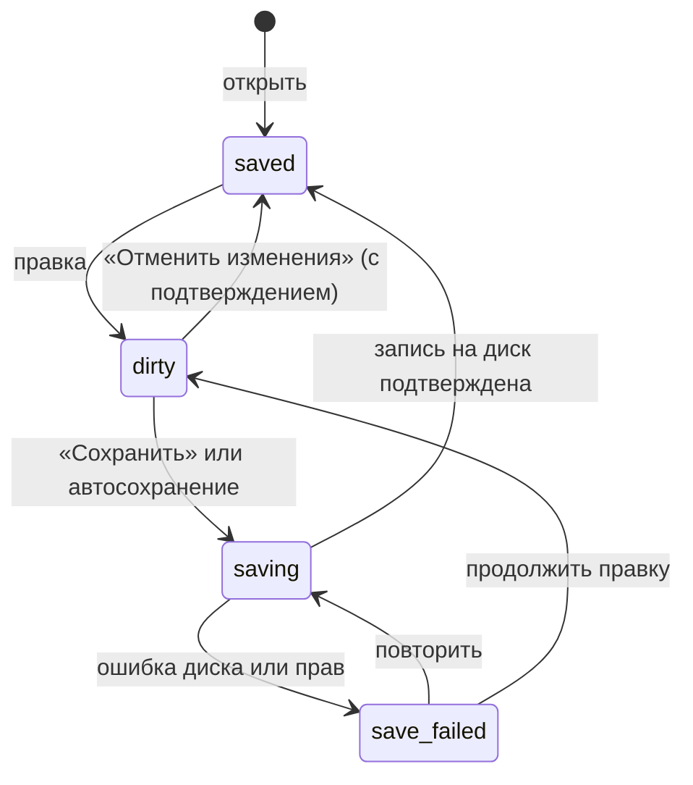
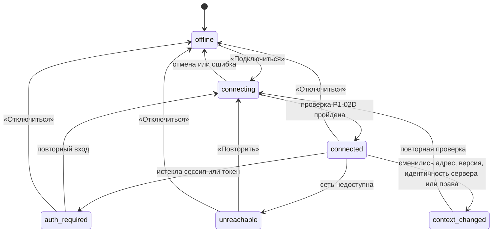

# P1-01C — модель режимов и состояний сессии

Статус: принято владельцем 25.10.2026. Это design specification, не реализованный код.

Входы: P1-IN-07 (локальная сессия), P1-IN-01 (ошибки подключения), P1-IN-04 и P1-IN-11 (запись), O-017, O-018, O-031, O-032, P1-00E (экранные состояния), журнал `JournalState` в `crates/application/src/publisher.rs`.

## 1. Независимые оси

Состояние экрана — это не одна переменная, а шесть независимых осей. Каждая отображается своим элементом интерфейса, и ни одна не выводится из другой.

| Ось | Значения | Где видно | Сохраняется между запусками |
|---|---|---|---|
| A. Локальная сессия | `active`, `no_session`, `app_restarted` | весь экран (заглушка вместо содержимого) | нет |
| B. Черновик: вид и происхождение | вид `dashboard`/`page`; происхождение `local`/`server_copy` | плашки у заголовка | да |
| C. Черновик: сохранение | `saved`, `dirty`, `saving`, `save_failed`; редактирование `editing`/`open_elsewhere` | плашка «Сохранена/Изменена» | `saved`/`dirty` на диске; ввод в форме — нет |
| D. Подключение и режим | `offline`, `connecting`, `connected`, `auth_required`, `unreachable`, `context_changed`; режим `read_only`/`read_write` | метка режима в шапке | профиль — да; режим после запуска всегда `read_only` |
| E. Свежесть источника | `not_checked`, `current`, `stale`, `conflict`, `source_missing` | плашка «Не проверена / Проверена / Устарела / Конфликт» | время последней проверки — да; состояние после запуска — `stale` |
| F. Цель, намерение и публикация | цель `none`/`selected`; намерение (`CreateDashboard`, `SaveAsCopy`, `CloneDashboard`, `AppendPage`, `AppendWidgets`, `ReplaceHost`, `Update`); публикация по журналу (§6) | раздел «Публикация», баннер незавершённой операции | цель и намерение — да (локально); план — нет; журнал — да |

Инженерные имена из задач (`dashboard_project`, `page_project`, `dashboard_workcopy`, `page_workcopy`) — это сочетание оси B: вид × происхождение. В интерфейсе: «Панель» или «Страница» и «Локальная» или «Копия с сервера». Слово «проект» не показывается.

Серверные права учётной записи — не ось режима. Режим выбирает пользователь (O-013); права только сужают доступные операции и узнаются при проверке подключения (P1-02D). Владелец и общий доступ — по O-031.

## 2. Локальная сессия (ось A)

| Состояние | Когда | Экран | Выход |
|---|---|---|---|
| `active` | вкладка открыта по коду запуска, cookie действительна | обычная работа | — |
| `no_session` | адрес открыт без кода запуска или в другом браузере | только `session.bootstrap.invalid`, никаких данных | открыть через ярлык |
| `app_restarted` | процесс перезапущен или упал, вкладка осталась старой | `session.expired.title` + `session.expired.body` | открыть через ярлык; после входа показать незавершённые операции журнала |

Таймаута бездействия нет (O-032). Действие «Завершить сессию» (P1-09) переводит все вкладки в `no_session` и стирает секреты Zabbix из памяти; сохранённые черновики остаются на диске.

## 3. Черновик: сохранение и две вкладки (ось C)

- «Сохранена» означает только локальный диск, а не публикацию в Zabbix (P1-01B §5).
- При включённом автосохранении (P1-04G, решение G-1 от 25.10.2026) «Отменить изменения» означает отмену шагов истории до точки последнего ручного сохранения (P1-04G §4.5).
- При `save_failed` черновик остаётся открытым, ввод сохраняется, закрытие не продолжается.
- **Две вкладки (вопрос P1-IN-07; принято владельцем 25.10.2026).** Черновик редактирует одна вкладка. Вторая открывает его в состоянии `open_elsewhere`: только просмотр и действие «Редактировать здесь». После перехвата первая вкладка тоже переходит в просмотр; её несохранённый ввод остаётся видимым, его можно скопировать, но сохранить нельзя. Сохранение дополнительно проверяет ревизию черновика на диске: при несовпадении — «Черновик изменён в другой вкладке» с выбором «Загрузить сохранённую версию» или «Сохранить как новый черновик».

## 4. Подключение и режим (ось D)

Режим — отдельный переключатель внутри `connected`:

- после запуска и после каждого подключения режим `read_only`;
- переход в `read_write` — только явным действием с подтверждением (P1-02E); обратный переход мгновенный;
- в `read_only` пути записи нет вовсе: действия записи не отрисованы, раздел «Публикация» показывает требования (P1-01B §2);
- любой выход из `connected`, понижение режима и `context_changed` делают недействительными все планы публикации этого подключения и переводят свежесть источников этого подключения в `stale`.

Метка режима в шапке: «Автономно» (`common.state.offline`), «Подключение…», «Только чтение · {профиль}», «Чтение-запись · {профиль}», «Нужен вход · {профиль}», «Нет связи · {профиль}», «Сервер изменился · {профиль}».

## 5. Свежесть источника (ось E)

Источник — снимок панели или страницы на сервере, из которой сделана копия (или страница, взятая в сборку). Для локальных черновиков без источника ось не показывается.

| Состояние | Значение | Что блокируется | Выход |
|---|---|---|---|
| `not_checked` | после копирования источник ещё не сверялся с сервером в этой сессии | обновление существующей панели | «Проверить» (только чтение) |
| `current` | при последнем чтении удалённая панель совпала с Base (fingerprint); показываем время | — | — |
| `stale` | прошло время, переподключение, смена контекста, перезапуск | запись (до новой проверки) | «Проверить» |
| `conflict` | удалённая панель отличается от Base | обновление существующей панели | сравнить; переимпортировать или «Сохранить копию»; автоматического слияния нет (O-014) |
| `source_missing` | панель удалена или больше не видна учётной записи | обновление; восстановление владельца и доступа | «Сохранить копию» или продолжить как локальную |

Проверка свежести обязательна при открытии предпросмотра публикации, перед подтверждением и непосредственно перед записью (это делает publisher, P0-07). Пометка `current` в плашке — не обещание, что сервер не изменится между последним чтением и записью: у Dashboard API нет CAS.

## 6. Публикация (ось F)

Состояния совпадают с журналом `JournalState`; интерфейс добавляет только `idle` (операции нет).

| Журнал | В интерфейсе (RU) | Новая запись в ту же цель |
|---|---|---|
| — | «Нет операции» | разрешена при выполнении §7 |
| `Planned` | «Подготовка плана» | — |
| `Previewed` | «Предпросмотр» | после подтверждения |
| `Confirmed` | «Подтверждено» | — |
| `Submitting` | «Запись…» | запрещена |
| `Verified` | «Проверено повторным чтением» (`common.state.verified`) | разрешена новым планом |
| `Conflict` | «Конфликт: панель изменилась» | после пересборки предпросмотра |
| `FailedBeforeSend` | «Не отправлено» | разрешена новым планом |
| `FailedAfterResponse` | «Ошибка после ответа сервера» | только после сверки чтением |
| `UnknownOutcome` | «Результат неизвестен» (`common.state.unknown_outcome`) | **запрещена** до сверки |
| `ReconciledVerified` | «Сверено: изменения записаны» | разрешена новым планом |
| `ReconciledFailed` | «Сверено: изменения не записаны» | разрешена новым планом |

План существует только в памяти процесса и одноразовый. Он становится недействительным при изменении черновика после предпросмотра, смене цели или намерения, смене учётных данных, режима или контекста подключения, при `stale`/`conflict` источника и после перезапуска. Незавершённая операция журнала (`Submitting` без итога, `UnknownOutcome`) переживает перезапуск и показывается баннером `startup.recovery.found` с точными источником, целью и видом объекта до любых новых записей.

## 7. Сквозные правила (guards)

1. **Запись** возможна только если одновременно: сессия `active`; подключение `connected`; режим `read_write`; цель выбрана и принадлежит этому подключению; свежесть источника `current` по проверке внутри этого предпросмотра (для намерений, у которых есть источник); есть действующий одноразовый план без блокирующих проверок; по этой цели нет `UnknownOutcome`.
2. **`read_only`** не имеет пути записи независимо от прав учётной записи.
3. **Локальное сохранение** никогда не меняет ось F и не называется публикацией.
4. **Источник и цель** не объединяются: смена цели не меняет источник; панель, из которой взята страница, не становится целью неявно.
5. **Автономно** доступны правка, сохранение, экспорт, импорт файлов и синтетический предпросмотр (O-028); проверка источника, подбор узлов сети на сервере и публикация показываются с причиной недоступности.
6. **Режим после запуска** — всегда `read_only`, даже если в прошлый раз был `read_write`.
7. **Владелец и доступ** при записи не передаются, если их явно не меняли (O-031 п. 5); `userid` — только от Super admin.

## 8. Что доступно в каком состоянии подключения

| Действие | Автономно | Подключение потеряно или нужен вход | Только чтение | Чтение-запись |
|---|---|---|---|---|
| Правка, сохранение, экспорт черновика | да | да | да | да |
| Синтетический предпросмотр | да | да | да | да |
| Импорт с сервера, проверка источника | нет | нет (вход или повтор) | да | да |
| Подбор узлов сети и элементов данных на сервере | нет | нет | да | да |
| Предпросмотр публикации | показывает требования | показывает требования | показывает требования | да |
| Подтверждение и запись | нет | нет | нет | да, по §7 |
| Сверка незавершённой операции чтением | нет | после входа | да | да |

## 9. Сохранение между запусками

| Сохраняется (локальное хранилище O-018) | Не сохраняется |
|---|---|
| черновики и их сохранённое состояние, выбранные цель и намерение, рабочие копии и снимки, журнал, профили подключений без секретов, время последней проверки источника, секреты в системном хранилище — только по выбору пользователя (ADR-008) | несохранённый ввод в браузере, планы публикации, режим `read_write`, секреты в памяти, локальная сессия, состояние `current` источника |

## 10. Новые message IDs

| ID | EN source | RU |
|---|---|---|
| `connection.state.connecting` | Connecting… | Подключение… |
| `connection.state.read_only_profile` | Read-only · {profile} | Только чтение · {profile} |
| `connection.state.read_write_profile` | Read-write · {profile} | Чтение-запись · {profile} |
| `connection.state.auth_required` | Sign-in required · {profile} | Нужен вход · {profile} |
| `connection.state.unreachable` | No connection · {profile} | Нет связи · {profile} |
| `connection.state.context_changed` | Server changed · {profile} | Сервер изменился · {profile} |
| `draft.context.save_failed` | Not saved: {reason} | Не сохранено: {reason} |
| `draft.context.open_elsewhere` | Open for editing in another tab | Открыт для правки в другой вкладке |
| `draft.action.edit_here` | Edit here | Редактировать здесь |
| `draft.conflict.revision` | This draft was changed in another tab | Черновик изменён в другой вкладке |
| `draft.freshness.not_checked` | Not checked | Не проверена |
| `draft.freshness.current` | Checked at {time} | Проверена в {time} |
| `draft.freshness.stale` | Out of date, check again | Устарела, проверьте снова |
| `draft.freshness.conflict` | Changed on the server | Изменена на сервере |
| `draft.freshness.source_missing` | Source not found or not available | Источник не найден или недоступен |
| `publication.state.idle` | No operation | Нет операции |
| `publication.state.submitting` | Writing… | Запись… |
| `publication.state.failed_before_send` | Not sent | Не отправлено |
| `publication.state.reconciled_failed` | Checked: changes were not written | Сверено: изменения не записаны |

Параметры `{profile}`, `{time}` — пользовательские данные и локализованное время; `{reason}` — message ID ошибки, а не готовый текст.

## 11. Проверки приёмки

- Каждая ось имеет свой элемент интерфейса; «Сохранена», «Проверена», «Только чтение» и «Проверено повторным чтением» никогда не подменяют друг друга.
- Запись невозможна без всех условий §7, а в `read_only` пути записи нет.
- После перезапуска режим `read_only`, планов нет, свежесть `stale`, незавершённая операция журнала показана до новых записей.
- Две вкладки не могут молча перезаписать один черновик.
- Ни одно состояние не требует подключения для локальной работы.
