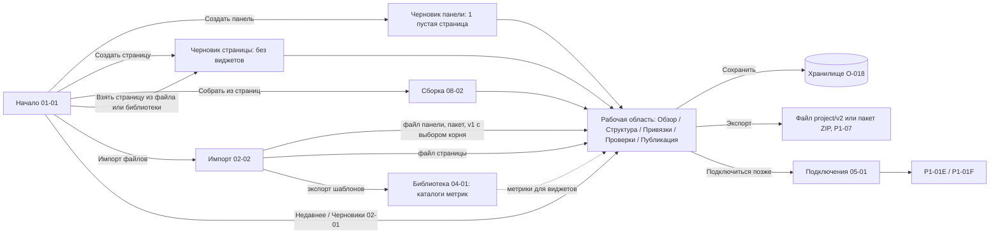

# P1-01D — сквозной автономный поток

Статус: принято владельцем 25.10.2026. Это design specification сквозного потока, не новый экран: шаги ссылаются на уже принятые макеты. Реализация — P4 (локальные черновики, импорт, редактор, экспорт), P2-00 (оболочка).

Входы: P1-01A (точки входа), P1-01B (оболочка, «Структура»), P1-01C (оси состояний и guards), P1-01I (страницы), P1-03 (импорт и библиотека), O-018 (хранилище), O-023 (выбор файлов), O-025—O-028 (панель/страница, `project/v2`, страница как единица, синтетика), `schemas/project-v2.schema.json`.

Автономно — это состояние без подключения (P1-01C ось D `offline`), а не режим доступа. Всё ниже работает без профиля Zabbix; подключение можно добавить в любой момент без потери черновика.

## 1. Общая схема

Поток панели и поток страницы различаются только корнем черновика; разделы рабочей области одинаковы (P1-01B §2). Вид черновика никогда не меняется неявно: страница не превращается в панель и наоборот, кроме явной «Собрать панель из страниц» (новый черновик) и «Добавить страницу в панель» (меняется целевая панель).

## 2. Поток «Панель»

| # | Триггер | Экран / маршрут | Предусловия | Данные вход → выход | Сохранение | Успех → / Ошибка → | Message IDs |
|---|---|---|---|---|---|---|---|
| D1 | «Создать панель» на «Начале» или «Черновики → Создать» | диалог имени поверх `01-01_P1-01A_start.svg` / `02-01_P1-03F_drafts-list.svg` | — | имя → черновик `kind: dashboard`, 1 страница без виджетов, умолчания Zabbix (период 30 с, слайд-шоу вкл.) | создаётся в хранилище | → D3 / имя пустое — ошибка поля | `startup.action.new_dashboard`, `startup.local.dashboard_help` |
| D2 | открыть сохранённую панель | «Черновики» `02-01` или «Недавнее» | черновик есть в хранилище | `local_id` → рабочая область | — | → D3 / черновик пропал — `startup.draft.missing` | `startup.recent.title`, `drafts.title` |
| D3 | открытие рабочей области | «Обзор» `/draft/:id/overview` (композиция как `07-overview/07-01_P1-01B_page-copy-overview.svg`, без источника) | черновик загружен | — | — | → D4 | `draft.nav.overview`, `draft.context.offline`, `draft.context.saved` |
| D4 | правка структуры | «Структура» `08-structure/08-01_P1-01B_dashboard-structure.svg` | — | порядок, имена, страницы, перенос виджетов | состояние «Изменена» | → D5 / нет места на странице — ничего не меняется | `draft.structure.*`, `draft.context.dirty` |
| D5 | «Изменить» виджет / «Добавить виджет» | редактор P1-04 (не спроектирован) | для виджета с метрикой — каталог метрик в библиотеке (см. §5) | поля виджета, геометрия на сетке 72 колонки | «Изменена» | → D6 / выход за сетку или перекрытие — `editor.validation.*` | `editor.*` |
| D6 | проверка | «Проверки» (P1-04F, не спроектирован) | — | локальная проверка схемы, связей, геометрии, совместимости `Zabbix {min}+` | — | → D7 / блокирующие ошибки показываются, сохранение не блокируют | `draft.compat.label` |
| D7 | «Сохранить локально» | любая секция; закрытие — `draft.close.dirty.title` | — | черновик → хранилище (атомарно, O-018) | «Сохранена локально» | → D8 / `draft.context.save_failed` — черновик открыт, ввод цел | `draft.context.saved`, `draft.context.save_failed` |
| D8 | «Экспорт в файл» | «Черновики» `02-01` (действие для локальных) → поток P1-07 | черновик валиден как `project/v2` (§5) | файл `project/v2` `kind: dashboard` или пакет ZIP с каталогами | файл на диске (нативный диалог O-023 или загрузка) | → итог экспорта / блокировка с причиной | `export.*` |
| D9 | «Подключиться» в шапке или «Публикация» | `05-connections/05-01_P1-02A_connections-list.svg` | — | профиль → подключение | черновик не меняется | → P1-01E (`read_only`) | `startup.action.connect` |

## 3. Поток «Страница»

| # | Триггер | Экран / маршрут | Предусловия | Данные вход → выход | Сохранение | Успех → / Ошибка → | Message IDs |
|---|---|---|---|---|---|---|---|
| P1 | «Создать страницу» | диалог имени поверх `01-01` / `02-01` | — | имя → черновик `kind: page`, без виджетов | создаётся в хранилище | → P3 | `startup.action.new_page`, `startup.local.page_help` |
| P2 | «Взять страницу» из файла или библиотеки | `02-drafts/02-02_P1-03A_import-files.svg` (файл) или «Библиотека → Страницы» (`04-library/04-01_P1-03F_library-catalogs.svg`, раздел «Страницы») | — | страница → черновик страницы «Локальная» | создаётся в хранилище | → P3 | `startup.action.take_page`, `intent.take_page` |
| P3 | работа со страницей | «Обзор» `07-01`, «Структура» `08-01` (корень — страница) | — | виджеты страницы | «Изменена» | → P4 | `draft.nav.*` |
| P4 | использовать страницу | «Собрать из страниц» `08-structure/08-02_P1-01I_assemble-dashboard.svg` или «Добавить страницу в панель» (локальный черновик панели) | целевая панель — локальный черновик | страница → копия страницы в новом / выбранном черновике панели; исходный черновик страницы не меняется | целевой черновик «Изменена» | → D3 целевой панели / совпадения `reference` переименовываются | `assemble.*`, `intent.append_page` |
| P5 | «Экспорт в файл» | поток P1-07 | черновик валиден как `project/v2` | файл `project/v2` `kind: page` | файл на диске | → итог экспорта | `export.*` |

Страница, добавленная в сервер-панель, — уже подключённый поток (P1-01F, P5-03).

## 4. Импорт файлов (обе ветки)

Маршрут — P1-03A/D/G, макеты `02-02` и `02-03_P1-03D_import-result.svg`. Файл с диска всегда приносится «Импортом файлов», «Открыть» относится только к хранилищу (P1-01A §2).

| Файл | Что станет | Особенность |
|---|---|---|
| `project/v2`, `kind: dashboard` | черновик панели «Локальная» | каталоги из пакета — в библиотеку |
| `project/v2`, `kind: page` | черновик страницы «Локальная» | несколько файлов страниц за раз |
| пакет ZIP | черновик по `kind` + каталоги | проверка без распаковки на диск |
| старый `project/v1` | черновик выбранной панели или страницы | запуск недоступен, пока не выбран корень (`import.files.legacy_choose`); исходный файл не меняется; провенанс `migrated_v1` |
| экспорт шаблонов 7.4 | каталоги метрик в библиотеку | панели шаблонов не импортируются (`import.result.template_dashboards`) |
| не распознан / отклонён | ничего | код правила (`errors.import.*`) |

Повторный импорт того же файла создаёт новый черновик; существующие не перезаписываются.

## 5. Пограничные состояния

**Пустой корень.** Новая панель — одна страница без виджетов; новая страница — без виджетов. «Структура» показывает пустую страницу с действием «Добавить виджет»; предпросмотр — пустая сетка с подписью размеров. Сохранение пустого черновика разрешено.

**Пустой черновик и переносимый формат.** Схема `project/v2` требует хотя бы один каталог метрик и одну роль узлов сети (`catalogs: minItems 1`, `roles: minProperties 1`). Решение O-034 (25.10.2026, вариант В): каталоги и роли могут быть пустыми, а виджеты любых типов хранятся общим видом «виджет Zabbix». До реализации P0-10 черновик без метрик сохраняется локально, а «Экспорт в файл» для него недоступен с причиной `draft.export.needs_catalog`; после P0-10 это ограничение и сообщение удаляются.

**Нет данных метрик.** Без подключения значений метрик нет никогда. Виджеты показывают компоновку и настройки (`editor.preview.no_live_data`). Если в библиотеке нет ни одного каталога метрик, добавление виджетов с метрикой подсказывает источник: «Импорт файлов» (экспорт шаблона) или копирование шаблона с сервера после подключения (`draft.metrics.no_catalog`).

**Синтетические данные (O-028).** Только по флажку «Показать синтетические данные» в предпросмотре страницы; при включении — плашка «Синтетика» и пояснение `draft.preview.synthetic.notice`. Синтетика не сохраняется в черновик, файлы, экспорт и публикацию; по умолчанию выключена, флажок не запоминается между черновиками.

**Частично и не поддерживается.** До P0-10 переносимый черновик хранит только графики и значения элемента данных; после P0-10 (O-034) — виджеты любых типов общим видом «виджет Zabbix», а тип или поле, неизвестные реестру, сохраняются с пометкой и без права изменения. Файл, нарушающий схему, отклоняется кодом (`errors.import.validation`), ничего не теряется молча. Панели шаблонов из экспорта не импортируются и перечисляются в итоге. Метрика виджета, которой нет в указанном каталоге, — ошибка проверки (`unknown_*`), сохранение локально не блокирует, экспорт блокирует.

**Привязки без подключения.** Роли и слоты черновика есть, а конкретные узлы сети подбираются только при подключении. «Привязки» показывают роли и «Подключитесь, чтобы подобрать узлы сети» (P1-01C §7 п. 5).

**«Публикация» автономно.** Раздел виден и показывает требования: подключение (`publication.requirement.no_connection`; для выбранного профиля — `publication.requirement.connection` из P1-01F), затем режим «Чтение-запись» (P1-01B §2). Действий записи нет.

## 6. Восстановление в автономной работе

| Событие | Что сохраняется | Что делать |
|---|---|---|
| Ошибка сохранения (диск, права) | черновик открыт, ввод цел | «Повторить»; закрытие не продолжается |
| Перезапуск приложения | сохранённые черновики, библиотека | несохранённый ввод браузера теряется; «Недавнее» ведёт к последнему сохранённому |
| Черновик удалён в другой вкладке / вне приложения | — | `startup.draft.missing`, предложить найти в «Черновиках»; тип не меняется |
| Вторая вкладка с тем же черновиком | — | правило двух вкладок P1-01C §3 |
| Нативный диалог недоступен | — | `startup.dialog.browser_fallback` |

## 7. Новые message IDs

| ID | EN source | RU |
|---|---|---|
| `draft.export.needs_catalog` | To export, the draft needs at least one metric catalog and one host role. It is still saved locally. | Для экспорта в черновике нужен хотя бы один каталог метрик и одна роль узлов сети. Локально он сохранён. |
| `draft.metrics.no_catalog` | There are no metric catalogs yet. Import a template export, or connect to Zabbix and copy templates. | Каталогов метрик пока нет. Импортируйте экспорт шаблона или подключитесь к Zabbix и скопируйте шаблоны. |
| `draft.bindings.connect_to_resolve` | Connect to Zabbix to choose hosts for roles. | Подключитесь к Zabbix, чтобы подобрать узлы сети для ролей. |
| `publication.requirement.no_connection` | Publication needs a connection to Zabbix. | Для публикации нужно подключение к Zabbix. |
| `drafts.action.export_file` | Export to file… | Экспорт в файл… |

## 8. Решение O-034 (25.10.2026)

Оба вопроса решены вариантом В (`OPEN_DECISIONS.md`, O-034; реализация — P0-10): виджеты любых типов хранятся в переносимом черновике общим видом «виджет Zabbix» без ID сервера, ссылки на объекты — переносимыми привязками или «нужна привязка»; каталоги и роли могут быть пустыми. Сборка из страниц сервера (P1-01I) и экспорт страницы только с часами возможны после P0-10.

## Проверки приёмки

- Весь путь «создать → править → проверить → сохранить → экспортировать» проходим без подключения отдельно для панели и для страницы.
- Импорт старого формата требует явного выбора панели или страницы; исходный файл не меняется.
- Пустой корень сохраняется; ограничение экспорта показано с причиной, а не скрыто.
- Значений метрик без подключения нет; синтетика — только по флажку, с меткой, никуда не сохраняется.
- Неподдерживаемое отклоняется или перечисляется, не теряется молча.
- Подключение позже не меняет вид черновика и не теряет локальную работу; «Публикация» автономно показывает только требования.
