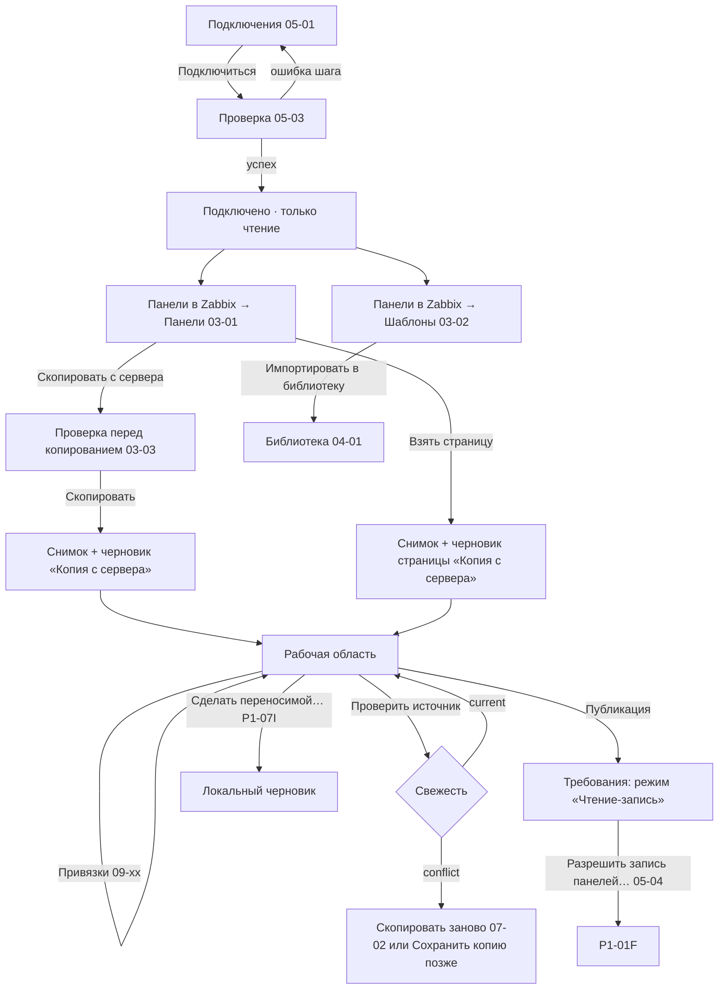

# P1-01E — сквозной подключённый поток «Только чтение»

Статус: принято владельцем 25.10.2026. Это design specification сквозного потока, не новый экран: шаги ссылаются на уже принятые макеты. Реализация — P2-01 (подключение), P2-05 (копия панели), P4-01A (шаблоны), P2-02/P2-03 (привязки и расчёт замены без записи).

Входы: P1-01A/B/C, P1-02 (подключения и режимы), P1-03 (импорт и библиотека), P1-05 (привязки), P1-08 (публикация), P1-IN-08 (видимость при ограниченных правах), O-013 (режимы), O-018, O-031, O-032.

«Только чтение» — режим подключения (P1-01C ось D): данные сервера читаются, шлюза записи нет независимо от прав учётной записи, даже у Super admin (O-013, P1-02E). Это режим по умолчанию после каждого подключения и запуска.

## 1. Общая схема

## 2. Шаги

| # | Триггер | Экран / маршрут | Предусловия | Данные вход → выход | Сохранение | Успех → / Ошибка → | Message IDs |
|---|---|---|---|---|---|---|---|
| E1 | «Подключиться к Zabbix» / выбрать профиль | `05-connections/05-01_P1-02A_connections-list.svg` | профиль (иначе «Новое подключение», `05-02`) | профиль, секрет одним запросом → сессия Zabbix в процессе Rust | профиль без секрета | → E2 | `startup.action.connect`, `connection.list.*` |
| E2 | подключение | шаги `05-03_P1-02D_connection-test.svg` | — | адрес → версия, идентичность, права, возможности | время последней проверки | → E3 «Только чтение» / ошибка шага — исправление в профиле | `connection.test.*`, `connection.state.read_only_profile` |
| E3 | «Панели в Zabbix» | `03-server/03-01_P1-03B_server-dashboards.svg` `/server/:connection/dashboards` | подключено | список видимых панелей | — | → E4/E5 / пусто — `dashboards.permission.not_visible_or_denied` | `server.*` |
| E4 | «Скопировать с сервера» | `03-server/03-03_P1-03C_copy-scope.svg` | подключено | панель → состав, зависимости, существующие копии | — | → E6 | `copy.*`, `server.action.copy` |
| E5 | «Взять страницу» | выбор страницы из сведений `03-01` | подключено | панель + страница | — | → E6 (корень — страница) | `startup.action.take_page` |
| E6 | подтверждение копирования | прогресс поверх `03-03` | подключено | два чтения панели → неизменяемый снимок + черновик «Копия с сервера» (база + пустой список операций, O-018); владелец и доступ — локально (O-031) | снимок, черновик | → E7 / изменилась во время чтения — `errors.import.inconsistent`, ничего не создано | `import.progress.*` |
| E7 | открытие копии | «Обзор» `07-overview/07-01_P1-01B_page-copy-overview.svg` | — | источник, свежесть `current` | — | → E8 | `draft.context.source`, `draft.freshness.current` |
| E8 | локальные правки | «Структура» `08-01`; «Привязки» `09-bindings/09-01…09-07` | подключено (для подбора узлов) | операции над базой (замена узла, клон-преобразование, структура) | «Изменена» → «Сохранена локально» | → E9 / нет связи — подбор узлов недоступен, правка структуры доступна | `bindings.*`, `draft.context.*` |
| E9 | «Проверить источник» в «Обзоре» | «Обзор» | подключено | чтение панели → сравнение отпечатка с базой | время проверки | `current` → E10 / `conflict` → E11 / `source_missing` → копия работает как локальная | `draft.freshness.*`, `draft.action.check_source` |
| E10 | «Публикация» | `11-publication` в режиме «Только чтение» (§4) | — | черновик → требования и локальное сравнение | — | → «Разрешить запись панелей…» (`05-04`, P1-01F) или остаётся в чтении | `publication.requirement.read_write` |
| E11 | конфликт | сравнение «На сервере: база → Zabbix сейчас» (как `11-05_P1-08D_conflict.svg`, без записи) | подключено | изменения на сервере, пересечения | — | «Скопировать заново» → `07-overview/07-02_P1-03E_reimport-replay.svg`; черновик не меняется | `publication.conflict.*`, `workcopy.refetch.*` |
| E12 | «Шаблоны» → выбрать → «Импортировать в библиотеку» | `03-server/03-02_P1-03B_server-templates.svg` → `04-library/04-01_P1-03F_library-catalogs.svg` | подключено | экспорт конфигурации (чтение) → каталоги метрик, новые версии | библиотека | → «Библиотека» / пустой экспорт — «не найдено или нет доступа» | `server.templates.*`, `library.*` |
| E13 | «Сделать переносимой для экспорта…» | «Черновики» `02-01` → поток P1-07I (не спроектирован) | — | копия → новый локальный черновик (узлы → роли и слоты, элементы → метрики) | новый черновик; копия не меняется | → P1-01D | `drafts.action.make_portable` |

## 3. Правила режима

- Копия с сервера — рабочая копия (база + операции), а не переносимый черновик. Напрямую она не экспортируется (`drafts.server_copy_export_hint`); переносимой становится только явным преобразованием P1-07I, и тогда это новый черновик, а копия остаётся.
- Привязки рассчитываются и сохраняются в «Только чтение»: подбор узлов, таблица соответствий, итог замены и клона (P1-05). Это локальные операции, а не запись.
- Серверные объекты не меняются никогда: в «Только чтение» нет шлюза записи, нет кнопок «Опубликовать», «Записать», «Создать на сервере». Права учётной записи на это не влияют.
- Источник и цель независимы: копия помнит источник, но цель публикации не выбирается из источника неявно (P1-01C §7 п. 4).
- Режим «Чтение-запись» включается только явным диалогом `05-04_P1-02E_enable-writes.svg` — это вход в P1-01F, а не скрытое продолжение этого потока.

## 4. «Публикация» в режиме «Только чтение»

Используется та же оболочка шагов (P1-08A), но:

| Шаг P1-08 | В «Только чтение» |
|---|---|
| 1 Назначение | можно выбрать намерение и цель как локальный выбор; владелец и доступ — только просмотр (P1-02E) |
| 2 Проверки | проверки чтением выполняются; строка «Режим «Чтение-запись»» — блокировка `publication.requirement.read_write`; план не создаётся |
| 3 Изменения | «Мои изменения: база → черновик» и «На сервере: база → Zabbix сейчас» доступны |
| 4 Подтверждение | недоступно, с причиной; кнопки записи нет |
| 5 Запись и проверка | недоступно; незавершённую операцию журнала можно сверить чтением (P1-01C §8) |

Вместо основной кнопки — «Разрешить запись панелей…» (открывает `05-04`); при отказе в диалоге всё остаётся в «Только чтение».

## 5. Прерывания

| Событие | Локальная работа | Что видно | Выход |
|---|---|---|---|
| Потеря сети | доступна | `connection.state.unreachable`; список панелей не показывается как актуальный | «Повторить» |
| Истёк токен или сессия | доступна | `connection.state.auth_required` | «Войти» |
| Сервер или версия изменились | доступна | `connection.state.context_changed`; свежесть копий `stale`, привязки устарели (P1-05G) | проверка, подтверждение нового сервера |
| Изменились права | доступна | привязки устарели | «Проверить все» (`09-07`) |
| Ручное «Отключиться» / «Завершить сеанс» (O-032) | доступна | «Автономно» | P1-01D |
| Панель-источник удалена или скрыта | копия работает как локальная | `draft.freshness.source_missing` | «Сохранить копию» позже (P1-01F) или «Сделать переносимой» |

Ни одно событие не удаляет черновики, снимки и привязки (P1-02G).

## 6. Новые message IDs

`publication.requirement.read_write` и `publication.requirement.connection` определены в P1-01F и используются как есть.

| ID | EN source | RU |
|---|---|---|
| `draft.action.check_source` | Check source | Проверить источник |
| `drafts.server_copy_export_hint` | A copy from server is exported only after it is made portable. | Копия с сервера экспортируется только после преобразования в переносимую. |

## Проверки приёмки

- Путь «подключиться → выбрать панель или страницу → скопировать → править → проверить источник» проходит без единой записи в Zabbix, в том числе под Super admin.
- Копирование целой панели и взятие одной страницы дают снимок и рабочую копию нужного вида; шаблоны — каталоги в библиотеке.
- Рабочая копия не становится переносимой без явного преобразования; копия при этом не меняется.
- «Публикация» показывает требования и локальное сравнение, но не создаёт план и не имеет действия записи; переход в «Чтение-запись» — только через явный диалог.
- Конфликт источника ведёт к сравнению и «Скопировать заново», без слияния и без потери локальных правок.
- Потеря связи, вход, смена сервера или прав не удаляют локальную работу.
