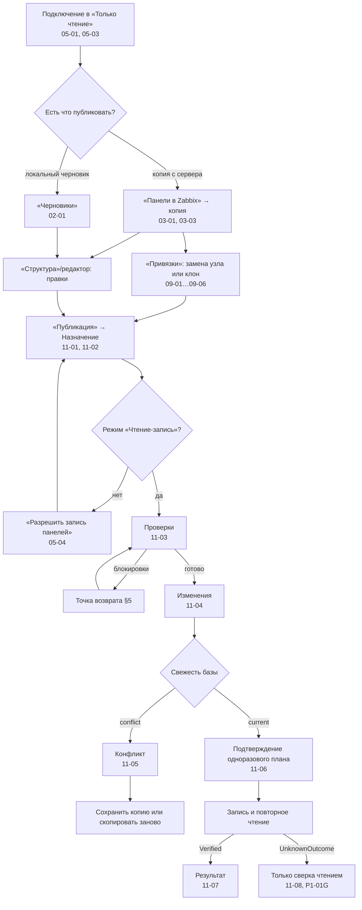

# P1-01F — сквозной поток в режиме «Чтение-запись»

Статус: принято владельцем 25.10.2026. Это design specification, не реализованный экран. Новых макетов нет: каждый шаг ссылается на уже принятые SVG. Реализация — P2-04, P2-06, P3-01/P3-03, P5-02, P5-03, P5-05; запись доступа — P5-08.

Входы: P1-01A/B/C/I, P1-02 (особенно P1-02E и макет 05-04), P1-03, P1-05, P1-08 (включая правку по O-003 и решение O-031 п. 6), P1-IN-04 (матрица записи 7.4.16), P1-IN-06 (задержки), P1-IN-11 (владелец и доступ), O-013, O-018, O-019, O-022, O-031, ADR-011/ADR-012 (`VerifiedPlan`, журнал).

## 1. Решение и граница

Режим «Чтение-запись» — единственный путь записи в Zabbix, и он ведёт только к **глобальным панелям**. Узлы сети, шаблоны, элементы данных, триггеры, пользователи и группы не изменяются никогда (P1-02E, макет 05-04). Интерфейс не вызывает JSON-RPC: он показывает предпросмотр, передаёт непрозрачный `plan_id` и получает события этапов; `VerifiedPlan` строится, подтверждается и исполняется только в процессе Rust (P1-08F).

Путь записи проходит **всегда одни и те же шаги** раздела «Публикация» (P1-08): Назначение → Проверки → Изменения → Подтверждение → Запись и проверка. Короткого пути «опубликовать сразу» нет ни для одного намерения. Подготовка (копия, привязки, правка, сборка) возможна и в «Только чтение» и автономно; в «Чтение-запись» добавляются только подтверждение и запись.

## 2. Какие операции предлагаются

Действие появляется в интерфейсе только при статусе `verified` в матрице P1-IN-04 для точной версии сервера и подтверждённых возможностях реестра P0-09; иначе оно не показывается как доступное, а проверка объясняет причину.

| Намерение (подпись) | Запрос | P1-IN-04 (7.4.16) | Откуда начинается | Реализация |
|---|---|---|---|---|
| «Создать панель» (локальная панель, в том числе собранная из страниц) | `dashboard.create` | `verified`: умолчания (`private=1`, владелец — вызывающий), отказ при повторе имени | «Черновики» → черновик панели → «Публикация» | P5-02 |
| «Сохранить копию» | `dashboard.create` | `verified`: копия всех виджетов, включая неизвестные, с новыми ID | копия с сервера → «Публикация» → «Сохранить копию» | P2-06 |
| «Клонировать панель» | `dashboard.create` | `verified`: копия + замена шаблона узла `svggraph` | «Панели в Zabbix» → «Клонировать» → «Привязки» (09-02…09-06) | P3-01 |
| «Добавить страницу в панель» | `dashboard.update` (все страницы с ID + новая) | `verified`: ID существующих сохраняются | черновик страницы или «Взять страницу» → цель-панель | P5-03 |
| «Добавить виджеты на страницу» | `dashboard.update` | `verified`: виджеты в свободные клетки, ID существующих сохраняются | выбранные виджеты → цель-страница | P5-03 |
| «Заменить узел сети» (обновление исходной) | `dashboard.update` с ID | `verified` для `item` и шаблона узла `svggraph`; `graph` (classic) — `unsupported` до контракта | «Привязки» (09-01, 09-03) | P2-03/P2-04 |
| «Обновить панель» (прочие правки) | `dashboard.update` с ID | только поля и типы с `edit` в реестре P0-09 | черновик-копия → «Публикация» | P5-05 |
| Владелец и общий доступ | поля `userid`, `private`, `users`, `userGroups` | не подтверждено до P5-08 | блок «Владелец и доступ» (11-01, 11-02) | P5-08 |

Пока P5-08 не пройден, блок доступа показывается, но запись доступа не выполняется: проверка «Владелец и доступ» даёт «не проверялось: возможность не подтверждена», а новая панель создаётся с умолчанием Zabbix — личной (P1-IN-04, P2-06).

## 3. Схема потока

Переход в «Чтение-запись» можно сделать заранее (кнопка в шапке → 05-04) или по требованию на шаге «Назначение»: до перехода шаги показывают требования, но не скрываются (P1-01B §2).

## 4. Шаги

| # | Триггер | Экран / маршрут | Предусловия | Данные вход → выход | Побочные эффекты | Сохраняется | Успех → | Ошибка → | Message IDs |
|---|---|---|---|---|---|---|---|---|---|
| 1 | «Подключиться» | `/connections` (05-01, 05-03) | профиль; секрет в памяти или хранилище | профиль → состояние, версия, права | только read-методы allowlist | профиль, время проверки | `connected`, «Только чтение» | ветки P1-02D | `connection.state.read_only_profile`, `connection.test.*` |
| 2 | выбор источника | `/server/:connection_local_id/dashboards` (03-01) или `/drafts` (02-01) | подключение (для сервера) | список → выбранный объект | — | — | шаг 3 или 5 | «нет панелей или нет доступа» | `server.*`, `drafts.*` |
| 3 | «Скопировать с сервера», «Клонировать», «Заменить узел сети», «Взять страницу» | проверка состава (03-03) | подключение | панель → снимок + копия | двойное чтение (P2-05C) | снимок, рабочая копия, владелец и доступ локально (O-031) | рабочая область копии | `errors.import.inconsistent` | `copy.*`, `server.action.copy` |
| 4 | мастер привязок | `/draft/:local_id/bindings` (09-01…09-06) | копия; подключение для поиска узлов | ссылки → соответствия, решения, слоты | только чтение | операции копии (O-018) | «К публикации» | блокировки P1-05H | `bindings.*`, `clone.*` |
| 5 | «Публикация» | `/draft/:local_id/publication`, шаг «Назначение» (11-01, 11-02) | черновик загружен | намерение, цель, имя, доступ → выбор цели | проверка имени среди видимых | цель и намерение — в черновике | шаг «Проверки» | «нужен режим «Чтение-запись»» | `publication.target.*`, `publication.access.*` |
| 6 | «Разрешить запись панелей» | диалог 05-04 | `connected` | — → `read_write` | — | не сохраняется между запусками | возврат на шаг, откуда вызван | — | `connection.enable_writes.*` |
| 7 | открытие шага, «Проверить снова» | «Проверки» (11-03) | `read_write` для итога «готово» | черновик, цель, подключение → проверки, план | чтение базы и цели | план только в памяти | «Изменения» | точка возврата §5 | `publication.check.*`, `publication.preflight.*` |
| 8 | «Далее: изменения» | «Изменения» (11-04) | план построен или показаны блокировки | база, черновик, сервер → два сравнения | — | — | «Подтверждение» | конфликт (11-05) | `publication.diff.*` |
| 9 | «Подтвердить запись…» | диалог (11-06) | P1-01C §7 полностью | `plan_id` → подтверждённый план | план потребляется | запись журнала `Confirmed` | «Запись и проверка» | `publication.plan.invalidated` → шаг 7 | `publication.confirm.*` |
| 10 | «Записать в Zabbix» | «Запись и проверка» | подтверждённый план | план → результат этапов | чтение перед записью, **ровно один** запрос, до трёх чтений после | журнал `Submitting` на диск до отправки | «Проверено повторным чтением» (11-07) | `UnknownOutcome` (11-08), `Conflict`, `FailedBeforeSend` | `publication.stage.*`, `publication.result.*`, `publication.unknown.*` |
| 11 | итог `Verified` | результат (11-07) | — | ответ и повторное чтение → новая база | — | для обновления: снимок после записи — новая база (`publication.result.base_advanced`); для создания: созданная панель в «Создано из этой копии» (O-022) | «Открыть в Zabbix», «Вернуться к черновику» | — | `publication.action.open_in_zabbix`, `drafts.created_from_copy` |

После записи режим остаётся «Чтение-запись» до отключения или перезапуска (P1-02E); вернуть «Только чтение» можно в любой момент из шапки — все планы этого подключения становятся недействительными.

## 5. Точки возврата

Любая блокировка ведёт на шаг, где её исправляют, и обратно на «Проверки». Пересборка плана обязательна: старый план после правки недействителен, обходного пути нет.

| Проверка (P1-08C) | Возврат | Что меняется | После исправления |
|---|---|---|---|
| нет подключения, `read_only`, нужен вход | «Подключения» (05-01) или диалог 05-04 | подключение, режим | «Проверки» заново |
| нет права записи панели | — (права в ZDashstitch не расширяются) | ничего; предлагается «Сохранить копию» | — |
| база `stale` | «Проверить снова» на шаге «Проверки» | свежесть | «Проверки» |
| база `conflict` | 11-05: «Сохранить копию» / «Скопировать панель заново» (P1-03E, 07-02) | цель или база | «Назначение» или «Привязки» |
| `source_missing` | «Сохранить копию» или работа как с локальной | цель | «Назначение» |
| неразрешённые соответствия, маски, LLD | «Привязки» (09-03, 09-04) | решения | «Проверки» |
| список «останутся на старом узле» не подтверждён | «Подтвердить список» в «Проверках» или 09-04 | подтверждение | «Проверки» |
| виджет «один узел» при росте целей | редактор страницы (P1-04) | структура | «Привязки» → «Проверки» |
| геометрия, перекрытие, пустая панель | «Структура» / редактор | структура | «Проверки» |
| имя занято среди видимых | «Назначение» | имя | «Проверки» |
| отказ сервера «имя занято» после отправки | «Назначение», новый план | имя | «Проверки» |
| правка доступа лишает права записи; `userid` от не-Super admin | «Назначение», блок доступа | доступ | «Проверки» |
| операция или поле без `verified` | не предлагается; для замены узла — «останется на старом» | — | — |

## 6. Варианты по намерениям

| Шаг | Создать панель | Сохранить копию | Клонировать | Добавить страницу / виджеты | Заменить узел сети | Обновить панель |
|---|---|---|---|---|---|---|
| Копия с сервера (шаг 3) | нет | есть | есть | для источника с сервера | есть | есть |
| Привязки (шаг 4) | по каждой странице (сборка) | нет | обязательны | при другой панели-цели — по странице | обязательны | при изменении источников |
| Сравнение «на сервере» | нет базы | только свежесть | только свежесть | по цели | есть | есть |
| Владелец и доступ | новая: «Личная/Общая» | новая; «Восстановить исходных» | копия доступа исходной (O-031) | не передаются | не передаются, если не меняли | не передаются, если не меняли |
| Запрос | `dashboard.create` | `dashboard.create` | `dashboard.create` | `dashboard.update` | `dashboard.update` | `dashboard.update` |
| Сверка при неизвестном итоге | по имени и отпечатку | по имени и отпечатку | по имени и отпечатку | по отпечатку цели | по отпечатку цели | по отпечатку цели |

## 7. Чего не происходит

- Нет записи из «Только чтение», из автономного режима и из любого экрана, кроме шага «Запись и проверка».
- Нет записи в панель другого подключения; цель всегда в активном подключении.
- Нет автоматического слияния при конфликте (O-014) и повторной отправки после возможной записи.
- Нет изменения объектов, кроме глобальной панели; панели шаблонов не изменяются.
- «Сохранена» не означает «опубликована»; успех не объявляется без повторного чтения.

## 8. Новые message IDs

| ID | EN source | RU |
|---|---|---|
| `connection.action.set_read_only` | Return to read-only | Вернуть «Только чтение» |
| `publication.requirement.read_write` | Writing needs read-write mode for this connection. | Для записи нужен режим «Чтение-запись» для этого подключения. |
| `publication.requirement.connection` | Writing needs a connection to {profile}. | Для записи нужно подключение «{profile}». |
| `publication.operation.not_verified` | This operation is not verified for Zabbix {version} and is not offered. | Эта операция не подтверждена для Zabbix {version} и не предлагается. |
| `publication.access.not_verified` | Sharing is shown but not written until the write contract is verified. The new dashboard stays private. | Доступ показан, но не записывается, пока не подтверждён контракт записи. Новая панель останется личной. |

Параметры: `{profile}` — пользовательские данные, `{version}` — технический.

## Проверки приёмки

- Каждое намерение проходит одни и те же пять шагов «Публикации»; короткого пути записи нет.
- Запись возможна только в «Чтение-запись», только к глобальной панели активного подключения и только через одноразовый план.
- Предлагаются только операции со статусом `verified` P1-IN-04 и флагами реестра P0-09; остальное не показано как доступное.
- Любая блокировка ведёт на шаг исправления и обратно на «Проверки» с пересборкой плана.
- Неизвестный итог не повторяется; результат называется успешным только после повторного чтения.
- Источник и цель, черновик и рабочая копия не смешиваются на всём пути.
