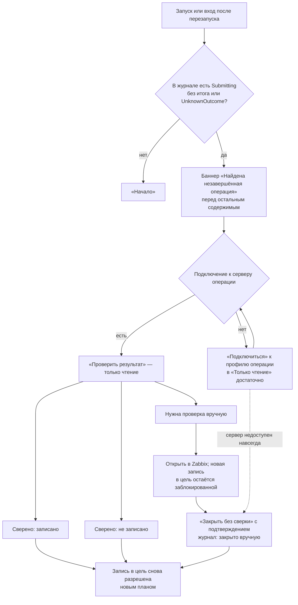

# P1-01G — прерывания, восстановление и продолжение

Статус: принято владельцем 25.10.2026. Это design specification, не реализованный экран. Новых макетов нет: экраны восстановления используют принятые макеты и баннеры P1-00E. Реализация — P2-SEC-01 (локальная сессия), P2-01 (подключение), P2-04 (журнал и сверка), P2-05 (копии), P4-06 (хранилище).

Входы: P1-01C (оси состояний, guards, две вкладки — принято), P1-02G (смена контекста подключения), P1-03D/E (импорт, «Скопировать заново»), P1-05G (привязки), P1-08D/F/G (конфликт, план, неизвестный итог), P1-IN-01 (ошибки подключения), P1-IN-07 (жизненный цикл локальной сессии), P1-IN-09 (зависание нативного диалога), O-017, O-018, O-022, O-032.

## 1. Принципы

1. **Локальная работа не теряется.** Ни одно событие не удаляет сохранённые черновики, рабочие копии, снимки и журнал. Теряется только то, что по определению живёт в памяти: несохранённый ввод в форме браузера, секреты Zabbix в памяти, планы публикации, режим «Чтение-запись».
2. **После неопределённости — только чтение.** Если запрос записи мог дойти до сервера, повторной записи нет: только сверка чтением (P1-08G).
3. **У каждого прерывания есть точка продолжения** — экран и шаг, куда пользователь вернётся, и безопасные действия «Повторить», «Отмена», «Подключиться снова». Тупиков нет.
4. **Объект назван точно.** Сообщение о прерывании называет вид объекта («Панель»/«Страница»), происхождение («Локальная»/«Копия с сервера»), источник и цель — каждое своим полем; черновик и рабочая копия, источник и цель не склеиваются в одну строку.
5. **Новые записи блокируются только в ту цель, где итог неизвестен.** Остальная работа, включая чтение и локальную правку, доступна.

## 2. Матрица восстановления

| Событие | Где обнаруживается | Что меняется (оси P1-01C) | Сохраняется | Теряется | Безопасные действия | Точка продолжения | Message IDs |
|---|---|---|---|---|---|---|---|
| Потеря сети без активной записи | любой запрос к Zabbix | D → `unreachable`; E → `stale`; план недействителен | всё локальное | план | «Повторить», «Отключиться», работать автономно | тот же экран; шаги публикации показывают требования | `connection.state.unreachable`, `errors.connection.unreachable_or_timeout` |
| Потеря сети до отправки записи | чтение перед записью | F → `FailedBeforeSend` | черновик, журнал | план | «Повторить» после подключения → новый предпросмотр | «Публикация» → «Проверки» | `publication.state.failed_before_send` |
| Потеря сети во время или после отправки | этап «Запись» | F → `UnknownOutcome` | черновик, журнал с записью до отправки | план | только «Проверить результат» после подключения | «Публикация» → «Запись и проверка» (11-08) | `publication.unknown.*`, `errors.publication.unknown_outcome` |
| Ответ получен, повторное чтение не удалось | этап «Повторное чтение» | F: итог не проверен, приравнивается к неизвестному | то же | — | только сверка чтением | 11-08 | `publication.unknown.*` |
| Истекли сессия Zabbix или токен | ответ API | D → `auth_required`; план недействителен | всё локальное; токен в хранилище, если сохранялся | сессия Zabbix, пароль в памяти | «Войти», «Отключиться» | экран, где произошло; после входа — повторная проверка свежести | `connection.state.auth_required`, `errors.auth.*` |
| Смена адреса в профиле | сохранение профиля | D → `context_changed`; привязки и база этого подключения → `stale`/недействительны (P1-02G, P1-05G) | черновики, копии, снимки | планы | проверка подключения, повторная проверка привязок | «Подключения» → проверка (05-03) → «Привязки» (09-07) | `connection.form.server_changed.*`, `connection.state.context_changed` |
| Сервер обновлён (другая версия) | `apiinfo.version` | D → `context_changed`; привязки → «Устарела» | всё локальное | планы | проверка подключения; если версия без адаптера — только чтение или отказ | «Подключения»; затем «Привязки» → «Проверить все» | `connection.state.context_changed`, `connection.result.version` |
| Другая идентичность сервера по тому же адресу | шаг 4 проверки (P1-02D) | D → `context_changed`; привязки → недействительны | всё локальное | планы | явное подтверждение нового сервера | 05-03, затем «Привязки» | `connection.test.step.identity` |
| Изменились права учётной записи | шаг 5 проверки, отказ API | привязки → «Устарела» | всё локальное | планы | «Проверить все»; недействительные строки — выбрать другой узел | «Привязки» (09-07) | `bindings.state.*` |
| База `stale` | открытие предпросмотра, таймер, переподключение | E → `stale` | — | план | «Проверить» (только чтение) | шаг «Проверки» | `draft.freshness.stale` |
| База `conflict` | любая проверка свежести | E → `conflict`; F → `Conflict` | черновик без изменений | план | «Сохранить копию», «Скопировать панель заново», «Проверить снова» | 11-05 → «Назначение» или 07-02 | `publication.conflict.*`, `draft.freshness.conflict` |
| Источник исчез (`source_missing`) | проверка свежести | E → `source_missing` | черновик | план обновления | «Сохранить копию», работать как с локальной | «Назначение» | `draft.freshness.source_missing` |
| Перезапуск или падение приложения | новая вкладка через ярлык; старая вкладка | A старой вкладки → `app_restarted`; D → `offline`; E → `stale` | см. §3 | см. §3 | открыть через ярлык; разобрать незавершённые операции | «Начало» с баннером (§4) или последний черновик | `session.expired.*`, `startup.recovery.found` |
| Адрес открыт без кода запуска или в другом браузере | загрузка страницы | A → `no_session` | всё на диске | — | открыть через ярлык | «Начало» | `session.bootstrap.invalid` |
| «Завершить сеанс» (O-032) | действие пользователя | A всех вкладок → `no_session`; секреты стёрты; D → `offline` | всё на диске, журнал | секреты в памяти, планы, режим | открыть через ярлык | «Начало» | `session.action.end`, `session.ended.*` |
| Несохранённые изменения при закрытии черновика | закрытие, смена черновика | C остаётся `dirty` до выбора | — | ничего без выбора пользователя | «Сохранить локально», «Отменить изменения», «Отмена» | тот же черновик | `draft.close.dirty.*` |
| Не удалось сохранить на диск | сохранение | C → `save_failed` | ввод в форме остаётся видимым | — | «Повторить», продолжить правку; закрытие не продолжается | тот же черновик | `draft.context.save_failed` |
| Черновик открыт во второй вкладке | открытие | C второй вкладки → `open_elsewhere` | — | — | «Редактировать здесь»; копировать несохранённый ввод | черновик в той вкладке, где идёт правка | `draft.context.open_elsewhere`, `draft.action.edit_here` |
| Черновик на диске изменён другой вкладкой | сохранение | конфликт ревизии | обе версии | — | «Загрузить сохранённую версию», «Сохранить как новый черновик» | выбранная версия | `draft.conflict.revision` |
| План недействителен во время подтверждения | любое событие P1-01C §6 | F: план удалён | черновик | план | «Создать новый предпросмотр» | «Проверки» | `publication.plan.invalidated` + причина (§6) |
| Импорт прерван или отменён | P1-03D | — | уже сохранённые объекты целиком | частично прочитанный файл | «Повторить» с начала | итог импорта (02-03) | `import.result.*` |
| «Скопировать заново» с нерешёнными случаями | P1-03E | новая база не принята | прежняя база и правки | — | решить каждый случай или «Вернуться к прежней базе» | «Обзор» (07-02) | `workcopy.*` |
| Нативный диалог не отвечает | P1-IN-09 | — | — | — | ожидание с «Отмена»; «Загрузить через браузер» | тот же экран | `startup.dialog.waiting`, `startup.dialog.browser_fallback` |

## 3. Перезапуск: что остаётся и что теряется

Совпадает с P1-01C §9.

| Остаётся на диске (O-018) | Теряется |
|---|---|
| черновики панелей и страниц и их сохранённое состояние | несохранённый ввод в формах браузера |
| рабочие копии: база, операции, привязки, решения, выбранные цель и намерение | планы публикации (только в памяти) |
| снимки, каталоги метрик, страницы библиотеки | режим «Чтение-запись» (после запуска всегда «Только чтение») |
| журнал операций, включая запись `Submitting`, сделанную до отправки | секреты Zabbix в памяти (пароль, токен без сохранения) |
| профили подключений без секретов; токен в системном хранилище — если пользователь его сохранил | локальная сессия браузера (cookie) |
| время последней проверки источника | состояние `current` источника (после запуска — `stale`) |

После запуска приложение открывает «Начало». Если журнал содержит незавершённую операцию — сначала баннер §4. «Недавнее» ведёт к последнему черновику и его последнему разделу; раздел «Публикация» открывается с шага «Назначение» (цель и намерение сохранены, план — нет).

## 4. Незавершённая операция журнала

Баннер `startup.recovery.found` показывается на «Начале», в «Черновиках» и в рабочей области затронутого черновика — до любых новых записей. Он называет отдельными полями:

| Поле | Пример |
|---|---|
| Операция | «Сохранить копию» (`intent.*`) |
| Вид и происхождение объекта | «Панель» · «Копия с сервера» |
| Источник | черновик «Базы данных: Prod» (база — снимок 25.10.2026, 14:02) |
| Цель | подключение «Лаборатория 7.4», новая панель «Базы данных: Pilot» (или существующая панель с именем) |
| Отправлено | время записи `Submitting` |
| Состояние | «Результат неизвестен» / «Запись…» без итога |

Действия: «Проверить результат» (`publication.action.reconcile`), «Открыть журнал операции» (`publication.action.open_journal`), «Открыть черновик». Сверка выполняется в «Только чтение» тоже — запись для неё не нужна (P1-01C §8). Если профиль операции удалён или сервер навсегда недоступен, баннер предлагает «Подключиться» к тому же серверу заново или «Закрыть без сверки» с подтверждением (решение §7). Блокировка касается только этой цели: другие черновики и другие цели работают.

## 5. Две вкладки и «Завершить сеанс»

**Две вкладки** (P1-01C §3, принято): черновик правит одна вкладка; вторая — `open_elsewhere` с «Редактировать здесь». После перехвата первая вкладка переходит в просмотр, её несохранённый ввод виден и копируется, но не сохраняется. Сохранение сверяет ревизию на диске. Для публикации действует то же правило: предпросмотр и подтверждение — только во вкладке, которая правит черновик; во второй вкладке шаги «Публикации» показываются только для просмотра. Журнал один на процесс, поэтому незавершённая операция видна во всех вкладках.

**«Завершить сеанс»** (O-032): действие в «Настройках» (раздел безопасности, P1-09) с подтверждением. Перед подтверждением показывается, есть ли несохранённые изменения в открытых вкладках и идёт ли запись. Во время этапа «Запись» действие недоступно до итога или неизвестного итога. Результат: все вкладки — «Локальный сеанс завершён», секреты Zabbix стёрты из памяти, планы удалены, сохранённое на диске остаётся.

## 6. Причины недействительности плана

`publication.plan.invalidated` получает причину отдельным message ID.

| Событие (P1-01C §6) | Причина |
|---|---|
| правка черновика после предпросмотра | `publication.plan.reason.draft_changed` |
| смена цели или намерения | `publication.plan.reason.target_changed` |
| смена учётных данных, режима, контекста подключения | `publication.plan.reason.connection_changed` |
| изменение привязок | `publication.plan.reason.bindings_changed` |
| база устарела или конфликт | `publication.plan.reason.source_changed` |
| перезапуск приложения | `publication.plan.reason.app_restarted` |

## 7. Решения владельца 25.10.2026

1. **«Закрыть без сверки».** Если сервер операции недоступен навсегда (профиль удалён, сервер сменился) или сверка дала «Нужна проверка вручную», операцию можно закрыть действием «Закрыть без сверки». Подтверждение называет операцию, цель и время отправки и предупреждает, что результат не проверен. Запись остаётся в журнале с отметкой «закрыто вручную»; блокировка цели снимается. Новая публикация в ту же цель всё равно начинается с повторного чтения сервера (P1-08D), поэтому повторное создание не произойдёт незаметно.
2. **«Завершить сеанс»**: место кнопки выбирается в P1-09 вместе с окном «О программе» (P1-12); до этого описано в «Настройках».

## 8. Новые message IDs

| ID | EN source | RU |
|---|---|---|
| `session.action.end` | End session | Завершить сеанс |
| `startup.recovery.close_unverified` | Close without checking | Закрыть без сверки |
| `startup.recovery.close_unverified.confirm` | Close the operation {operation_id} to {target} sent at {time} without checking the result? The result stays unknown; the journal keeps the entry. | Закрыть операцию {operation_id} в «{target}», отправленную в {time}, без сверки? Результат останется неизвестным; запись в журнале сохранится. |
| `startup.recovery.closed_manually` | Closed manually, result not checked | Закрыто вручную, результат не проверен |
| `session.end.confirm.title` | End the local session? | Завершить локальный сеанс? |
| `session.end.confirm.body` | All tabs will close the session and Zabbix secrets in memory will be erased. Saved drafts stay on disk; unsaved input in open tabs is lost. | Сеанс закроется во всех вкладках, секреты Zabbix будут стёрты из памяти. Сохранённые черновики останутся на диске; несохранённый ввод в открытых вкладках пропадёт. |
| `session.end.unavailable_writing` | Wait for the write to finish or for its result to become known. | Дождитесь окончания записи или того, что её результат станет известен. |
| `session.ended.title` | Session ended | Сеанс завершён |
| `session.end.not_confirmed` | Confirm ending the local session first. | Сначала подтвердите завершение локального сеанса. |
| `startup.recovery.body` | {intent}: {object_kind}, source {source}, target {target} on {profile}. Sent at {time}. Do not publish to this target again until the result is checked. | {intent}: {object_kind}, источник — {source}, цель — {target} в подключении «{profile}». Отправлено в {time}. Не публикуйте в эту цель снова, пока результат не проверен. |
| `startup.recovery.connect_first` | Connect to {profile} to check the result. Read-only mode is enough. | Подключитесь к «{profile}», чтобы проверить результат. Достаточно режима «Только чтение». |
| `startup.recovery.action.open_draft` | Open draft | Открыть черновик |
| `publication.plan.reason.draft_changed` | the draft changed after preview | черновик изменён после предпросмотра |
| `publication.plan.reason.target_changed` | the target or action changed | изменились цель или действие |
| `publication.plan.reason.connection_changed` | the connection, mode or credentials changed | изменились подключение, режим или учётные данные |
| `publication.plan.reason.bindings_changed` | bindings changed | изменились привязки |
| `publication.plan.reason.source_changed` | the dashboard on the server changed or must be checked again | панель на сервере изменилась или требует повторной проверки |
| `publication.plan.reason.app_restarted` | the application was restarted | приложение перезапущено |

Параметры: `{intent}`, `{object_kind}` — message ID; `{source}`, `{target}`, `{profile}` — пользовательские или серверные данные; `{time}` — локализованное время.

## Проверки приёмки

- Для каждого события матрицы есть безопасное действие и точка продолжения; тупиков нет.
- Ни одно событие не удаляет сохранённые черновики, копии, снимки и журнал; теряемое перечислено явно.
- После возможной записи доступна только сверка чтением; новая запись в ту же цель заблокирована до итога сверки.
- Незавершённая операция показывается до любых новых записей с отдельными полями операции, вида объекта, источника и цели.
- Режим после перезапуска — «Только чтение»; планы не переживают перезапуск.
- Две вкладки не сохраняют одно и то же поверх друг друга; «Завершить сеанс» не прерывает идущую запись.
