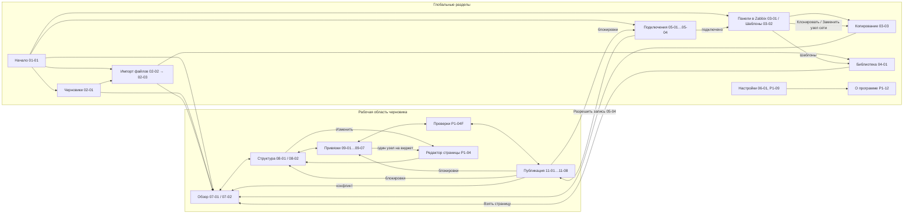

# P1-01H — карта потоков и handoff (flow pack v1)

Статус: принято владельцем 25.10.2026. Версия пакета: **v1 от 25.10.2026**. Это сводный design handoff эпика P1-01: он не вводит новых экранов, а связывает принятые спецификации и макеты в одну карту и проверяет её на тупики и недостижимые экраны. При расхождении деталей действует спецификация конкретной задачи, а не этот обзор.

Состав пакета:

| Документ | Что задаёт | Статус |
|---|---|---|
| [`P1-01A-entry-points.md`](P1-01A-entry-points.md) | точки входа, «Начало» | принято |
| [`P1-01B-information-architecture.md`](P1-01B-information-architecture.md) | разделы, маршруты, оболочка, «Структура» | принято |
| [`P1-01C-session-states.md`](P1-01C-session-states.md) | оси состояний A–F, guards, сохранение между запусками | принято |
| [`P1-01D-offline-flow.md`](P1-01D-offline-flow.md) | автономный поток (панель, страница, импорт) | черновик |
| [`P1-01E-readonly-flow.md`](P1-01E-readonly-flow.md) | поток «Только чтение» | черновик |
| [`P1-01F-readwrite-flow.md`](P1-01F-readwrite-flow.md) | поток «Чтение-запись» | черновик |
| [`P1-01G-recovery.md`](P1-01G-recovery.md) | прерывания и восстановление | черновик |
| [`P1-01I-page-flows.md`](P1-01I-page-flows.md) | потоки страниц | принято |
| P1-02, P1-03, P1-05, P1-08 | подключения, импорт и библиотека, привязки, публикация | приняты |

## 1. Карта экранов и переходов

Шапка с глобальной навигацией и «Настройками» есть на каждом экране; из любого экрана доступны «Начало», «Черновики», «Панели в Zabbix», «Библиотека», «Подключения», «Настройки». Баннер незавершённой операции (P1-01G §4) перекрывает «Начало», «Черновики» и рабочую область затронутого черновика.

## 2. Инвентарь экранов и покрытие дизайном

| Экран | Маршрут | Макет | Спецификация | Нужен для |
|---|---|---|---|---|
| Начало | `/` | 01-01 | P1-01A | P2 |
| Черновики | `/drafts` | 02-01 | P1-03F | P2 |
| Импорт файлов, итог | `/import` | 02-02, 02-03 | P1-03A/D/G | P4 (файлы), P2 — только копия с сервера |
| Панели в Zabbix, Шаблоны | `/server/:connection_local_id/...` | 03-01, 03-02 | P1-03B | P2 (панели), P4 (шаблоны) |
| Копирование панели | `/server/.../copy` | 03-03 | P1-03C | P2 |
| Библиотека | `/library` | 04-01 | P1-03F | P4 |
| Подключения | `/connections` | 05-01…05-04 | P1-02 | P2 |
| Настройки → Внешний вид | `/settings/appearance` | 06-01 | P1-09A/C | P2 (язык, тема) |
| Настройки → файл YAML | `/settings/*` | P1-09B | P1-09B | P2 (хранение), P4 (экран) |
| О программе и лицензии | P1-12 | P1-12 | P1-12 | P6 (обязательно до выпуска) |
| Обзор | `/draft/:local_id/overview` | 07-01, 07-02 | P1-01B, P1-03E | P2 |
| Структура, сборка | `/draft/:local_id/structure/*` | 08-01, 08-02 | P1-01B, P1-01I | P2 (просмотр), P4 (правка, сборка) |
| Привязки | `/draft/:local_id/bindings` | 09-01…09-07 | P1-05 | P2 (замена узла), P3 (клон) |
| Проверки | `/draft/:local_id/checks` | — | P1-04F | P4; в P2–P3 см. §6 |
| Публикация | `/draft/:local_id/publication` | 11-01…11-08 | P1-08 | P2–P3, P5 |
| Редактор страницы | `/draft/:local_id/structure/page/:page/edit` | 12-01…12-04, 12-06 | P1-04 | P4 |
| Экспорт и обезличивание, «Сделать переносимой» | `/draft/:local_id/export` | 13-01…13-04 | P1-07 | P4 |

Маршруты `/import` и `/server/:connection_local_id/copy` дополняют таблицу P1-01B §3 (там их не было); `local_id` и `connection_local_id` — непрозрачные локальные идентификаторы, как и прежде.

## 3. Сквозные переходы

Детальные шаги — в спецификациях потоков (ссылки на номера шагов). Здесь — переходы между разделами, где встречаются контракты разных эпиков.

| # | Переход | Триггер | Предусловия | Вход → выход | Побочные эффекты | Сохраняется | Успех / ошибка | Message IDs |
|---|---|---|---|---|---|---|---|---|
| T1 | Начало → новый черновик | «Создать панель/страницу» | — | имя → черновик `dashboard`/`page` | — | черновик (O-018) | рабочая область / ошибка поля | `startup.action.new_*` (D1, P1) |
| T2 | Начало, Черновики → Импорт | «Импорт файлов» | — | файлы → распознанный вид | нативный диалог или загрузка (O-023) | — | 02-02 / `dialog_*` | `import.files.*` |
| T3 | Импорт → черновик, библиотека | «Импортировать» | все выборы сделаны | файлы → черновики, каталоги | чтение в памяти | каждый файл атомарно | 02-03 / `errors.import.*` | `import.result.*` |
| T4 | Начало, шапка → Подключения | «Подключиться» | — | профиль → проверка 5 шагов | только read-методы | профиль без секрета | «Только чтение» / ветки P1-02D | `connection.*` (E1–E2) |
| T5 | Подключения → Панели в Zabbix | после подключения | `connected` | — → видимые панели | `dashboard.get` | — | 03-01 / «не найдено или нет доступа» | `server.*` (E3) |
| T6 | Панели в Zabbix → копия | «Скопировать», «Взять страницу», «Клонировать», «Заменить узел сети» | `connected` | панель → снимок + рабочая копия | двойное чтение | снимок, копия, владелец и доступ локально | Обзор / `errors.import.inconsistent` | `copy.*` (E4–E6) |
| T7 | Шаблоны → Библиотека | «Импортировать в библиотеку» | `connected` | шаблоны → каталоги | экспорт конфигурации | каталоги (версии) | 04-01 / «нет доступа» | `server.templates.*` (E12) |
| T8 | Рабочая область → Привязки | «Заменить узел сети», «Клонировать» | копия; подключение для подбора | ссылки → соответствия | только чтение | операции копии | Итог / блокировки P1-05H | `bindings.*` |
| T9 | Привязки → Редактор | «Открыть редактор страницы» | виджет «один узел» при росте целей | — | — | — | редактор P1-04 / — | `bindings.series.open_editor` |
| T10 | Привязки → Публикация | «К публикации» | итог без блокировок | — | — | цель и намерение | 11-01 / — | `clone.action.to_publication` |
| T11 | Публикация → Подключения | «Разрешить запись панелей…» | `connected` | — → `read_write` | — | не сохраняется | шаг, откуда вызван / отказ — «Только чтение» | `connection.enable_writes.*` |
| T12 | Публикация → шаг исправления | блокировка проверки | — | — | — | — | Привязки, Структура, Подключения, Назначение (P1-01F §5) | `publication.check.*` |
| T13 | Публикация → Конфликт → Обзор | `Remote ≠ Base` | — | — | план недействителен | черновик без изменений | «Сохранить копию» / «Скопировать заново» 07-02 | `publication.conflict.*` |
| T14 | Публикация → запись | «Записать в Zabbix» | P1-01C §7 | `plan_id` → этапы | ровно один запрос записи | журнал до отправки | 11-07 / 11-08 | `publication.stage.*` |
| T15 | Запуск → восстановление | журнал с незавершённой операцией | — | запись журнала → баннер | — | журнал | сверка / «Закрыть без сверки» | `startup.recovery.*` |
| T16 | Черновики → переносимый | «Сделать переносимой для экспорта…» | копия с сервера | копия → новый локальный черновик | — | новый черновик | P1-07I / — | `drafts.action.make_portable` |
| T17 | Черновик → файл | «Экспорт в файл» | валиден как `project/v2` | черновик → файл/ZIP | диалог или скачивание | — | итог экспорта / причина | `export.*` |
| T18 | Любой экран → Настройки → О программе | «Настройки» | — | — | — | — | P1-09 / P1-12 | `settings.*` |

## 4. Матрица состояний и переходов

Оси и их значения — P1-01C §1. Сводка: что разрешает каждая комбинация основных осей.

| Подключение (D) | Режим | Источник (E) | Публикация (F) | Разрешено |
|---|---|---|---|---|
| `offline` | — | не проверялся | `idle` | правка, сохранение, экспорт, импорт файлов, синтетика; публикация — требования |
| `connected` | `read_only` | любое | `idle` | всё выше + копия с сервера, шаблоны, привязки, проверка источника, сравнение; запись — нет |
| `connected` | `read_write` | `current` | `idle`/`Previewed` | всё выше + подтверждение одноразового плана и запись |
| `connected` | `read_write` | `stale` / `conflict` / `source_missing` | — | запись в эту цель — нет; «Проверить», «Сохранить копию», «Скопировать заново» |
| любое | любой | любое | `Submitting` / `UnknownOutcome` | новая запись в эту цель — нет; сверка чтением; остальная работа — да |
| `auth_required` / `unreachable` / `context_changed` | — | → `stale` | план недействителен | локальная работа; «Войти», «Повторить», проверка нового сервера |

Переходы, которые делают план недействительным: P1-01C §6, причины — P1-01G §6.

## 5. Контракты между эпиками

| Поставщик → потребитель | Что передаётся | Где описано |
|---|---|---|
| P1-02 → P1-03, P1-05, P1-08 | состояние подключения, режим, версия, права, идентичность сервера; событие `connection.context_changed` | P1-02H |
| P1-03 → P1-05, P1-08 | снимок (база), рабочая копия, каталоги метрик, владелец и доступ источника (локально) | P1-03H |
| P1-03E → P1-05G, P1-08D | новая база, итоги переигрывания, свежесть | P1-03E, P1-05G |
| P1-05 → P1-08 | соответствия и решения как операции, подтверждённый список «останется на старом», блокировки | P1-05H |
| P1-04 → P1-05, P1-08 | структура и поля виджетов, геометрия (G1b) | P1-04H |
| P1-08 → P1-03F, P1-01G | итог записи, новая база, «Создано из этой копии» (O-022), журнал | P1-08H |
| P1-09 → все | язык, тема, корень хранилища, «Завершить сеанс» | P1-09B/C, P1-12 |
| P1-07 → P1-01D | экспорт `project/v2` и пакетов, преобразование копии (P1-07I) | P1-07 (G1b) |

## 6. Аудит: тупики, неоднозначности, недостижимые экраны

| Находка | Решение в пакете |
|---|---|
| «Проверки» (P1-04F) и «Редактор страницы» (P1-04) не спроектированы, а входы в них есть в принятых макетах | относятся к G1b. В реализации P2–P3: раздел «Проверки» показывает сводку локальной проверки и последних предварительных проверок публикации общими компонентами (без нового дизайна); «Изменить» и «Открыть редактор страницы» видны недоступными с подсказкой «Редактор появится позже». Окончательно — в P1-11 |
| «Экспорт в файл» и «Сделать переносимой…» ведут в P1-07 (G1b) | в P2–P3 действия видны недоступными с той же подсказкой |
| Остальные входы G1b на экранах P2–P3: «Взять страницу», «Собрать из страниц», вкладка «Шаблоны», «Импорт файлов», «Библиотека», «Создать панель/страницу», разделы «Настроек» кроме «Внешний вид», «Общие», «О программе» (P1-11, 25.10.2026) | то же правило: пункт или кнопка видны недоступными с подсказкой «Появится позже» (`common.state.coming_later`); глобальная навигация не прячет разделы, раздел без содержимого показывает пустое состояние с той же подсказкой |
| «О программе» и место «Завершить сеанс» | P1-12 и P1-09; в коде — помеченное место `TODO(P1-12)` (P2-00F) |
| Экспорт черновика без метрик и сборка из страниц сервера с часами, проблемами и т. п. | невозможны до P0-10 (O-034); причина показывается, не скрывается |
| Недостижимые экраны | нет: каждый экран раздела §2 имеет вход из §1 |
| Тупики | нет: каждое состояние ошибки, устаревания, конфликта и неизвестного итога имеет выход (P1-01G §2) |

## 7. Проверка критериев приёмки P1-01

| Критерий | Где выполняется |
|---|---|
| автономный путь полностью проходим без подключения | P1-01D §2–§4; экспорт без метрик — после P0-10 |
| `read_only` не имеет записи | P1-01E §3–§4, P1-02E, P1-01C §7 п. 2 |
| `read_write` ведёт только к записи панели | P1-01F §1, §7 |
| у ошибок, устаревания, конфликта, неизвестного итога есть безопасный выход | P1-01G §2, §4; P1-08D/G |
| нет неоднозначных или недостижимых экранов | §2 и §6 этого пакета |
| потоки страниц включены | P1-01I, P1-01D §3 |

## 8. Новые message IDs

| ID | EN source | RU |
|---|---|---|
| `common.state.coming_later` | Will be available later | Появится позже |
| `editor.unavailable_yet` | The page editor will appear in a later version. | Редактор страницы появится в следующей версии. |

## Проверки приёмки

- Каждый экран имеет вход и выход; карта §1 совпадает с маршрутами P1-01B.
- Каждый сквозной переход имеет триггер, предусловия, данные, побочные эффекты, сохранение, успех, ошибку и message IDs (§3 и шаги потоков).
- Матрица §4 не противоречит guards P1-01C §7.
- Незакрытые разделы G1b названы явно, и в реализации P2–P3 у них определённое, видимое поведение.
