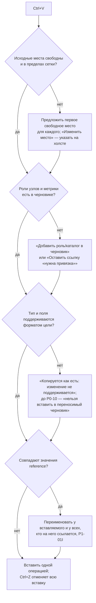

# P1-04A–E — редактор страницы на сетке Zabbix

Статус: принято владельцем 25.10.2026 (решения E-1…E-4, G-1…G-3, I-1…I-4 по рекомендации). Это design specification, не реализованный экран. Реализация — P4-03; копирование между страницами и черновиками — P4-09; публикация изменений — P1-08/P5.

Входы: P1-IN-02 (виды полей и ссылок, плотность), P1-IN-04 (сервер отклоняет выход за сетку и перекрытие; копирование виджетов сохраняет поля), P1-IN-10 (типы полей `ZBX_WIDGET_FIELD_TYPE_*`, поля `item` и `svggraph`), P0-09 (реестр возможностей: флаги `read`/`preview`/`edit`/`create`), O-018 (рабочая копия = база + операции), O-026/O-034 (`project/v2`, общий вид «виджет Zabbix», неизвестное хранится с пометкой), O-028 (синтетика только по флажку), P1-01B §2a («Структура», «Изменить»), P1-01H (маршрут редактора), P1-01I (уникальность `reference`), P1-05 (привязки отдельно), P1-11F (доступность), P1-04F/G (проверки и история — отдельная спецификация).

Уточнение формулировок задачи. Текст P1-04 в плане написан до O-026/O-034: переносимый черновик — `project/v2`, а не `project/v1`; после P0-10 виджеты любых типов хранятся в черновике общим видом «виджет Zabbix», неизвестные тип или поле сохраняются с пометкой и без права изменения — и в рабочей копии, и в локальном черновике.

Макеты (`docs/design/assets/12-editor/`, только светлая тема, генератор `docs/design/tools/editor_svg.py`):

| Файл | Подзадача | Экран |
|---|---|---|
| `12-01_P1-04A_editor-canvas.svg` | P1-04A/B/E | редактор страницы: вкладки, холст 72 колонки с линейками, список виджетов, выбранный виджет, инспектор с положением и размером |
| `12-02_P1-04C_widget-chooser.svg` | P1-04C | выбор типа виджета по возможностям, размещение |
| `12-03_P1-04D_inspector-svggraph.svg` | P1-04D | полный инспектор «График»: разделы, наборы данных, проверка поля, умолчание и изменённое, неизвестные поля |
| `12-04_P1-04E_paste-resolution.svg` | P1-04E | вставка трёх виджетов с другой панели: места, роль узлов, тип без изменения, связи |

Сценарий макетов — локальная панель «Базы данных: сводная» (страницы PostgreSQL / ClickHouse / Keeper и HAProxy, виджеты как в 08-01).

## P1-04A — оболочка редактора и холст

Вход — «Изменить» в «Структуре» (P1-01B §2a) или «Открыть редактор страницы» из «Привязок»; маршрут `/draft/:local_id/structure/page/:page/edit` (P1-01H). Редактор — сосредоточенный режим «Структуры»: боковая колонка рабочей области заменяется списком виджетов страницы; выход — «Готово» или хлебные крошки, черновик не закрывается.

Композиция (12-01):

| Область | Содержимое |
|---|---|
| Шапка и строка контекста | глобальная навигация, режим подключения; хлебные крошки `Черновики / {панель} / Структура / {страница}`; «Готово»; плашки «Изменена»/«Сохранена локально» и происхождение |
| Вкладки страниц | P1-04B |
| Панель инструментов | «Добавить виджет», «Отменить»/«Повторить» (с названием шага), масштаб: «Уменьшить», «100 %», «Увеличить», «По ширине»; флажок «Показать синтетические данные» (выключен по умолчанию, поведение — P1-04I) |
| Холст | сетка 72 колонки, линейки колонок (через 6) и строк; виджеты с именем и типом; без синтетики — только каркас «имя + тип» |
| Список виджетов (слева) | порядок чтения: сверху вниз, слева направо; тип, «x, y · ширина × высота»; значок «Изменение не поддерживается» |
| Инспектор (справа) | P1-04D; кратко — положение и размер, имя, данные, «Все параметры виджета» |
| Строка состояния | выбранное: имя, столбец, строка, размер в ячейках; «Занято строк: N из 64»; подсказка клавиш |

Холст показывает только компоновку и настройки; значений метрик нет никогда (`editor.preview.no_live_data`), синтетика — только по флажку и с меткой.

**Координаты.** Сетка Zabbix 7.4: 72 колонки (x 0–71), строки y 0–63; ширина и высота виджета — целые ячейки, не меньше 1, виджет не выходит за 72 колонки и 64 строки.

| Правило | Как |
|---|---|
| Хранение | только целые `x`, `y`, `width`, `height`; дробных значений в черновике нет |
| Экран → ячейка | `col = floor((px − x0) / cw)`, `row = floor((py − y0) / rh)`, с ограничением границами сетки; при перетаскивании и изменении размера край прилипает к ближайшей границе ячейки |
| Масштаб | меняет только отображение: `cw` = ширина холста / 72, `rh` = 2,8 × `cw` (пропорция 70 px строки Zabbix к колонке при ширине экрана 1800 px; P1-01B «Предпросмотр»); «По ширине» вписывает 72 колонки |
| Предпросмотр места | при перетаскивании виден контур целевых ячеек и подпись «столбец, строка · ширина × высота»; недопустимое место — красный контур и причина |
| Отпускание | допустимое место — одна операция `move`/`resize`; недопустимое (перекрытие, выход за сетку) — виджет возвращается на исходное место, ничего не меняется |
| Без скрытых изменений | открытие, масштаб, переключение страниц и сохранение не меняют геометрию; значения вне сетки из импорта не обрезаются молча, а показываются находкой P1-04F |
| Соседи | операция меняет только выбранные виджеты; другие виджеты не сдвигаются и не сжимаются |

Окно 1024×720 (P1-01B): список виджетов сворачивается в выдвижную панель, инспектор — в выдвижной ящик справа; холст остаётся «По ширине».

## P1-04B — страницы в редакторе

Вкладки страниц вызывают те же команды, что «Структура» (P1-01B §2a, решение 25.10.2026): добавить, переименовать, копировать, вставить, переставить, удалить. Отдельной логики страниц в редакторе нет.

| Действие | Как в редакторе | Особенности |
|---|---|---|
| Переключить страницу | щелчок по вкладке; Ctrl+PageUp/PageDown | выбор виджетов сбрасывается; история общая для черновика |
| Добавить | «+» после вкладок | новая пустая страница с умолчаниями Zabbix (период по умолчанию); открывается сразу |
| Переименовать | двойной щелчок или F2 на вкладке | пустое имя Zabbix допускает (`name=""`, P1-IN-04) — показывается «Страница {n}»; одинаковые имена — предупреждение, не ошибка |
| Копировать / вставить страницу | меню вкладки | как в «Структуре»; совпадающие `reference` переименовываются (P1-01I) |
| Переставить | перетаскивание вкладки или меню вкладки «Левее»/«Правее»; Ctrl+Shift+PageUp/PageDown | — |
| Удалить | меню вкладки | подтверждение с числом виджетов; отмена — Ctrl+Z до публикации; последнюю страницу удалить нельзя (у панели минимум одна страница, P1-IN-04) |

Много вкладок: стрелки прокрутки и меню «Все страницы» со списком; текущая вкладка всегда видна. Пустая страница: холст с подсказкой «Страница пуста» и «Добавить виджет». Лимиты имени и числа страниц — из адаптера; превышение — ошибка поля с лимитом. Имя панели, её свойства, владелец и доступ в редакторе не меняются: свойства — в «Структуре», доступ — в «Публикации» (P1-08I).

## P1-04C — выбор и жизненный цикл виджета

Выбор (12-02) группирует типы по реестру возможностей точной версии адаптера (P0-09); подписи — официальные русские названия Zabbix, код типа — справа моноширинным.

| Группа | Типы на 7.4 | Добавить | Изменить поля | Дублировать, копировать, вставить | Переместить, размер | Удалить |
|---|---|---|---|---|---|---|
| Можно добавить и настроить (`edit` + `create`) | «График» (`svggraph`), «Значение элемента данных» (`item`) | да, из выбора | все поля с описанием в форме (P1-04D) | да | да | да |
| Можно добавить, настройки по умолчанию (`create`) | «Часы» (`clock`), «Проблемы» (`problems`) | да, с умолчаниями Zabbix | нет: поля только для просмотра | да | да | да |
| Только копированием (`read`/`preview`) | «График (классический)», «Доступность узлов сети», «Проблемы по важности», «Информация о системе», «Топ узлов сети» и остальные распознаваемые типы — всего 26 на 7.4 | нет | нет | да, поля копируются как есть | да | да |
| Неизвестный реестру тип | модуль стороннего виджета и т. п. | нет | нет; «Сводка полей» только для чтения | внутри черновика и между черновиками — как есть | да | да |
| Из заготовок | P1-06 | «Появится позже» | — | — | — | — |

Геометрия — свойство виджета, а не его поле, поэтому перемещение и размер доступны всем типам; можно ли опубликовать изменение, решают предварительные проверки P1-08C по реестру. Изменение полей и создание неподтверждённого типа не предлагаются, а не выдаются за возможные.

Размещение нового виджета: «В первое свободное место» (первая позиция сверху вниз, слева направо, где помещается размер по умолчанию) или «Указать на холсте» (контур под указателем, Enter или щелчок — поставить). Размер по умолчанию — из описания типа адаптера (`manifest.json` типа на 7.4, P1-IN-10); значение «12 × 5» в макете — пример до сверки с реестром. Существующие виджеты не сдвигаются; если места нет — «На странице нет свободного места для размера {width} × {height}» и предложение уменьшить размер или добавить страницу.

Состояния виджета в редакторе:

| Состояние | Когда | Что видно |
|---|---|---|
| Новый, не настроен | добавлен, обязательное поле пусто (например, элемент данных `item`) | плашка «Нужно настроить»; находка P1-04F «неполная конфигурация» |
| Загрузка описания полей | инспектор открывается до готовности формы | скелет полей; холст доступен |
| Неполная | обязательное поле пусто или неверно | ошибка у поля; находка P1-04F; сохранение не блокирует |
| Изменение не поддерживается | тип или поле без флага `edit` | плашка `common.state.edit_unsupported`; поля только для просмотра |
| Нужна привязка | поле-ссылка на объект сервера без привязки (O-034) | «нужна привязка» в поле; переход в «Привязки» |

## P1-04D — инспектор

Разделы (порядок табуляции, одинаковый для всех типов; пустой раздел не показывается):

| Раздел | `svggraph` | `item` |
|---|---|---|
| Основное | тип (с кодом), имя, показ заголовка, интервал обновления | то же |
| Положение и размер | x, y, ширина, высота в ячейках — числовые поля с проверкой границ | то же |
| Данные | наборы данных `ds.<n>`: вид набора (шаблоны или отдельные элементы), узлы сети — роль и слот (O-034; подбор в «Привязках»), элементы — шаблон имени или метрика каталога, цвет, подпись набора, агрегирование, сдвиг; добавить, переставить, удалить набор | элемент данных — метрика каталога и роль узла; период и функция агрегирования; источник истории |
| Отображение | вид рядов (тип, ширина, точки, прозрачность, заливка, ступени), легенда | что показывать (описание, значение, время, индикатор изменения), размеры, позиции, цвета, единицы, знаки после запятой, спарклайн |
| Оси и пороги | левая/правая ось (мин., макс., единицы), ось X, процентили | пороги и цвета |
| Период | период виджета или ссылка на период другого виджета (`time_period._reference`) | то же |
| Дополнительно | история/тренды, проблемы на графике, замещения `or.*`, «Переопределить узел сети» | «Переопределить узел сети» |
| Неизвестные поля | поля, которых нет в описании формы: имя, тип, значение — только просмотр | то же |

Правила полей:

- Поля-ссылки на объекты сервера (типы 2–13: группа, узел, элемент, график и т. д.) никогда не показывают ID: в поле — роль и слот, метрика каталога или «нужна привязка»; изменение привязки — в «Привязках» (P1-05).
- Проверка — рядом с полем, сразу после ввода: формат интервалов (`1h`, `30m`), диапазоны чисел, обязательность; ошибка не блокирует ввод других полей и сохранение черновика (P1-04F).
- Значение, отличное от умолчания Zabbix, помечено «изменено» и имеет «Вернуть умолчание»; значение по умолчанию — «умолчание Zabbix». Метка «из профиля» зарезервирована для P1-06.
- Технические ключи (`ds.0.hosts.0`, коды типов) — только в «Технических сведениях» и в разделе «Неизвестные поля», не переводятся.
- Изменения видны на холсте сразу и являются шагами истории (`editor.op.edit_field`, P1-04G).

**Расширяемый контракт.** Для каждого типа и версии адаптера — описание формы: поле API → раздел, элемент управления, проверка, message ID подписи, умолчание. Описание существует только для типов с флагом `edit` реестра P0-09; появление нового кодека — новое описание с лабораторным контрактом записи. Тип без описания показывает поля только для просмотра; post-MVP типы молча не включаются.

## P1-04E — выбор, геометрия, копирование и вставка

| Действие | Мышь | Клавиатура |
|---|---|---|
| Выбрать | щелчок | Tab / Shift+Tab по виджетам в порядке чтения; в списке — стрелки |
| Добавить к выбору / убрать | Ctrl+щелчок; Shift+щелчок — диапазон в порядке чтения | пробел в списке виджетов |
| Выбрать всё на странице | рамка выделения по пустому месту | Ctrl+A |
| Снять выбор | щелчок по пустому месту | Esc |
| Переместить | перетаскивание | стрелки — 1 ячейка; Shift+стрелки — 6 колонок или 2 строки |
| Изменить размер | маркеры по краям и углам | Ctrl+стрелки — 1 ячейка (правый и нижний край); Ctrl+Shift+стрелки — 6 колонок или 2 строки |
| Точные значения | — | поля x, y, ширина, высота в инспекторе |
| Выровнять (2+ виджета) | меню «Выровнять»: по левому, правому, верхнему, нижнему краю; одинаковая ширина или высота | то же меню с клавиатуры |
| Распределить (3+ виджета) | меню «Распределить» по горизонтали или вертикали | доступно, только если равные промежутки получаются в целых ячейках; иначе недоступно с причиной |
| Дублировать | меню виджета | Ctrl+D — копия в ближайшем свободном месте той же страницы |
| Копировать / вырезать / вставить | меню виджета, меню холста | Ctrl+C / Ctrl+X / Ctrl+V |
| Удалить | меню виджета, «Удалить» в инспекторе | Delete; отмена — Ctrl+Z |
| Отменить / повторить | кнопки панели | Ctrl+Z / Ctrl+Shift+Z (и Ctrl+Y) |
| Открыть параметры | двойной щелчок | Enter |

Перетаскивание всегда имеет клавиатурную альтернативу; маркеры размера имеют область нажатия не меньше 32 × 32; выбор объявляется live-region «Выбрано: {имя}, столбец {x}, строка {y}, {ширина} на {высоту}». Любая операция меняет только выбранные виджеты; если для группы хотя бы один виджет попадает на занятые ячейки или за сетку, группа не перемещается и показывается причина.

**Буфер обмена.** Внутренний буфер приложения в пределах локальной сессии: хранит виджеты с полями, геометрией, связями `reference`, привязками ролей и метриками каталога. Системный буфер обмена не используется (данные черновика не уходят в другие программы); буфер очищается при «Завершить сессию» (O-032). Вставка возможна на другую страницу, в другой черновик и в рабочую копию (там это операция «Добавить виджеты на страницу»).

**Вставка (12-04).** Если вставка не требует решений (места свободны, роли есть, связей не задевает), виджеты вставляются сразу на исходные позиции одной операцией. Иначе открывается окно вставки:

Правила вставки:

- Существующие виджеты цели не сдвигаются; если свободного места нет, вставка этого виджета недоступна с причиной («добавьте страницу или уменьшите размер»).
- Связь между вставляемыми виджетами сохраняется; связь на виджет, который не вставляется, становится находкой P1-04F «связь с виджетом вне страницы» (не теряется молча).
- Источник не меняется; вставка в рабочую копию с сервера не меняет её базу и видна в «Мои изменения» (P1-08B).
- Вставленные виджеты не несут ID сервера: при публикации они создаются заново (P1-IN-04).

## Handoff для P4-03, P4-09

Команды редактора — через общий `editor.apply` из P1-04F/G (история и находки). Операции (`op`) совпадают с ID `editor.op.*` P1-04G.

| Команда | Предусловия | Успех | Ошибки (коды) |
|---|---|---|---|
| `editor.open` | черновик загружен, вкладка правит черновик (P1-01C §3) | страница, виджеты с геометрией и возможностями, находки | `draft_open_elsewhere`, `page_missing` |
| `editor.types.list` | версия адаптера (или 7.4 автономно) | типы с группой возможностей, размером по умолчанию | — |
| `editor.form.describe` | тип, версия адаптера | описание формы (разделы, поля, проверки, умолчания) | `capability_not_verified` (только просмотр) |
| `editor.apply` `op=add_widget` | тип с `create` | виджет на месте, шаг истории | `no_free_space`, `capability_not_verified` |
| `editor.apply` `op=move`/`resize`/`align` | выбранные виджеты | новая геометрия | `layout_bounds`, `layout_overlap` (коды `core`), `distribute_not_integer` |
| `editor.apply` `op=edit_field` | поле с описанием и флагом `edit` | значение, пересчитанные находки | `field_invalid` (с параметрами), `capability_not_verified` |
| `editor.apply` `op=duplicate`/`remove_widget`/`page` | — | — | `no_free_space`, `last_page` |
| `editor.clipboard.copy` / `cut` | выбор | содержимое буфера (в процессе приложения) | — |
| `editor.paste.inspect` | буфер, целевая страница | для каждого виджета: место (исходное или предложенное), роли и метрики, поддержка типа целью, переименования `reference` | `no_free_space`, `format_unsupported_type` (до P0-10) |
| `editor.apply` `op=paste` | решения окна вставки | вставлено одной операцией | те же |

Данные виджета для интерфейса: `widget_ref` (локальный), `type`, `name`, `x`, `y`, `width`, `height`, `capability` (`edit_create`/`create`/`read`/`unknown`), `fields[]` (`name`, `field_type`, `value` или `binding`, `is_default`, `known`), `findings[]`. Ответы — коды и параметры, без готового текста. Фокус после закрытия инспектора и окна вставки возвращается на виджет; холст имеет имя `editor.canvas.label`.

## Решения владельца (рекомендация — первый вариант)

| # | Вопрос | Рекомендация | Альтернатива |
|---|---|---|---|
| E-1 | Отпускание на занятые ячейки | отказ и возврат на место; соседи не сдвигаются (как требует P1-04E) | сдвигать соседей вниз, как интерфейс Zabbix |
| E-2 | «Часы» и «Проблемы» из выбора виджета | добавлять с умолчаниями Zabbix, поля только для просмотра (флаг `create` реестра) | только копированием, как остальные |
| E-3 | Буфер обмена | внутренний буфер приложения на время локальной сессии | системный буфер (текст JSON) — риск утечки данных черновика в другие программы |
| E-4 | Компоновка редактора | сосредоточенный режим: список виджетов вместо навигации рабочей области, выход «Готово» | редактор внутри обычной рабочей области с навигацией (меньше места для холста) |

## Новые message IDs

Используются также `editor.*` из P1-00F (`editor.title`, `editor.canvas.label`, `editor.action.*`, `editor.inspector.title`, `editor.geometry.*`, `editor.validation.*`, `editor.preview.no_live_data`), `editor.op.*` и `history.*` из P1-04F/G, `common.state.edit_unsupported`, `common.state.coming_later`, `draft.preview.synthetic.*` из P1-01B.

| ID | EN source | RU |
|---|---|---|
| `editor.page_title` | Page editor: {page_name} | Редактор страницы «{page_name}» |
| `editor.action.done` | Done | Готово |
| `editor.zoom.in` | Zoom in | Увеличить |
| `editor.zoom.out` | Zoom out | Уменьшить |
| `editor.zoom.level` | {percent} % | {percent} % |
| `editor.zoom.fit_width` | Fit width | По ширине |
| `editor.outline.title` | Widgets on this page | Виджеты страницы |
| `editor.outline.order` | top to bottom, left to right | сверху вниз, слева направо |
| `editor.selection.summary` | Selected: {widget_name} · column {x}, row {y} · {width} × {height} cells | Выбрано: {widget_name} · столбец {x}, строка {y} · {width} × {height} ячеек |
| `editor.selection.announce` | Selected: {widget_name}, column {x}, row {y}, {width} by {height} | Выбрано: {widget_name}, столбец {x}, строка {y}, {width} на {height} |
| `editor.rows_used` | Rows used: {used} of 64 | Занято строк: {used} из 64 |
| `editor.keyboard.hint` | Arrows move by 1 cell · Shift+arrows by 6 · Ctrl+arrows resize · Delete removes (Ctrl+Z restores) | Стрелки — сдвиг на 1 ячейку · Shift+стрелки — на 6 · Ctrl+стрелки — размер · Delete — удалить (Ctrl+Z вернёт) |
| `editor.page.empty` | The page is empty | Страница пуста |
| `editor.page.unnamed` | Page {number} | Страница {number} |
| `editor.page.duplicate_name` | Another page has the same name | Другая страница называется так же |
| `editor.page.last_cannot_delete` | A dashboard needs at least one page | У панели должна быть хотя бы одна страница |
| `editor.page.delete.confirm` | Delete page {page_name} with {count, plural, one {# widget} other {# widgets}}? You can undo this until publication. | Удалить страницу «{page_name}» и {count, plural, one {# виджет} few {# виджета} many {# виджетов} other {# виджета}}? Отменить можно до публикации. |
| `editor.page.all_pages` | All pages | Все страницы |
| `editor.capability.editable` | Editing supported | Изменение поддерживается |
| `editor.widget.needs_setup` | Needs setup | Нужно настроить |
| `editor.widget.needs_binding` | Needs binding | Нужна привязка |
| `editor.chooser.title` | Add widget to page {page_name} | Добавить виджет на страницу «{page_name}» |
| `editor.chooser.search` | Search by widget type | Поиск по типу виджета |
| `editor.chooser.group.editable` | Can be added and configured | Можно добавить и настроить |
| `editor.chooser.group.defaults` | Can be added with default settings | Можно добавить, настройки по умолчанию |
| `editor.chooser.group.defaults_hint` | ZDashstitch does not change fields of these types yet: the widget is created with Zabbix defaults. | Поля этих типов ZDashstitch пока не изменяет: виджет создаётся с умолчаниями Zabbix. |
| `editor.chooser.group.copy_only` | {count, plural, one {Copy only · # type} other {Copy only · # types}} | {count, plural, one {Только копированием · # тип} few {Только копированием · # типа} many {Только копированием · # типов} other {Только копированием · # типа}} |
| `editor.chooser.group.copy_only_hint` | Recognised and kept as is; add one by copying a widget from another page or dashboard. | Распознаются и сохраняются как есть; добавить можно, скопировав виджет с другой страницы или панели. |
| `editor.chooser.group.blueprints` | From blueprints | Из заготовок |
| `editor.chooser.default_size` | Default size | Размер по умолчанию |
| `editor.chooser.place.first_free` | First free place: {x}, {y} | В первое свободное место: {x}, {y} |
| `editor.chooser.place.on_canvas` | Choose on the canvas | Указать на холсте |
| `editor.chooser.no_shift` | Existing widgets are not moved. | Существующие виджеты не сдвигаются. |
| `editor.chooser.no_space` | There is no free place on the page for {width} × {height}. | На странице нет свободного места для размера {width} × {height}. |
| `editor.inspector.section.position` | Position and size | Положение и размер |
| `editor.inspector.section.basic` | Basic | Основное |
| `editor.inspector.section.data` | Data | Данные |
| `editor.inspector.section.display` | Display | Отображение |
| `editor.inspector.section.axes` | Axes and thresholds | Оси и пороги |
| `editor.inspector.section.period` | Time period | Период |
| `editor.inspector.section.advanced` | Advanced | Дополнительно |
| `editor.inspector.section.unknown` | {count, plural, one {Unknown fields · #} other {Unknown fields · #}} | {count, plural, one {Неизвестные поля · #} few {Неизвестные поля · #} many {Неизвестные поля · #} other {Неизвестные поля · #}} |
| `editor.inspector.cells_hint` | in grid cells | в ячейках сетки |
| `editor.inspector.cells_range` | Whole cells: 0–71 horizontally, 0–63 vertically. | Целые ячейки: 0–71 по горизонтали, 0–63 по вертикали. |
| `editor.inspector.hosts_in_bindings` | Hosts are chosen in Bindings. | Узлы сети подбираются в разделе «Привязки». |
| `editor.inspector.all_params` | All widget settings | Все параметры виджета |
| `editor.inspector.local_only` | Changes are kept in the draft; the server is not changed. | Изменения хранятся в черновике; сервер не меняется. |
| `editor.field.default_zabbix` | Zabbix default | умолчание Zabbix |
| `editor.field.changed` | changed | изменено |
| `editor.field.reset_default` | Reset to default | Вернуть умолчание |
| `editor.field.unknown_readonly` | Unknown fields are passed as is and are not changed. | Неизвестные поля передаются как есть и не изменяются. |
| `editor.field.invalid_interval` | Invalid format: for example 1h or 30m | Неверный формат: например 1h или 30m |
| `editor.dataset.add` | Add data set | Добавить набор данных |
| `editor.align.title` | Align | Выровнять |
| `editor.distribute.title` | Distribute | Распределить |
| `editor.distribute.not_integer` | Equal spacing is not possible in whole cells. | Равные промежутки в целых ячейках получить нельзя. |
| `editor.paste.title` | {count, plural, one {Paste # widget} other {Paste # widgets}} | {count, plural, one {Вставить # виджет} few {Вставить # виджета} many {Вставить # виджетов} other {Вставить # виджета}} |
| `editor.paste.source` | From {draft_name} → page {page_name}. The source is not changed. | Из «{draft_name}» → страница «{page_name}». Источник не меняется. |
| `editor.paste.place_taken` | place {from_x}, {from_y} is taken → {x}, {y} | место {from_x}, {from_y} занято → {x}, {y} |
| `editor.paste.change_place` | Change place | Изменить место |
| `editor.paste.role_missing` | This draft has no host role {role} | Роли узлов «{role}» в этом черновике нет |
| `editor.paste.add_role` | Add role {role} (hosts in Bindings) | Добавить роль «{role}» (узлы — в «Привязках») |
| `editor.paste.keep_unbound` | Keep the reference as “needs binding” | Оставить ссылку «нужна привязка» |
| `editor.paste.kept_as_is` | Copied as is: editing not supported | Копируется как есть: изменение не поддерживается |
| `editor.paste.format_unsupported` | This widget type cannot be pasted into a portable draft yet. | Этот тип виджета пока нельзя вставить в переносимый черновик. |
| `editor.paste.reference_renamed` | Reference {old} is already used on this page and will be renamed to {new} in the widget and in everything that refers to it. | Значение reference «{old}» на этой странице уже занято — переименуется в «{new}» у источника и у всех, кто на него ссылается. |
| `editor.paste.undo_hint` | One Ctrl+Z undoes the whole paste. | Отменить вставку можно одним Ctrl+Z. |
| `editor.paste.action` | Paste {count} | Вставить {count} |

Параметры: `{page_name}`, `{widget_name}`, `{draft_name}`, `{role}`, `{old}`, `{new}` — данные пользователя или сервера (не переводятся); числа — целые.

## Проверки приёмки

- Страница черновика редактируется без подключения на сетке 72 колонки; геометрия хранится только в целых ячейках и не меняется без действия пользователя.
- Каждое перетаскивание имеет клавиатурную альтернативу; соседние виджеты не сдвигаются.
- Добавить и настроить можно только типы с подтверждённой возможностью; остальные копируются как есть и видны, а не теряются.
- Инспектор не показывает ID объектов сервера; узлы сети — через роли и «Привязки».
- Вставка между страницами и черновиками разрешает места, роли, тип и `reference` явно и отменяется одним шагом.
- Сервер в редакторе не меняется; синтетика — только по флажку с меткой.
