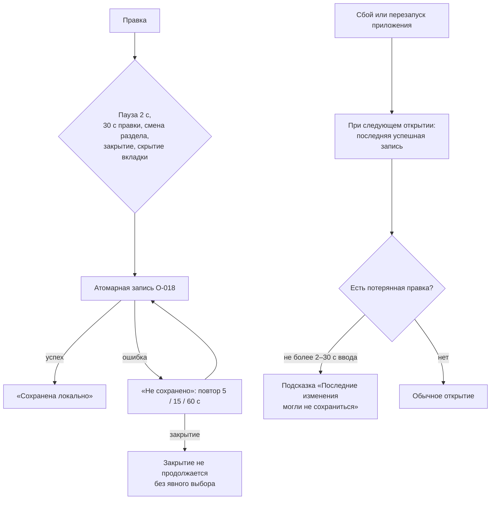

# P1-04F, P1-04G — проверка композиции, раздел «Проверки», история и автосохранение

Статус: принято владельцем 25.10.2026 (решения E-1…E-4, G-1…G-3, I-1…I-4 по рекомендации). Это design specification, не реализованный экран. Реализация — P4-03 (редактор и проверки), P4-06 (хранение и автосохранение); в P2–P3 раздел «Проверки» работает в промежуточном объёме (§3.4).

Входы: P1-01B §2–§3 (рабочая область, маршрут `/draft/:local_id/checks`), P1-01C (оси состояний, ось C «сохранение», правило двух вкладок, `save_failed`), P1-01G (матрица восстановления), P1-01H §6 и P1-11H D2 (промежуточное поведение входов G1b), P1-03E (повторное копирование и переигрывание), P1-05G (состояния привязок), P1-08C (группы и статусы предварительных проверок — словарь статусов берётся оттуда), P1-09B (файл настроек; ключ автосохранения — P1-09D), P0-09 (реестр возможностей и совместимость), O-018 (хранилище, рабочая копия = база + операции), O-026/O-034 (`project/v2`, виджеты любых типов после P0-10), P1-00D/E (компоненты и состояния), коды `core` (`layout_bounds`, `layout_overlap`, `unknown_metric` и др.).

Связанные части редактора проектируются отдельно: оболочка, холст, страницы, виджеты, инспектор и перенос — P1-04A–E (макеты `12-01…12-05`), синтетический предпросмотр — P1-04I. Здесь — только проверка, раздел «Проверки» и история. Новых макетов нет: раздел «Проверки» собирается из уже принятых компонентов (§3).

## 1. Принципы

1. **Локальное сохранение не блокируется проверками.** Черновик с ошибками всегда сохраняется; блокировки действуют только на экспорт, привязки и публикацию. Единственное, что мешает сохранению, — ошибка записи на диск (`save_failed`).
2. **Один словарь статусов.** Статусы — те же, что в предварительных проверках публикации (P1-08C): «пройдено», «предупреждение», «блокирует», «не проверялось», «устарело», с теми же значками Tabler (`circle-check`, `alert-triangle`, `circle-x`, `circle-dashed`). Для каждой блокировки указано, **что** она блокирует.
3. **Проверка локальная.** Раздел «Проверки» не обращается к Zabbix сам. Сетевые проверки (свежесть базы, права, привязки на сервере) выполняются в «Публикации» и «Привязках»; здесь показывается их последний результат со временем.
4. **Из любой находки — к месту исправления.** Каждая строка ведёт к объекту: виджету на холсте, полю в инспекторе, странице в «Структуре», строке в «Привязках».
5. **Серверные изменения не попадают в историю правки.** Отмена и повтор касаются только действий пользователя в этом черновике.

## 2. P1-04F — правила проверки композиции

### 2.1 Что блокирует что

| Уровень | Сохранить локально | Экспорт в файл | Привязки | Предпросмотр и публикация |
|---|---|---|---|---|
| предупреждение | да | да | да | да; показывается в подтверждении как «просмотрено» (P1-08F) |
| блокирует экспорт | да | **нет** | да | да, если не блокирует и публикацию |
| блокирует публикацию | да | да | да | **нет**: план не строится (P1-08C) |
| блокирует экспорт и публикацию | да | нет | да | нет |

Привязки (P1-05) не блокируются проверками композиции: мастер сам показывает свои блокировки. Блокировки привязок (`ambiguous`, `missing`, LLD, маски, список «останутся на старом узле», устаревшие привязки) отображаются здесь как отражение состояния P1-05 и ведут в «Привязки».

### 2.2 Правила

| Код | Уровень | Где показывается | Куда ведёт исправление |
|---|---|---|---|
| `layout_bounds` — виджет выходит за сетку 72 колонки × 64 строки | блокирует экспорт и публикацию (сервер отклоняет, P1-IN-04) | рамка и значок на холсте, маркер в дереве «Структуры», строка «Проверок», поле геометрии в инспекторе | виджет на холсте, поле «Положение / Размер» |
| `layout_overlap` — виджеты перекрываются | блокирует экспорт и публикацию | штриховка пересечения на холсте, оба виджета в списке | один из виджетов на холсте |
| `page_rows_overflow` — содержимое страницы ниже последней разрешённой строки при росте виджета | блокирует экспорт и публикацию | граница сетки на холсте | страница на холсте |
| `dashboard_no_pages` — в панели нет страниц | блокирует экспорт и публикацию (сервер: «pages cannot be empty») | заголовок «Структуры», строка «Проверок» | «Структура» → «Добавить страницу» |
| `page_empty` — страница без виджетов | предупреждение | вкладка страницы, дерево | страница |
| `name_empty` — пустое имя панели или страницы, где оно обязательно | блокирует экспорт и публикацию | поле имени | «Свойства панели» / вкладка страницы |
| `name_too_long`, `page_count_limit`, `widget_count_limit` — лимиты адаптера и формата | блокирует экспорт и публикацию | поле или счётчик | соответствующий объект |
| `widget_incomplete` — не заполнено обязательное поле поддержанного виджета | блокирует экспорт и публикацию | значок на виджете, поле в инспекторе | поле в инспекторе |
| `widget_field_invalid` — значение поля вне допустимого (тип, диапазон, формат) | блокирует экспорт и публикацию | поле в инспекторе с текстом рядом | поле |
| `unknown_metric` — метрики нет в указанном каталоге | блокирует экспорт и публикацию | значок на виджете, строка «Проверок» | поле «Источник» в инспекторе или «Библиотека» (каталог) |
| `catalog_missing` — нужен каталог метрик, которого нет | блокирует экспорт (до P0-10 — и пустой черновик, `draft.export.needs_catalog`) | строка «Проверок» | «Библиотека» / «Импорт файлов» |
| `source_binding_required` — у роли или источника нет привязки к узлу сети | блокирует публикацию | значок «нужна привязка» на виджете | «Привязки» |
| `bindings_unresolved`, `bindings_stale`, `kept_on_source_unconfirmed` — отражение состояния P1-05 | блокирует публикацию | строка «Проверок» | «Привязки» (09-03, 09-04, 09-07) |
| `reference_broken` — виджет ссылается на `reference`, которого нет на панели | блокирует экспорт и публикацию | связь на холсте у виджета-получателя | поле связи в инспекторе |
| `reference_duplicate` — одинаковый `reference` у двух виджетов (сборка, вставка) | блокирует публикацию; при сборке переписывается автоматически с отчётом (P1-01I §4) | оба виджета | «Структура» / сборка |
| `reference_outside_page` — копия страницы ссылается на виджет другой страницы | предупреждение (связь не переносится) | виджет-получатель | поле связи |
| `widget_type_unknown` — тип, не известный реестру адаптера | предупреждение: виджет сохраняется и копируется как есть, изменение недоступно; при публикации — по возможностям P0-09 (копия неизвестного виджета в новую панель подтверждена, P1-IN-04) | плашка «Изменение не поддерживается» на виджете | — (только просмотр сводки полей) |
| `widget_field_unknown` — поле, неизвестное реестру | предупреждение: поле хранится как есть, только просмотр | раздел «Дополнительно» в инспекторе | — |
| `capability_not_verified` — пользователь изменил тип или поле без флага `edit` для точной версии | блокирует публикацию | поле в инспекторе | отменить правку или «Сохранить копию» как новую панель, если `create` подтверждён |
| `graph_classic_unsupported` — классический график затронут операцией до лабораторного контракта | блокирует публикацию (O-003) | виджет | «Привязки» / отменить правку |
| `compatibility_mismatch` — заявленная совместимость шире вычисленной (P0-09) | предупреждение | метка «Zabbix 7.4.0+» в заголовке, строка «Проверок» | «Свойства панели» → заявленная совместимость |
| `compatibility_unknown` — вычисленная совместимость неизвестна из-за неизвестного типа или поля | предупреждение | то же | — |

Коды совпадают с кодами `core` там, где они уже есть (`layout_bounds`, `layout_overlap`, `unknown_metric`, `duplicate_*`), и с кодами `application` (`compatibility.*`, P0-09). Новые коды добавляются в `core`/`application` как стабильные коды, не как текст (P4-03).

### 2.3 Когда выполняется проверка

- При открытии черновика — полная проверка.
- После каждого шага истории (§4) — только затронутые объекты, без задержки ввода; список «Проверок» обновляется после паузы ввода 300 мс.
- Результаты сетевых проверок (привязки, свежесть, права) приходят из P1-05/P1-08 со временем; при смене контекста подключения они получают статус «устарело» (P1-01C §4, P1-05G), а не исчезают.
- «Не проверялось» — когда проверка невозможна (нет подключения для привязок, нет каталога). Причина пишется рядом.

### 2.4 Показ на холсте, в дереве и в инспекторе

- **Холст:** у виджета с блокировкой — рамка состояния ошибки и значок `circle-x` в углу; с предупреждением — `alert-triangle`; пересечение — штриховка общей области. Цвет не единственный носитель: значок и подсказка с текстом (P1-00G).
- **Дерево «Структуры»** и вкладки страниц: маркер и число находок у страницы и виджета.
- **Инспектор:** ошибка поля — под полем, связана с ним (`aria-describedby`); сводка находок виджета — в начале инспектора со ссылками на поля.
- **Шапка рабочей области:** плашка «Проверки: N блокируют» рядом с локальным статусом; нажатие ведёт в раздел «Проверки».

### 2.5 Переход к исправлению

Строка находки в «Проверках» — ссылка «Перейти». Переход открывает нужный раздел, выделяет объект (страница переключается автоматически), прокручивает холст к виджету и ставит фокус в поле инспектора. Клавиатура: Enter на строке — переход; Esc в инспекторе — возврат к списку находок с прежней позицией.

## 3. Раздел «Проверки» рабочей области

### 3.1 Состав

Компоновка повторяет шаг «Проверки» публикации (макет `11-03`), чтобы пользователь видел одинаковую картину:

1. **Заголовок** «Проверки» и подзаголовок «Проверка выполняется на этом компьютере; Zabbix не опрашивается».
2. **Итог справа** (карточка как в `11-03`): счётчики «пройдено / предупреждения / блокируют / не проверялось / устарело» и три строки готовности: «Сохранить локально — можно всегда», «Экспорт в файл — можно / заблокировано: N», «Публикация — можно / заблокировано: N». Кнопка «Проверить снова» перезапускает только локальную проверку.
3. **Список находок слева** — группами, как в P1-08C, со строкой «исправляется: …»:
   - «Структура и геометрия» — `layout_*`, `page_*`, `dashboard_no_pages`, `name_*`, лимиты;
   - «Виджеты и поля» — `widget_*`, `capability_not_verified`, `graph_classic_unsupported`;
   - «Источники и привязки» — `unknown_metric`, `catalog_missing`, `source_binding_required`, отражение P1-05;
   - «Связи виджетов» — `reference_*`;
   - «Совместимость» — `compatibility_*`.
   Строка: значок статуса, текст по коду, путь к объекту («Страница 2 › Queries per second»), кнопка «Перейти». Пройденные группы свёрнуты в одну строку «Пройдено: N».
4. **Фильтры** — общие компоненты-переключатели: «Все», «Блокируют», «Предупреждения», и выбор страницы.
5. **«Последние проверки публикации»** — свёрнутый блок: время последнего шага «Проверки» в «Публикации» (P1-08C) и его итог; «Открыть публикацию». Если их не было — «Ещё не выполнялись».

Компоненты: Banner, Badge, DataTable/список, EmptyState, кнопки (P1-00D); состояния — P1-00E. Пустое состояние — «Нарушений нет» со счётчиком проверенных объектов.

### 3.2 Состояния раздела

| Состояние | Что видно |
|---|---|
| Проверка идёт (открытие большого черновика) | скелет списка; при > 1 с — «Проверка… {done} из {total} объектов» |
| Нарушений нет | итог «Готово к экспорту и публикации» (публикация всё равно проверит сервер) |
| Есть блокировки | итог с причинами по группам |
| Нет подключения | группа «Источники и привязки» частично «не проверялось: нужно подключение» |
| Черновик открыт для правки в другой вкладке | список только для просмотра, «Перейти» открывает объект без правки (правило двух вкладок) |

### 3.3 Отличие от предварительных проверок публикации

| | «Проверки» (P1-04F) | «Публикация» → «Проверки» (P1-08C) |
|---|---|---|
| Где | раздел рабочей области | шаг публикации |
| Сеть | нет | да: свежесть, права, возможности сервера |
| Цель публикации | не нужна | нужна |
| Результат | список находок | план записи или блокировки |
| Статусы и значки | общие | общие |

Находки «Проверок» входят в предварительные проверки публикации как группа «Сохранение и геометрия» и «Виджеты и поля» — одно и то же правило не проверяется двумя разными способами.

### 3.4 Промежуточный объём в P2–P3 (P1-01H §6, P1-11H D2)

Пока редактора нет (G1b), раздел «Проверки» уже есть и показывает:

- группы, которые не требуют редактора: «Источники и привязки» (из P1-05), «Связи виджетов» и «Совместимость» (из P0-09), «Структура и геометрия» по данным снимка;
- блок «Последние проверки публикации»;
- для находок, исправляемых только в редакторе, кнопка «Перейти» заменяется на «Исправить в редакторе — появится позже» (`common.state.coming_later`), а где можно — ведёт в «Структуру» (порядок, имена, перенос виджета).

Копия с сервера в P2–P3 почти всегда проходит «Структуру и геометрию» (сервер уже принял её); основные находки — привязки и совместимость. Полный объём включается вместе с редактором (P4-03) без смены компоновки.

## 4. P1-04G — история, сохранение и восстановление

### 4.1 Две модели истории

| | Копия с сервера (рабочая копия, O-018) | Локальный черновик (`project/v2`) |
|---|---|---|
| Что хранится на диске | база (снимок) + упорядоченный список операций | сам черновик |
| Шаг истории | операция в списке | снимок изменённых объектов в памяти редактора |
| Отмена | снимает последнюю операцию; Local пересчитывается из базы и оставшихся операций | возвращает предыдущее состояние |
| Отмена после повторного открытия | **да**: операции сохранены; доступна та же цепочка | **нет**: история только в памяти, после открытия начинается заново |
| Повтор | до новой правки после отмены | то же |
| Предел | без предела по числу операций; операции «отменены» не хранятся после сохранения | 200 шагов в памяти; старые отбрасываются с пометкой «более ранние шаги недоступны» |

Неизвестные виджеты и поля после P0-10 могут жить и в локальном черновике (O-034): они хранятся как есть и в истории участвуют только целиком (удаление, перенос, копирование), без правки полей.

### 4.2 Группировка шагов

- Один жест — один шаг: перетаскивание, изменение размера, перенос выделения из нескольких виджетов, вставка, выравнивание.
- Ввод в поле инспектора — один шаг при подтверждении (Enter, уход фокуса), а не на каждую букву.
- Массовые действия — один шаг: «Принять точные» в привязках, применение замены узла сети, применение решений клона, сборка панели из страниц.
- Действия мастера «Привязки» — шаги той же истории, потому что это операции копии (P1-05G).
- Подпись шага берётся из `editor.op.*` и показывается в «Отменить: {action}» / «Повторить: {action}» (`editor.action.undo/redo`).

### 4.3 Матрица команд

| Команда | Вид | Шаг истории | Операция рабочей копии (O-018) | Локальный черновик | Проверка после | Автосохранение |
|---|---|---|---|---|---|---|
| Переместить, изменить размер, выровнять | структура | да | `move_widget`, `resize_widget` | да | `layout_*` | да |
| Добавить, удалить, дублировать, вставить виджет | структура | да | `add_widget`, `remove_widget` | да | `layout_*`, `reference_*`, `widget_*` | да |
| Изменить поле виджета | параметр | да | `set_widget_field` | да | `widget_*`, `capability_not_verified` | да |
| Добавить, переименовать, переставить, удалить страницу | структура | да | `add_page`, `rename_page`, `move_page`, `remove_page` | да | `page_*`, `dashboard_no_pages` | да |
| Свойства панели | параметр | да | `set_dashboard_property` | да | `name_*`, `compatibility_*` | да |
| Замена узла сети, решения клона, серии | привязки | да (один шаг на применение) | `replace_host`, `clone_mapping`, `set_series` | для локального — привязки ролей | отражение P1-05 | да |
| Сохранить вручную | — | нет | запись списка операций | запись черновика | — | — |
| Скопировать заново (P1-03E), принять новую базу | граница | **нет**: начинается новая история | операции переигрываются на новой базе | — | полная | да |
| Публикация с итогом «Проверено» | граница | нет | снимок после записи — новая база (P1-08G) | — | полная | да |
| Изменение на сервере, обнаруженное проверкой | — | **никогда** | не меняет операции; показывается как конфликт (P1-08D) | — | «устарело» | — |
| Синтетические данные (P1-04I) | вид | нет | не сохраняется | не сохраняется | — | нет |

### 4.4 Границы истории

- Импорт и копирование с сервера создают новый черновик с пустой историей.
- Повторное открытие: рабочая копия — цепочка операций доступна; локальный черновик — история пустая, с подсказкой «Отмена доступна для изменений с момента открытия».
- Принятие новой базы после «Скопировать заново» и успешная публикация — граница: отменить шаги до неё нельзя; вернуться к прежней базе можно только «Вернуться к прежней базе» (P1-03E) до принятия.
- Перехват правки другой вкладкой (P1-01C §3): история проигравшей вкладки отбрасывается, вкладка переходит в просмотр; несохранённый ввод виден и копируется.

### 4.5 Сохранение и автосохранение

Состояния — ось C P1-01C: «Сохранена локально», «Изменена», «Сохранение…», «Не сохранено: {reason}».

- **Вручную:** «Сохранить черновик» (`common.action.save_draft`), сочетание Ctrl+S.
- **Автосохранение — по умолчанию включено:** после 2 секунд без правки, но не реже раза в 30 секунд непрерывной правки, а также при переходе между разделами, закрытии черновика и скрытии вкладки. Пишет тем же атомарным способом, что и ручное (временный файл → `fsync` → rename, O-018). Отключается в настройках (ключ — P1-09D); при отключении перед закрытием — диалог `draft.close.dirty.*`.
- Автосохранение — только локальная запись; оно никогда не публикует и не меняет ось публикации.
- **Ошибка записи:** «Не сохранено: {reason}» в шапке и баннер; автосохранение повторяет с паузой 5, 15, 60 секунд; «Повторить» вручную; закрытие черновика и выход из приложения не продолжаются без явного выбора (P1-01C §3, P1-01G).
- «Отменить изменения» (вернуться к сохранённому) при включённом автосохранении заменяется отменой шагов истории; для рабочей копии дополнительно доступна отмена отдельных операций из списка в «Обзоре».

### 4.6 Восстановление после закрытия и сбоя

- Потерять можно только правку после последней успешной записи: до 2 секунд при паузе в работе, до 30 секунд при непрерывной правке, и несохранённый ввод в поле браузера (P1-IN-07).
- Если приложение закрылось при состоянии «Не сохранено», при следующем открытии черновика показывается «Последние изменения могли не сохраниться» с временем последней успешной записи.
- Повреждённый файл черновика не открывается молча с умолчаниями: «Черновик повреждён» с кодом; рабочая копия восстанавливается из базы и операций, если повреждён только производный вид (`materialized.json` — кэш, O-018).

## 5. Решения владельца

| # | Вопрос | Рекомендация | Альтернатива |
|---|---|---|---|
| G-1 | Автосохранение по умолчанию | **включено** (2 с паузы / 30 с правки), отключается в настройках | выключено, только ручное сохранение |
| G-2 | Отмена после повторного открытия | **только для рабочей копии** (операции на диске); локальный черновик — история в памяти | хранить историю локального черновика на диске (точки восстановления) — больше объёма и сложности |
| G-3 | «Проверки» в P2–P3 | промежуточный объём §3.4 без смены компоновки | скрыть раздел до P4 — противоречит P1-01B §2 и P1-11H D2 |

## 6. Handoff для P4-03, P4-06

| Команда | Предусловия | Успех | Ошибки (коды) |
|---|---|---|---|
| `checks.run` | черновик загружен | находки по объектам: `code`, `level`, `blocks` (`export`/`publication`), `object_ref`, `fix_target`, `params` | — |
| `checks.summary` | — | счётчики и готовность «сохранить / экспорт / публикация» | — |
| `editor.apply` | вкладка правит черновик | новый шаг истории, пересчитанные находки затронутых объектов | `draft_open_elsewhere`, `capability_not_verified` |
| `editor.undo`, `editor.redo` | есть шаг | состояние и находки | `history_boundary` |
| `draft.save` | — | `saved_at` | `save_failed` (`disk_full`, `permission_denied`, `storage_unavailable`) |
| `draft.autosave.set` | настройка P1-09D | — | — |
| `draft.open` | — | черновик, история (для рабочей копии — операции), флаг «последние изменения могли не сохраниться» | `draft_corrupted`, `draft_missing` |

Данные находки — коды и параметры, не текст. Фокус и live-region: изменение счётчика блокировок объявляется вежливо; ошибка сохранения — ассертивно; переход «Перейти» ставит фокус в поле. Синтетические данные не попадают ни в находки, ни в историю, ни в файлы.

Связи: P1-04A–E (холст, инспектор, перенос — действия, порождающие шаги), P1-04I (синтетика вне истории), P1-05 (привязки как шаги), P1-08C (общий словарь статусов, группы), P1-09D (настройка автосохранения), P1-03E (граница истории при новой базе).

## 7. Новые message IDs

Используются существующие: `draft.nav.checks`, `draft.context.saved`, `draft.context.dirty`, `draft.context.save_failed`, `draft.close.dirty.*`, `editor.action.undo`, `editor.action.redo`, `editor.validation.collision`, `editor.validation.out_of_bounds` (тексты для `layout_overlap` и `layout_bounds`), `draft.export.needs_catalog`, `common.action.save_draft`, `common.state.coming_later`, `publication.check.recheck`, статусы и значки P1-08C.

| ID | EN source | RU |
|---|---|---|
| `checks.subtitle` | Checked on this computer; Zabbix is not queried. | Проверка выполняется на этом компьютере; Zabbix не опрашивается. |
| `checks.summary.save_always` | Save locally — always possible | Сохранить локально — можно всегда |
| `checks.summary.export_ready` | Export to file — possible | Экспорт в файл — можно |
| `checks.summary.export_blocked` | {count, plural, one {Export to file — blocked: # issue} other {Export to file — blocked: # issues}} | {count, plural, one {Экспорт в файл — заблокирован: # нарушение} few {Экспорт в файл — заблокирован: # нарушения} many {Экспорт в файл — заблокирован: # нарушений} other {Экспорт в файл — заблокирован: # нарушения}} |
| `checks.summary.publication_ready` | Publication — possible after server checks | Публикация — возможна после проверок на сервере |
| `checks.summary.publication_blocked` | {count, plural, one {Publication — blocked: # issue} other {Publication — blocked: # issues}} | {count, plural, one {Публикация — заблокирована: # нарушение} few {Публикация — заблокирована: # нарушения} many {Публикация — заблокирована: # нарушений} other {Публикация — заблокирована: # нарушения}} |
| `checks.empty` | No issues found in {count} objects | Нарушений нет, проверено объектов: {count} |
| `checks.progress` | Checking… {done} of {total} objects | Проверка… {done} из {total} объектов |
| `checks.group.structure` | Structure and geometry | Структура и геометрия |
| `checks.group.widgets` | Widgets and fields | Виджеты и поля |
| `checks.group.sources` | Sources and bindings | Источники и привязки |
| `checks.group.references` | Widget links | Связи виджетов |
| `checks.group.compatibility` | Compatibility | Совместимость |
| `checks.group.passed` | Passed: {count} | Пройдено: {count} |
| `checks.action.go_to` | Go to | Перейти |
| `checks.action.fix_in_editor_later` | Fix in the editor — available later | Исправить в редакторе — появится позже |
| `checks.last_preflight.title` | Last publication checks | Последние проверки публикации |
| `checks.last_preflight.none` | Not run yet | Ещё не выполнялись |
| `checks.last_preflight.at` | Run at {time}: {result} | Выполнены в {time}: {result} |
| `checks.object_path` | {page} › {widget} | {page} › {widget} |
| `checks.header_badge` | {count, plural, one {Checks: # blocking issue} other {Checks: # blocking issues}} | {count, plural, one {Проверки: # блокирует} few {Проверки: # блокируют} many {Проверки: # блокируют} other {Проверки: # блокируют}} |
| `validation.page_rows_overflow` | Page content goes below the last allowed row | Содержимое страницы выходит ниже последней разрешённой строки |
| `validation.dashboard_no_pages` | The dashboard has no pages; Zabbix requires at least one | В панели нет страниц; Zabbix требует хотя бы одну |
| `validation.page_empty` | The page has no widgets | На странице нет виджетов |
| `validation.name_empty` | Enter a name | Введите имя |
| `validation.name_too_long` | The name is longer than {max} characters | Имя длиннее {max} символов |
| `validation.count_limit` | Limit reached: {max} | Достигнут предел: {max} |
| `validation.widget_incomplete` | Required field is empty: {field} | Не заполнено обязательное поле: {field} |
| `validation.widget_field_invalid` | Invalid value: {field} | Недопустимое значение: {field} |
| `validation.unknown_metric` | The metric is not in catalog {catalog} | Метрики нет в каталоге «{catalog}» |
| `validation.catalog_missing` | A metric catalog is needed | Нужен каталог метрик |
| `validation.source_binding_required` | A host binding is needed | Нужна привязка к узлу сети |
| `validation.reference_broken` | The linked widget is missing | Связанного виджета нет |
| `validation.reference_duplicate` | Two widgets use the same link name | Два виджета используют одно имя связи |
| `validation.reference_outside_page` | The link points to a widget on another page and is not carried over | Связь указывает на виджет другой страницы и не переносится |
| `validation.widget_type_unknown` | Editing is not supported; the widget is kept as is | Изменение не поддерживается; виджет сохраняется как есть |
| `validation.widget_field_unknown` | Unknown field kept as is | Неизвестное поле сохраняется как есть |
| `validation.capability_not_verified` | Changing this field is not verified for Zabbix {version} | Изменение этого поля не подтверждено для Zabbix {version} |
| `validation.graph_classic_unsupported` | Changing a classic graph is not supported yet | Изменение классического графика пока не поддерживается |
| `draft.context.saving` | Saving… | Сохранение… |
| `draft.autosave.retrying` | Not saved, retrying in {seconds} s | Не сохранено, повтор через {seconds} с |
| `draft.recovery.maybe_lost` | Recent changes may not have been saved. Last saved at {time}. | Последние изменения могли не сохраниться. Последнее сохранение — {time}. |
| `draft.corrupted` | The draft file is damaged ({code}) | Файл черновика повреждён ({code}) |
| `history.reopened_hint` | Undo is available for changes since opening | Отмена доступна для изменений с момента открытия |
| `history.boundary` | Earlier steps cannot be undone: {reason} | Более ранние шаги отменить нельзя: {reason} |
| `history.boundary.new_base` | a new base was accepted | принята новая база |
| `history.boundary.published` | the dashboard was published | панель опубликована |
| `history.limit` | Earlier steps are no longer available | Более ранние шаги недоступны |
| `editor.op.move` | moving | перемещение |
| `editor.op.resize` | resizing | изменение размера |
| `editor.op.align` | alignment | выравнивание |
| `editor.op.add_widget` | adding a widget | добавление виджета |
| `editor.op.remove_widget` | deleting a widget | удаление виджета |
| `editor.op.duplicate` | duplication | дублирование |
| `editor.op.paste` | paste | вставка |
| `editor.op.edit_field` | changing {field} | изменение «{field}» |
| `editor.op.page` | page change | изменение страницы |
| `editor.op.dashboard_properties` | dashboard properties | свойства панели |
| `editor.op.bindings` | applying bindings | применение привязок |

Параметры: `{field}`, `{catalog}`, `{page}`, `{widget}` — данные (не переводятся); `{reason}`, `{result}`, `{action}` — message ID; числа — целые; `{time}` — локализованное время. Проверено против реестра P1-00F §7 и таблиц P1-0x: дублей ID нет; для `layout_overlap`/`layout_bounds` используются существующие `editor.validation.*`.

## Проверки приёмки

- Локальное сохранение никогда не блокируется проверками; для каждой блокировки видно, что именно она блокирует (экспорт, публикацию).
- Статусы и значки совпадают с предварительными проверками публикации; одно правило не проверяется двумя способами.
- Из каждой находки можно перейти к объекту и полю; находки видны на холсте, в дереве, в инспекторе и в «Проверках».
- Раздел «Проверки» работает в P2–P3 в промежуточном объёме без смены компоновки при появлении редактора.
- Отмена и повтор покрывают структурные, параметрические действия и привязки; серверные изменения в историю не попадают; границы истории названы.
- Автосохранение пишет атомарно и никогда не публикует; при ошибке записи закрытие не продолжается; после сбоя теряется не больше последних секунд правки, и пользователь об этом предупреждён.
