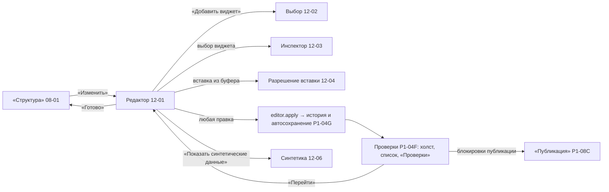

# P1-04H — handoff редактора страницы

Статус: принято владельцем 25.10.2026 (решения E-1…E-4, G-1…G-3, I-1…I-4 по рекомендации). Версия: v1, 25.10.2026. Адресат реализации — P4-03 (редактор), P4-06 (автосохранение и хранилище), P4-09 (страницы и вставка между панелями), реализация синтетики — P4 (O-028).

Состав пакета:

| Документ | Подзадачи | Макеты |
|---|---|---|
| [`P1-04A-E-editor.md`](P1-04A-E-editor.md) | A — оболочка и холст 72×64; B — вкладки страниц; C — выбор и жизненный цикл виджета; D — инспектор; E — выделение, геометрия, буфер, вставка | 12-01, 12-02, 12-03, 12-04 |
| [`P1-04F-G-validation-history.md`](P1-04F-G-validation-history.md) | F — проверки композиции и раздел «Проверки»; G — история, автосохранение, восстановление | — (компоновка «Проверок» повторяет 11-03) |
| [`P1-04I-synthetic-preview.md`](P1-04I-synthetic-preview.md) | I-A…F — синтетический предпросмотр | 12-06 |

## 1. Как части связаны

- Все изменения идут одной командой `editor.apply(op)`; операции `editor.op.*` (P1-04F/G) одинаковы для холста, инспектора, вкладок, «Структуры» и вставки. Один жест — один шаг истории.
- Проверки (P1-04F) используют словарь статусов P1-08C; один и тот же код показывается на холсте, в списке виджетов и в «Проверках».
- Синтетика (P1-04I) — настройка вида: генератор живёт в `application`, вызывается только при включённой галке и никогда не пишет в черновик, файл, журнал, отчёт или «Публикацию».
- Возможности виджетов берутся только из реестра P0-09 для точной версии адаптера: настройка — `svggraph`, `item`; добавление с умолчаниями — `clock`, `problems`; остальные известные типы — копированием как есть; неизвестные — сводка полей без изменения.

## 2. Данные и команды

| Команда / событие | Источник | Описано |
|---|---|---|
| `editor.open(local_id, page)`, `editor.close` | «Структура» | P1-04A |
| `editor.apply(op)`, `editor.undo`, `editor.redo` | холст, инспектор, вкладки, вставка | P1-04E, P1-04G |
| `editor.validate` → события находок | после каждого `apply` | P1-04F |
| `editor.clipboard.copy/cut/paste`, `editor.paste.resolve` | буфер приложения | P1-04E |
| `draft.save`, `draft.autosave` (события `saving/saved/save_failed/retrying`) | P1-04G, P1-09D | P1-04G |
| `preview.synthetic.render(page, period)` | галка синтетики | P1-04I |

Геометрия хранится только целыми ячейками (x 0–71, y 0–63); масштаб меняет отображение; открытие и сохранение геометрию не меняют (P1-04A). Отпускание на занятое место по умолчанию отменяется (решение E-1).

## 3. Решения владельца

| # | Вопрос | Рекомендация |
|---|---|---|
| E-1 | Отпускание виджета на занятые ячейки | отказ и возврат на место; соседи не сдвигаются (альтернатива — сдвиг, как в Zabbix) |
| E-2 | «Часы» и «Проблемы» в выборе виджета | добавлять с умолчаниями Zabbix, поля только для просмотра до контракта `edit` |
| E-3 | Буфер обмена | внутренний буфер приложения на время сессии; данные черновика не уходят в другие программы |
| E-4 | Где редактор | сосредоточенный режим «Структуры» со списком виджетов вместо навигации рабочей области, выход — «Готово» |
| G-1 | Автосохранение | включено по умолчанию (настройка — P1-09D); 2 с паузы или раз в 30 с правки |
| G-2 | Отмена после повторного открытия | только для рабочей копии (история = операции O-018); у локального черновика история в памяти, до 200 шагов |
| G-3 | «Проверки» в P2–P3 | промежуточный объём без смены компоновки (P1-04F §3.4), как решено в P1-11H D2 |
| I-1 | Откуда брать сопоставления значений, пороги, макросы и интервал для синтетики (в `metrics/v1` их нет) | локальные «подсказки предпросмотра» рядом с каталогом в библиотеке, не в переносимых файлах; новая версия схемы каталога — не сейчас |
| I-2 | Зерно генератора | устойчивый локальный ID страницы + ID виджета + номер набора + ключ метрики (задача P1-04I-D уточнена) |
| I-3 | Где генератор | `application` (Rust); интерфейс только рисует |
| I-4 | Данные для синтетики у копий с сервера | при копировании (P2-05) читать `item.get` по ссылкам снимка и хранить тип значения, единицы и сопоставления значений как локальные метаданные копии |

Связанное: P1-01C §3 описывает «Отменить изменения» как возврат к сохранённому; при автосохранении (G-1) это действие заменяется отменой шагов истории до точки ручного сохранения (P1-04G §4.5) — после решения G-1 P1-01C уточняется ссылкой.

## 4. Исправлено при сведении

- Цвет второго ряда графика в 08-01 совпадал с цветом статуса «успех», в 09-05 — был к нему близок: заменён на фиолетовый `#8b5cf6` (как в 12-06).
- `editor.canvas.label`: «72 колонки × 64 строки», как в правиле `layout_bounds`.
- Задачи P1-04 и P1-04G: устаревшие «`project/v1`» и «неизвестные виджеты только в рабочей копии» заменены по O-026/O-034; P1-04I-D — зерно от устойчивого ID страницы.

## 5. Отложено и зависимости

- Размер виджета по умолчанию (в 12-02 «12 × 5») сверить с `manifest.json` 7.4 при реализации (P1-IN-10).
- Вставка виджета неподдерживаемого типа в переносимый черновик — после P0-10 (O-034).
- Заготовки виджетов и профили оформления — P1-06 (в выборе виджета «Появится позже»).
- Настройка автосохранения — P1-09D (G1b).

## Проверки приёмки P1-04

- Многостраничная панель редактируется без подключения на сетке 72×64; геометрия только целыми ячейками, без скрытых изменений.
- Поддержанные виджеты добавляются и настраиваются; остальные видны, копируются как есть и не теряют полей; неизвестное не получает выдуманного редактора.
- Перетаскивание имеет альтернативу с клавиатуры; цели не меньше 32×32.
- Проверки показывают одну и ту же находку на холсте, в списке и в «Проверках»; сохранение не блокируется проверками.
- Отмена и автосохранение не теряют последнюю сохранённую версию; серверные изменения не попадают в историю.
- Синтетика только по галке, с меткой, никуда не сохраняется.
