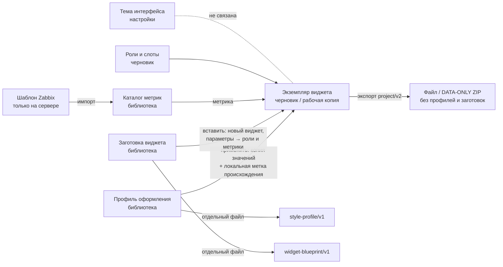

# P1-06A–B — профили оформления и заготовки виджетов: термины, модель применения, матрица совместимости

Статус: проект дизайна от 26.10.2026, ожидает решения O-012 (состав MVP). Это design specification, не реализованный экран и не изменение формата. Реализация — P4-05 (профили и заготовки), P4-04 (разделы библиотеки); остальные подзадачи эпика (P1-06C–H: библиотека, извлечение, редактор, применение заготовки, массовое применение и конфликты, handoff) проектируются после решения O-012 на основе этого документа.

Входы: эпик P1-06 и O-012 (две независимые переносимые сущности; без изменения canvas P1-04, привязок P1-05 и формата экспорта P1-07), O-033/P0-09 (реестр возможностей 32 типов 7.4: флаги `read`/`preview`/`edit`/`create`/`geometry`), P1-IN-10 (поля `item` и `svggraph` 7.4.16, типы полей `ZBX_WIDGET_FIELD_TYPE_*`, правило «`svggraph` пишет только отличающиеся от умолчаний свойства набора»), O-034/P0-10 (общий вид «виджет Zabbix» в `project/v2`), O-018 (хранилище приложения), O-021 (DATA-ONLY ZIP без новых файлов), O-028 (синтетика), O-029 (заявленная совместимость), P1-03F (разделы библиотеки «Профили оформления» и «Заготовки виджетов»), P1-04C/D (выбор виджета «Из заготовок», метка «из профиля» зарезервирована), P1-04F/G (находки и история), P1-05 и дополнение (роли, слоты, метрики каталога, статусы P1-IN-03), P1-05F/P3-03B (цвет нового ряда), P1-07 (пакет и сканер значений), P1-09B (тема ≠ профиль), P1-09E (`editor.confirm_bulk_apply`), P1-00F (`profiles.*`, `library.section.*`), `domain_model_v1_ru.md`, `format_contract_v1_ru.md`, ROADMAP F-03/F-05.

Макетов в этом шаге нет: модель описана таблицами и диаграммой; экраны — P1-06C–G после O-012.

## P1-06A — термины, границы и модель наследования

### 1. Сущности и что их различает

| Сущность | Что это | Где живёт | Переносится | Что хранит | Чего не хранит никогда |
|---|---|---|---|---|---|
| **Профиль оформления** (`StyleProfile`) | именованный набор совместимых визуальных значений полей для одного или нескольких типов виджетов; применяется к существующим виджетам | библиотека → «Профили оформления» | да, отдельным файлом (§4) | по типу виджета: список «поле → значение» из матрицы P1-06B; палитра рядов; имя, описание, теги, версия, адаптер | источники данных, узлы сети, элементы данных, роли, метрики, геометрию, период, фильтры, ссылки между виджетами, имя виджета, ID сервера, подключение |
| **Заготовка виджета** (`WidgetBlueprint`) | структура одного виджета с параметризованными источниками; из неё создаётся новый виджет | библиотека → «Заготовки виджетов» | да, отдельным файлом (§4) | тип виджета, размер по умолчанию, все поля в виде `project/v2` (простые значения как есть, ссылки — как **параметры**: роль узлов сети, метрика), объявленные параметры с описанием и кардинальностью | положение на странице, `reference`, конкретные узлы, `itemid`/`hostid`, маски и имена реальных узлов, привязки, ID сервера |
| **Экземпляр виджета** | виджет на странице черновика или рабочей копии | черновик (`project/v2`) или рабочая копия (O-018) | в составе черновика | тип, имя, геометрия, все поля, привязки через роли/метрики (O-034) | — |
| **Шаблон Zabbix** (template) | серверный объект Zabbix с элементами данных, LLD, макросами; источник **каталогов метрик** | только на сервере; в библиотеке — каталог метрик как производное | каталог — да | — | ZDashstitch никогда не изменяет шаблоны (AGENTS.md §3) и не превращает их в заготовки |
| **Тема интерфейса** (UI theme) | `system`/светлая/тёмная оформление самого приложения (P1-00C, P1-09B) | настройки приложения | нет | семантические токены | ничего о виджетах: тема не меняет оформление панели в Zabbix |
| **Страница в библиотеке** (O-027) | сохранённая страница целиком для повторного использования | библиотека → «Страницы» | да (`project/v2`, `kind: page`) | виджеты с геометрией и ролями | — (это не заготовка: заготовка — один виджет без положения) |
| **Каталог метрик** | переносимое описание метрик шаблона (`metrics/v1`) | библиотека → «Каталоги метрик» | да | метрики, типы значений, единицы | — |

Правила, которые нельзя нарушать:

- Профиль и заготовка независимы: профиль не ссылается на заготовку, заготовка не ссылается на профиль. Заготовка хранит собственные визуальные значения (она — полный виджет); «применить профиль после вставки» — отдельное действие пользователя, не вложение.
- Ни профиль, ни заготовка не зависят от конкретного узла сети, `itemid`, шаблона Zabbix, панели, страницы, подключения или названия области (Prod/Pilot — только данные пользователя в описании, если он сам их напишет).
- Профиль не может изменить то, что меняет **данные**: источники, агрегацию, период, фильтры, ссылки. Заготовка их объявляет параметрами, но не фиксирует.
- Тема приложения и профиль не смешиваются (P1-09B): профиль — про Zabbix, тема — про ZDashstitch.
- Шаблон Zabbix — источник каталогов метрик, а не заготовок (P1-03B); заготовка может *ссылаться на метрику каталога как на параметр*, но не на шаблон.

### 2. Матрица владения данными

Кто **владеет** значением (где оно задаётся) и кто **может** его менять при применении.

| Группа данных | Пример полей 7.4 | Владеет | Профиль применяет | Заготовка задаёт | Локально, не в файле |
|---|---|---|---|---|---|
| Визуальные поля (матрица P1-06B) | `ds.N.type`, `ds.N.width`, `lefty*`, `legend*`, `value_size`, `bg_color` | экземпляр; значение может происходить из профиля | да | да (как значения виджета) | — |
| Цвета рядов | `ds.N.color`, `ds.N.color.M`, `color_palette`, `sparkline.color` | экземпляр | да, по палитре профиля | да | — |
| Пороги | `thresholds.N.*` (`item`) | экземпляр | только по явному включению в профиль (§P1-06B) | да | — |
| Источники | `itemid.N`, `ds.N.hosts.M`, `ds.N.items.M`, `ds.N.itemids.M`, `graphid.N`, `hostids.N`, `groupids.N`, `override_hostid.*` | экземпляр через роли/метрики (O-034) | **никогда** | как параметры (роль, метрика) или «нужна привязка» | реальные ID — `local-bindings/v1`, операции рабочей копии |
| Смысл данных | `aggregate_function`, `aggregate_interval`, `aggregate_grouping`, `history`, `source`, `timeshift`, `approximation` | экземпляр | **никогда** | да | — |
| Время | `time_period.*`, `time_period._reference`, `sparkline.time_period.*`, `sparkline.history` | экземпляр | **никогда** | да (кроме `_reference`) | — |
| Фильтры проблем | `problemhosts.N`, `severities.N`, `problem_name`, `evaltype`, `tags.N.*`, `show_problems`, `graph_item_problems`, `simple_triggers` | экземпляр | показ проблем `show_problems` — да; фильтры — **никогда** | да (кроме `problemhosts`, которые хранятся параметром или пустыми) | — |
| Текст | `description` (`item`), `units`, `data_set_label`, имя виджета | экземпляр | **никогда** (`units` — см. матрицу) | да | — |
| Связи между виджетами | `reference`, `*._reference` | экземпляр; `reference` выдаёт ZDashstitch при вставке (P1-01I) | **никогда** | **никогда** (получает при вставке) | — |
| Геометрия | `x`, `y`, `width`, `height` | экземпляр | **никогда** | только размер по умолчанию | — |
| Атрибуты виджета | `view_mode` (показ заголовка) | экземпляр | по выбору (§P1-06B §10) | да | — |
| Интервал обновления | `rf_rate` | экземпляр | **никогда** (нагрузка на сервер — не оформление) | да | — |
| Неизвестные поля и типы (O-034) | `registry_state: unknown` | экземпляр | **никогда**, сохраняются как есть | **никогда** не создаются заготовкой | — |
| Происхождение значения («из профиля») | — | экземпляр | — | — | локальные метаданные черновика / операция рабочей копии (§3.3) |
| Использование, авторство, время | — | профиль/заготовка | — | — | локальная карточка библиотеки |
| ID сервера, подключение, права, секреты | — | — | **никогда** | **никогда** | только там, где и сейчас (O-018, O-031) |

### 3. Как профиль применяется к экземпляру

**Решение модели (рекомендация): копирование значений, а не ссылка.** При применении профиля значения его полей записываются в поля виджета как обычные правки (`editor.apply`, одна операция, один шаг истории). Черновик после этого **не зависит** от профиля: файл `project/v2` не содержит ни ID профиля, ни ссылки на библиотеку, экспорт и импорт не меняются, получатель файла видит обычные значения полей. Профиль, изменённый после применения, ничего не меняет в черновиках сам.

Почему не ссылка/наследование: ссылка потребовала бы поля в `project/v2` (изменение принятого формата и схемы — запрещено эпиком), профиль пришлось бы класть в пакет (изменение контейнера O-021), а получатель без этого профиля получил бы «наследование от ничего». Копирование даёт то же удобство в редакторе (метка происхождения и обновление по запросу, §3.3), не меняя контракты.

#### 3.1 Порядок источников значения

```text
умолчание Zabbix  →  профиль (применённые поля)  →  локальная правка пользователя
```

Для каждого поля экземпляра интерфейс показывает одно из состояний происхождения (расширяет правило P1-04D «умолчание Zabbix / изменено»):

| Происхождение | Когда | Подпись в инспекторе | Действия |
|---|---|---|---|
| умолчание Zabbix | значение равно умолчанию Zabbix; поле в API не пишется (для `ds.N.*` это правило самого Zabbix, P1-IN-10) | `editor.field.default_zabbix` | — |
| изменено | задано пользователем или скопировано как есть с сервера | `editor.field.changed` | «Вернуть умолчание» |
| из профиля | значение записано применением профиля и с тех пор не менялось | `profiles.field.origin.profile` («из профиля «{profile}»») | «Вернуть умолчание», «Отвязать от профиля» (значение остаётся, метка снимается) |
| изменено после профиля | применён профиль, затем пользователь изменил поле | `profiles.field.origin.overridden` | «Вернуть значение профиля», «Вернуть умолчание» |

Значение из профиля, равное умолчанию Zabbix, записывается как «умолчание» (поле снимается), чтобы выполнялось правило «`svggraph` пишет только отличающиеся от умолчаний свойства»; кодек адаптера отвечает за это, профиль хранит значение явно.

#### 3.2 Повторное применение и изменение профиля после применения

| Событие | Что происходит | Что видно |
|---|---|---|
| Профиль изменён и сохранён (новая версия) | ничего в черновиках не меняется | карточка профиля: «Используется: N виджетов в M черновиках; из них на прежней версии — K»; у виджета в инспекторе: «профиль «{profile}» обновлён до версии {version}» (`profiles.field.origin.outdated`) |
| «Обновить из профиля» (по виджету, по выбранным или по всему черновику) | перед применением — таблица «было → станет» по полям; применяется одной операцией | режим для полей «изменено после профиля» выбирается явно (§3.2.1); ничего не меняется молча |
| Профиль удалён из библиотеки | значения в черновиках остаются; метки происхождения превращаются в «изменено» | удаление с предупреждением «используется в N черновиках» (блокировки нет: зависимости нет) |
| Профиль переименован | метки показывают новое имя (ссылка по `profile_id`) | — |
| Черновик экспортирован и импортирован на другой машине | метки происхождения отсутствуют (они локальные); значения на месте | «изменено» |
| Рабочая копия: «Скопировать заново» (P1-03E) | применение профиля — операция `apply_style_profile` с конкретными значениями полей; переигрывается как любая правка поля; конфликт — по правилам P1-03E | «Конфликт» по полю |

##### 3.2.1 Режимы повторного применения (семантика; экраны — P1-06G)

| Режим | Поля «из профиля» | Поля «изменено после профиля» | Поля «изменено» (не из профиля) |
|---|---|---|---|
| `replace` — заменить | значение профиля | значение профиля | значение профиля |
| `keep_local` — сохранить мои правки (по умолчанию) | значение профиля | остаются | остаются |
| `merge` — только новые поля профиля | значение профиля | остаются | остаются; поля, которых раньше в профиле не было, получают значение профиля |

Во всех режимах: источники, время, фильтры, геометрия, неизвестные поля — не трогаются (§2). Отмена — один шаг истории.

#### 3.3 Где хранится происхождение

- Локальный черновик: локальные метаданные черновика в хранилище приложения (как подсказки предпросмотра I-1 и метаданные копии I-4; O-018), ключ — устойчивый ID виджета: `{profile_id, profile_version, fields: [имя поля → значение на момент применения]}`. Не в `project/v2`, не в пакете, не в экспорте.
- Рабочая копия: в операции `apply_style_profile` (O-018, Base + операции), с теми же данными.
- Сохранённое значение «на момент применения» нужно, чтобы отличать «из профиля» от «изменено после профиля» без обращения к старой версии профиля.

### 4. Идентичность, версии, хранение, экспорт

| Свойство | Профиль | Заготовка |
|---|---|---|
| Идентичность | `profile_id` — локально порождённый устойчивый идентификатор (UUID v4 текстом); имя — данные пользователя, не идентичность | `blueprint_id` — так же |
| Версия | целое `version`, увеличивается при каждом сохранении; старые версии не хранятся (отличия от более раннего применения видны по сохранённым значениям §3.3) | так же |
| Адаптер | `adapter: "7.4"` и диапазон совместимости по O-029, вычисленный по реестру для включённых типов и полей | так же, плюс требуемые возможности (`create` типа) |
| Встроенные | набор «встроенных» профилей (если будут) — только для чтения; «Дублировать» даёт пользовательскую копию, которую можно менять (P1-06C) | так же |
| Хранение | хранилище приложения O-018: `library/style-profiles/<profile_id>.yaml` (переносимая часть) + локальная карточка (использование, авторство, время, происхождение — `storage_scope: local_only`), производный индекс `library-index.json` | `library/widget-blueprints/<blueprint_id>.yaml` + карточка |
| Переносимый формат | **новое** пространство схем `zdashstitch.style-profile/v1` (решение O-012, п. 4) | `zdashstitch.widget-blueprint/v1` |
| Экспорт | «Экспорт в файл…» из библиотеки: один YAML-файл на объект; **не входит** в DATA-ONLY ZIP черновика (контейнер O-021 и `project/v2` не меняются) | так же; перед сохранением — сканер значений P1-07C по строковым полям (подпись набора, описание, единицы могут содержать имена) |
| Импорт | «Импорт файлов» (P1-03A): распознанный вид «Профиль оформления» / «Заготовка виджета», в библиотеку; тот же `profile_id` уже есть → «Заменить (новая версия)» или «Сохранить как копию» (новый ID) — выбор явный | так же |
| Удаление | всегда (черновики не зависят); предупреждение об использовании | так же |

Если владелец не утверждает новые публичные схемы (O-012 п. 4, вариант «без экспорта»), формат остаётся внутренним `…/v0` (как `workcopy/v0`), действие «Экспорт в файл…» в библиотеке показывается недоступным с «Появится позже», всё остальное в модели не меняется.

Что в переносимом профиле (эскиз, точная схема — после O-012 по `docs/DOC_GOVERNANCE.md`):

```yaml
format: zdashstitch.style-profile/v1
profile_id: 7a2f…            # устойчивый ID
name: "Рост БД — столбцы"     # данные пользователя
description: ""
tags: []
version: 3
adapter: "7.4"
declared_compatibility: { minimum: "7.4.0" }
widget_types:
  svggraph:
    widget_fields:            # поля уровня виджета из матрицы §8
      legend: 1
      legend_lines: 2
      lefty_min: "0"
    dataset_fields:           # применяются к каждому набору ds.N
      type: 3                 # столбцы
      stacked: 1
      transparency: 3
    series_palette: ["3156A3", "8B5CF6", "1F6B43"]   # по порядку наборов/элементов; формат `^[0-9A-F]{6}$`, как хранит Zabbix
  item:
    widget_fields:
      value_size: 45
      value_bold: 1
      units_show: 1
      bg_color: ""
```

Заготовка — один виджет в виде `project/v2` (`type: zabbix`, без `layout`, с `default_size`) плюс объявление параметров:

```yaml
format: zdashstitch.widget-blueprint/v1
blueprint_id: 91c0…
name: "Загрузка и нагрузка CPU"   # пример заготовки; не совпадает с именем эталонного профиля «Нагрузка CPU — линия» (§12)
version: 1
adapter: "7.4"
widget_type: svggraph
default_size: { width: 24, height: 6 }
parameters:
  roles:
    - { param: cpu_hosts, cardinality: many, description: "Узлы для графика CPU" }
  metrics:
    - { param: cpu_util, value_type: numeric_float, units: "%", description: "Загрузка CPU" }
    - { param: load_avg, value_type: numeric_float, description: "Средняя нагрузка" }
fields:                       # как в project/v2 type: zabbix; ссылки — только через параметры, ключей элементов в заготовке нет
  - { name: ds.0.dataset_type, field_type: 0, value: { kind: integer, value: 1 } }
  - { name: ds.0.hosts.0,      field_type: 1, value: { kind: host, role: "$cpu_hosts", selection: all } }
  - { name: ds.0.items.0,      field_type: 1, value: { kind: metric, metric: "$cpu_util" } }
  - { name: ds.0.type,         field_type: 0, value: { kind: integer, value: 0 } }
  - { name: ds.1.dataset_type, field_type: 0, value: { kind: integer, value: 1 } }
  - { name: ds.1.hosts.0,      field_type: 1, value: { kind: host, role: "$cpu_hosts", selection: all } }
  - { name: ds.1.items.0,      field_type: 1, value: { kind: metric, metric: "$load_avg" } }
```

Правила заготовки: `reference` и `*._reference` не хранятся; `override_hostid` — только параметром-ролью или отсутствует; маски узлов (`*`) и реальные имена в строковых шаблонах не допускаются при сохранении (извлечение P1-06D обязано заменить их параметрами или заблокировать сохранение); неизвестные поля не сохраняются (заготовка создаёт новый виджет, а создание с неизвестными полями запрещено O-034 п. 5 / `format_contract`). Параметр-метрика хранит только тип значения, единицы и описание — ни ключа элемента, ни каталога, ни селектора (решение В-14, 26.10.2026): метрика каталога выбирается при вставке и в локальном черновике, и в копии с сервера.

### 5. Применение заготовки (контракт; экран — P1-06F)

1. Выбор виджета P1-04C → группа «Из заготовок» → заготовка; показываются тип, размер по умолчанию, параметры.
2. Для каждого параметра-роли — выбрать существующую роль черновика (с совместимой кардинальностью) или «Создать роль…» (дополнение P1-05 §2.1); для параметра-метрики — метрика из каталогов черновика по типу значения и единицам (статусы P1-IN-03; «похожее имя не доказательство»), либо «Оставить «нужна привязка»». **Первый похожий источник не выбирается автоматически.**
3. Размещение — как у нового виджета (первое свободное место или на холсте); размер — `default_size`; `reference` выдаёт ZDashstitch.
4. Одна операция `editor.apply op=add_widget` с `blueprint_id`; шаг истории `editor.op.insert_blueprint`; неразрешённые параметры — находка P1-04F `source_binding_required` «нужна привязка» (не блокирует сохранение и экспорт, блокирует только публикацию — O-034 п. 3); `unknown_metric` при этом не возникает, так как метрика не указана.
5. Для рабочей копии: та же вставка в режиме «Добавить виджеты на страницу»; параметр-роль получает реальные узлы подключения, параметр-метрика — метрику каталога из библиотеки, по ключу которой ищется элемент на каждом узле (P1-06F §11); без подключения — «нужна привязка» и «Привязки» (P1-05).

Заготовка создаёт только типы с флагом `create` реестра; типы с `create` без `edit` (`clock`, `problems`) в заготовках MVP не участвуют (см. варианты объёма §12).

### 6. Диаграмма



## P1-06B — MVP-матрица типов и совместимости

### 7. Уровни совместимости и правила отказа

Совместимость считается для пары «профиль → виджет» перед применением (и для «заготовка → черновик» перед вставкой) по реестру P0-09 точной версии адаптера (7.4) и по состоянию виджета в черновике.

| Уровень | Условие | Поведение | Подпись |
|---|---|---|---|
| `compatible` — совместим | тип виджета есть в профиле; тип имеет флаг `edit`; виджет и все его поля `registry_state: known`; все включённые поля профиля применимы к этому виджету | применяются все включённые поля | `profiles.compatibility.compatible` |
| `partial` — частично | тип в профиле и `edit` есть, но часть включённых полей неприменима **к этому виджету**: поле зависит от другого значения (например, `ds.N.pointsize` при `ds.N.type` ≠ точки), поле относится к наборам другого вида (`ds.N.color.M` для набора-шаблона), поле у виджета помечено `unknown`, пороги с другими единицами, старый вид файла | применяется применимое подмножество; список неприменённых полей с причиной показывается до подтверждения и в итоге | `profiles.compatibility.partial` (есть в P1-00F; текст меняется на «к этому виджету» — см. «Что изменится»); короткая плашка `profiles.compatibility.badge.partial` |
| `incompatible` — несовместим | типа виджета нет в профиле; у типа нет флага `edit` (все типы, кроме `item` и `svggraph`, на 7.4); виджет `registry_state: unknown` | ничего не применяется; при массовом применении виджет перечисляется как «пропущен» с причиной | `profiles.compatibility.incompatible`; плашка `profiles.compatibility.badge.incompatible` |
| `unknown` — не проверено | у профиля другой адаптер: версия адаптера подключения или черновика не совпадает с `adapter` профиля либо реестр для неё отсутствует; файл профиля новее приложения (неизвестные поля схемы) | ничего не применяется; предложение: обновить приложение / проверить при подключении | `profiles.compatibility.unknown`; плашка `profiles.compatibility.badge.unknown` |

Уровень оценивается для пары «профиль → конкретный виджет», а не для типа: два виджета одного типа могут получить `compatible` и `partial`. Полные тексты `profiles.compatibility.*` — для карточки виджета и подсказки; короткие плашки `profiles.compatibility.badge.*` — для колонки «Совместимость» таблицы применения (14-10).

Правила отказа:

- Профиль не создаёт полей, которых реестр не знает для типа, и не меняет поля `registry_state: unknown`.
- Поле профиля с недопустимым значением (вне диапазона, неверный формат цвета) — ошибка профиля (`profiles.field.invalid`), профиль нельзя применить, пока ошибка не исправлена; черновик не трогается.
- Применение к виджету без флага `edit` не предлагается и не выдаётся за возможное (`common.state.edit_unsupported`), даже если виджет скопирован с сервера со всеми полями.
- Массовое применение (P1-06G): затрагиваются только `compatible`/`partial`; сводка «применится к N, частично к M, пропущено K»; подтверждение по настройке `editor.confirm_bulk_apply` (P1-09E).
- Публикация после применения проходит те же предварительные проверки P1-08C: профиль ничего не добавляет к контракту записи; поля `item`/`svggraph` пишутся существующими кодеками.

### 8. Матрица полей `svggraph` («График», 7.4.16)

Имена — по `WidgetForm.php` 7.4.16 и реестру P0-09 (`crates/zabbix/src/widget_capabilities.rs`); условия включения зависимых полей сверяются по форме 7.4.16 при реализации P4-05 (помечено «сверить»). Классы: **профиль** — переносится в профиле; **по выбору** — допустимо, но по умолчанию не включается в профиль при извлечении; **никогда** — не входит в профиль; **заготовка** — может быть задано в заготовке.

| Поле API (тип) | Смысл | В профиле | В заготовке | Примечание |
|---|---|---|---|---|
| `ds.N.type` (0) | вид ряда: 0 линия, 1 точки, 2 ступени, 3 столбцы | профиль | да | преобразование линия ↔ столбцы — ключевой сценарий («рост БД — столбцы», «нагрузка CPU — линия») |
| `ds.N.stacked` (0) | накопление | профиль | да | недоступно для точек (сверить) |
| `ds.N.width` (0) | толщина линии | профиль | да | только линия/ступени (сверить) |
| `ds.N.pointsize` (0) | размер точки | профиль | да | только точки (сверить) |
| `ds.N.transparency` (0) | прозрачность | профиль | да | — |
| `ds.N.fill` (0) | заливка | профиль | да | только линия/ступени (сверить) |
| `ds.N.axisy` (0) | левая/правая ось | профиль | да | — |
| `ds.N.missingdatafunc` (0) | обработка пропусков | **по выбору** | да | меняет вид линии, но зависит от характера данных |
| `ds.N.approximation` (0) | min/avg/max при агрегации точек | **никогда** | да | смысл данных |
| `ds.N.aggregate_function`, `ds.N.aggregate_interval`, `ds.N.aggregate_grouping` (0/1) | агрегация | **никогда** | да | смысл данных |
| `ds.N.timeshift` (1) | сдвиг времени | **никогда** | да | время |
| `ds.N.data_set_label` (1) | подпись набора | **никогда** | да | текст |
| `ds.N.color` (1, набор-шаблон) / `ds.N.color.M` (1, набор-список) | цвет ряда | профиль: палитра `series_palette` по порядку наборов и элементов | да | та же палитра используется P1-05F для нового ряда, если виджет «из профиля»; иначе правило P3-03B |
| `ds.N.color_palette` (0) | встроенная палитра Zabbix для набора-шаблона | профиль (альтернатива своей палитре; одно из двух) | да | — |
| `ds.N.dataset_type`, `ds.N.hosts.M`, `ds.N.items.M`, `ds.N.itemids.M`, `ds.N.itemids.M._reference`, `ds.N.override_hostid._reference` | источники | **никогда** | параметры (роль/метрика) или «нужна привязка»; `_reference` — никогда | O-034 |
| `or.N.hosts.M`, `or.N.items.M`, `or.N.*` | замещения по шаблонам имён | **никогда** | **никогда** в MVP (содержат шаблоны имён узлов) | заготовка с `or.*` не сохраняется (P1-06D) |
| `source` (0) | история/тренды/авто | **никогда** | да | смысл данных |
| `time_period.from/.to/._reference` (1) | период | **никогда** | `from/to` — да; `_reference` — никогда | — |
| `lefty`, `righty` (0) | показывать ось | профиль | да | — |
| `lefty_min`, `lefty_max`, `righty_min`, `righty_max` (1) | границы осей | **по выбору** | да | зависят от области значений (проценты — да, байты — нет) |
| `lefty_units`, `righty_units` (0) | единицы: авто/статически | **по выбору** | да | — |
| `lefty_static_units`, `righty_static_units` (1) | текст единиц | **по выбору** | да | текст, осмыслен только с `_units` = статически |
| `axisx` (0) | ось X | профиль | да | — |
| `legend`, `legend_statistic`, `legend_aggregation`, `legend_lines_mode`, `legend_lines`, `legend_columns` (0) | легенда | профиль | да | зависимые от `legend` = 1 (сверить) |
| `show_problems` (0) | показывать проблемы | профиль | да | — |
| `graph_item_problems`, `simple_triggers`, `working_time` (0) | проблемы элементов графика, простые триггеры, рабочее время | профиль | да | зависимы от `show_problems` (сверить) |
| `problemhosts.N`, `severities.N`, `problem_name`, `evaltype`, `tags.N.*` | фильтр проблем | **никогда** | `severities`, `evaltype`, `tags` — да; `problemhosts` — только параметр-роль или пусто; `problem_name` — да | имена узлов |
| `percentile_left`, `percentile_left_value`, `percentile_right`, `percentile_right_value` (0/1) | процентили | профиль | да | — |
| `override_hostid.N` (3) / `override_hostid._reference` (1) | переопределить узел | **никогда** | параметр-роль или нет; `_reference` — никогда | — |
| `reference` (1) | идентификатор виджета | **никогда** | **никогда** | выдаёт ZDashstitch |

Правила применения к наборам: поля `dataset_fields` профиля применяются к **каждому** набору `ds.N` виджета одинаково (вариативности «по наборам» в MVP нет — см. §12). Палитра: `series_palette[i]` → i-й ряд в порядке наборов и элементов списка; рядов больше, чем цветов — палитра повторяется по кругу с предупреждением в сводке; `color_palette` и `series_palette` взаимоисключающие в одном профиле.

### 9. Матрица полей `item` («Значение элемента данных», 7.4.16)

| Поле API (тип) | Смысл | В профиле | В заготовке | Примечание |
|---|---|---|---|---|
| `itemid.N` (4) | элемент данных | **никогда** | параметр-метрика или «нужна привязка» | — |
| `override_hostid.*` | переопределить узел | **никогда** | параметр-роль или нет | — |
| `show.N` (0) | что показывать: описание, значение, время, индикатор изменения, спарклайн | профиль | да | обязательное поле Zabbix; профиль с пустым `show` недопустим |
| `description` (1) | текст описания (`{ITEM.NAME}` и макросы) | **никогда** | да | текст |
| `desc_h_pos`, `desc_v_pos`, `desc_size`, `desc_bold`, `desc_color` | вид описания | профиль | да | зависимы от `show` ∋ описание (сверить имена по `desc_*`) |
| `value_h_pos`, `value_v_pos`, `value_size`, `value_bold`, `value_color` | вид значения | профиль | да | зависимы от `show` ∋ значение (`value_*`) |
| `decimal_places`, `decimal_size` (0) | знаки после запятой и их размер | профиль | да | `decimal_places` меняет представление числа, не данные; в профиле допускается |
| `units_show`, `units_pos`, `units_size`, `units_bold`, `units_color` | вид единиц | профиль | да | `units*` |
| `units` (1) | текст единиц (замена единиц элемента) | **по выбору** | да | текст; переопределяет единицы элемента — по умолчанию не включать |
| `time_h_pos`, `time_v_pos`, `time_size`, `time_bold`, `time_color` | вид времени | профиль | да | `time_*`; зависимы от `show` ∋ время |
| `up_color`, `down_color`, `updown_color` (1) | цвета индикатора изменения | профиль | да | зависимы от `show` ∋ индикатор |
| `bg_color` (1) | фон | профиль | да | — |
| `sparkline.width`, `sparkline.fill` (0), `sparkline.color` (1) | вид спарклайна | профиль | да | зависимы от `show` ∋ спарклайн |
| `sparkline.history` (0), `sparkline.time_period.from/.to` (1) | данные спарклайна | **никогда** | да | источник/время |
| `thresholds.N.threshold` (1), `thresholds.N.color` (1) | пороги и цвета | **по выбору**, только парой «порог + цвет», с пометкой «зависит от единиц» | да | извлечение по умолчанию не включает; применение к метрике с другими единицами — `partial` с предупреждением (единицы метрики известны из каталога) |
| `aggregate_function`, `history` (0), `time_period.*` (1) | агрегация, источник истории, период | **никогда** | да (`time_period._reference` — никогда) | смысл данных и время |
| `reference` (1) | идентификатор виджета | **никогда** | **никогда** | — |

### 10. Атрибуты виджета (не поля)

| Атрибут | В профиле | В заготовке | Примечание |
|---|---|---|---|
| `name` (имя виджета) | **никогда** | да (имя по умолчанию, пользователь может изменить при вставке) | текст |
| `view_mode` (показывать заголовок) | **по выбору** | да | атрибут объекта виджета; запись — тем же `dashboard.update`, что и поля (контракт P0-06 передаёт объект виджета целиком) |
| `rf_rate` (интервал обновления) | **никогда** | да | нагрузка на сервер |
| `x`, `y`, `width`, `height` | **никогда** | только `default_size` | P1-04A |
| тип виджета | ключ раздела профиля | да | профиль никогда не меняет тип виджета |

### 11. Другие типы, неизвестные типы и поля

| Что | Профиль | Заготовка |
|---|---|---|
| `clock`, `problems` (флаг `create`, без `edit`) | `incompatible`: изменение полей не подтверждено лабораторным контрактом; появление контракта `edit` (P0-10 и далее) добавляет тип в матрицу новым разделом, без изменения модели | в MVP не участвуют (вариант В §12) |
| остальные 28 типов (`read`/`preview`/`geometry`) | `incompatible` с причиной `common.state.edit_unsupported` | нет |
| тип неизвестен реестру (`registry_state: unknown`) | `incompatible`; поля не читаются профилем даже для извлечения | нет |
| известный тип, отдельное поле `unknown` | поле не трогается; остальное по матрице → `partial` | не сохраняется в заготовку |
| поле профиля, которого нет в описании формы типа | ошибка профиля (`profiles.field.unknown_for_type`); файл профиля новее приложения → `unknown` | — |
| виджеты типизированных видов `graph`/`item_value` в старых `project/v2` (до P0-10) | адресуемо только `series.color`; остальные поля матрицы недоступны → `partial` с причиной «старый вид виджета в файле»; перевод в общий вид — только явной операцией (O-034 п. 7) | — |

### 12. Варианты объёма MVP (для решения O-012)

| | А — только профили | **Б — профили и одиночные заготовки (рекомендуется)** | В — широкий |
|---|---|---|---|
| Типы профиля | `svggraph`, `item` | `svggraph`, `item` | `svggraph`, `item` + `clock`, `problems` после контрактов `edit` |
| Поля профиля | матрица §8–§10, одинаково для всех наборов | то же | то же + варианты внутри профиля (разные значения по номеру набора, по типу значения метрики) |
| Заготовки | только термины и модель (этот документ); реализация — после MVP (ROADMAP F-03/F-05); «Из заготовок» в выборе виджета остаётся «Появится позже» | один виджет `svggraph` или `item` с параметрами-ролями и метриками; применение через выбор виджета P1-04C и привязки P1-05 | + заготовки `clock`/`problems`; + заготовки из нескольких виджетов |
| Массовое применение | один, выбранные, все совместимые на странице/панели; режимы §3.2.1 | то же | то же |
| Экспорт | профиль — отдельный файл (новая схема, п. 4 O-012) | профиль и заготовка — отдельные файлы (две новые схемы) | то же |
| Что требует от других задач | P4-04 (раздел библиотеки), P4-05, P2-00 (ID сообщений), схемы по `DOC_GOVERNANCE` | то же + P4-03 (вставка с `blueprint_id`), P1-05 дополнение (создание роли из вставки) | + лабораторные контракты `edit` для `clock`/`problems` (P0-10+), + формат заготовки из нескольких виджетов (дублирует «Страницы» O-027) |
| Риски | `P4-05` в плане обещает «`WidgetBlueprint` со slots»; P6-03(A) требует только «style profiles» — выполняется | объём P1-06F и P1-06D (извлечение с заменой источников на параметры) | расширение контрактов записи без спроса; варианты внутри профиля усложняют происхождение значения (§3.1) и предпросмотр |

**Рекомендация — Б.** Профили закрывают главную боль (единое оформление десятков графиков и значений без ручного прохода по инспектору), а одиночная заготовка — повторяющийся виджет для новой панели с привязкой по ролям, то есть то же, что уже умеет `project/v2` (ссылки как роли/метрики — O-034), без нового механизма в формате черновика. Многовиджетные заготовки отклоняются: эту роль уже выполняют «Страницы» в библиотеке (O-027). Расширение на `clock`/`problems` — после лабораторных контрактов `edit`, новым разделом матрицы, без изменения модели.

Обязательные эталонные примеры (для P1-06E и тестов P4-05): профиль «Рост БД — столбцы» (`ds.N.type=3`, `stacked=1`, `fill` не применяется, палитра из трёх цветов, `lefty_min="0"`) и профиль «Нагрузка CPU — линия» (`ds.N.type=0`, `width=2`, `fill=1`, `transparency=3`, `lefty_min="0"`, `lefty_max="100"`, `lefty_units` статически `%`). Оба воспроизводимы на синтетике O-028 и не зависят от узлов и метрик. По решению В-17 (26.10.2026) именно эти два профиля поставляются **встроенными** (`origin: builtin`, только чтение, «Дублировать» даёт изменяемую копию); других встроенных профилей — в том числе «Zabbix по умолчанию» — нет. Пример заготовки в этом документе и в макетах называется «Загрузка и нагрузка CPU», чтобы не совпадать с именем эталонного профиля.

## Что понадобится P1-06C–H от этих решений

| Подзадача | Берёт отсюда | Нужно решить дополнительно |
|---|---|---|
| C — библиотека | карточка: имя, тип (профиль/заготовка), типы виджетов, версия, адаптер, совместимость, использование, встроенный/пользовательский (§4) | состояния `invalid`/`version-mismatch` по уровням §7 |
| D — извлечение | классы «профиль / по выбору / никогда» (§8–§10): по умолчанию включаются только «профиль»; заготовка: источники → параметры; блокировка сохранения при масках, `or.*`, неизвестных полях, `_reference` (§4) | отчёт included/excluded/parameterized |
| E — редактор профиля | поля матрицы по разделам инспектора P1-04D; эталонные примеры §12; синтетика | предпросмотр на синтетике с проверкой светлой/тёмной темы *приложения* (профиль — цвета Zabbix, тема не влияет) |
| F — заготовка | контракт §5; параметры роли/метрики; «нужна привязка» | экран параметров при вставке |
| G — массовое применение | уровни §7, режимы §3.2.1, настройка `editor.confirm_bulk_apply` | сводка «было → станет», undo одной операцией |
| H — handoff | команды ниже, message IDs, хранение §3.3/§4 | коды ошибок для P4-05 |

Команды (эскиз для P1-06H): `profiles.list/get/save/delete/duplicate`, `profiles.compatibility(profile_id, widget_refs[])` → уровни и причины по виджетам и полям, `profiles.apply(profile_id, widget_refs[], mode)` → `editor.apply op=apply_profile` (один шаг истории `editor.op.apply_profile`), `profiles.extract(widget_ref, include[])`, `profiles.export/import`; `blueprints.list/get/save/delete`, `blueprints.extract(widget_ref)`, `blueprints.insert(blueprint_id, page, params, place)` → `editor.apply op=add_widget` (шаг `editor.op.insert_blueprint`). Ответы — коды и параметры, без готового текста.

## Новые message IDs

Используются существующие `profiles.title`, `profiles.blueprints.title`, `profiles.action.extract`, `profiles.action.apply`, `profiles.compatibility.partial`, `library.section.profiles`, `library.section.blueprints`, `editor.chooser.group.blueprints`, `editor.field.default_zabbix`, `editor.field.changed`, `editor.field.reset_default`, `common.state.edit_unsupported`, `common.state.coming_later`, `settings.confirm.bulk_apply`. Пространство `profiles.*` и `blueprints.*`; остальные экраны добавят свои ID в P1-06C–H.

| ID | EN source | RU |
|---|---|---|
| `profiles.kind.profile` | Style profile | Профиль оформления |
| `profiles.kind.blueprint` | Widget blueprint | Заготовка виджета |
| `profiles.hint.profile` | A style profile changes only how supported widgets look. Data sources, hosts, items, time period, filters and layout are never part of it. | Профиль оформления меняет только внешний вид поддержанных виджетов. Источники данных, узлы сети, элементы данных, период, фильтры и расположение в него не входят никогда. |
| `profiles.hint.blueprint` | A blueprint is one widget without a place on the page: its hosts and items are parameters that you bind when inserting. | Заготовка — один виджет без места на странице: узлы сети и элементы данных в ней — параметры, которые задаются при вставке. |
| `profiles.hint.not_theme` | The application theme does not change dashboards in Zabbix; style profiles do not change the application. | Тема приложения не меняет панели в Zabbix; профили оформления не меняют приложение. |
| `profiles.hint.copy_semantics` | Applying copies values into the widget. Later changes to the profile are not applied automatically. | При применении значения копируются в виджет. Последующие изменения профиля автоматически не применяются. |
| `profiles.field.origin.profile` | from profile {profile} | из профиля «{profile}» |
| `profiles.field.origin.overridden` | changed after profile {profile} | изменено после профиля «{profile}» |
| `profiles.field.origin.outdated` | Profile {profile} was updated to version {version} | Профиль «{profile}» обновлён до версии {version} |
| `profiles.field.action.detach` | Detach from profile | Отвязать от профиля |
| `profiles.field.action.restore_profile` | Restore profile value | Вернуть значение профиля |
| `profiles.action.update_from_profile` | Update from profile… | Обновить из профиля… |
| `profiles.compatibility.compatible` | Can be applied | Можно применить |
| `profiles.compatibility.incompatible` | Cannot be applied to this widget | Нельзя применить к этому виджету |
| `profiles.compatibility.unknown` | Not checked for this Zabbix version | Для этой версии Zabbix не проверено |
| `profiles.compatibility.badge.compatible` | Can be applied | Можно применить |
| `profiles.compatibility.badge.partial` | Partially | Частично |
| `profiles.compatibility.badge.incompatible` | Cannot be applied | Нельзя применить |
| `profiles.compatibility.badge.unknown` | Not checked | Не проверено |
| `profiles.compatibility.reason.type_not_in_profile` | The profile has no settings for {widget_type} | В профиле нет настроек для типа «{widget_type}» |
| `profiles.compatibility.reason.edit_unsupported` | ZDashstitch does not change fields of this widget type | ZDashstitch не изменяет поля виджетов этого типа |
| `profiles.compatibility.reason.field_dependent` | {field} does not apply with the current {depends_on} | Поле {field} не применяется при текущем значении {depends_on} |
| `profiles.compatibility.reason.units_differ` | Thresholds are set for {profile_units}; the item uses {item_units} | Пороги заданы для «{profile_units}», а элемент данных использует «{item_units}» |
| `profiles.compatibility.reason.legacy_widget_view` | Only the series colour can be applied to this widget: it is stored in the old file view | К этому виджету применим только цвет рядов: он хранится в старом виде файла |
| `profiles.field.invalid` | {field}: invalid value | {field}: недопустимое значение |
| `profiles.field.unknown_for_type` | {field} is not a field of {widget_type} in Zabbix {version} | Поля {field} у типа «{widget_type}» в Zabbix {version} нет |
| `profiles.palette.repeats` | The palette has {colors} colours for {series} series: colours repeat | В палитре {colors} цветов на {series} рядов: цвета повторяются |
| `profiles.apply.mode.replace` | Replace all settings | Заменить все настройки |
| `profiles.apply.mode.keep_local` | Keep my changes | Сохранить мои правки |
| `profiles.apply.mode.merge` | Add only new settings | Добавить только новые настройки |
| `profiles.apply.untouched` | Sources, time period, filters and layout are not changed. | Источники, период, фильтры и расположение не меняются. |
| `profiles.used_by` | {widgets, plural, one {Used by # widget} other {Used by # widgets}} in {drafts, plural, one {# draft} other {# drafts}} | Используется: {widgets, plural, one {# виджет} few {# виджета} many {# виджетов} other {# виджета}} в {drafts, plural, one {# черновике} few {# черновиках} many {# черновиках} other {# черновиках}} |
| `profiles.delete.in_use` | Drafts do not depend on the profile: values stay, the “from profile” marks are removed. | Черновики от профиля не зависят: значения останутся, метки «из профиля» будут сняты. |
| `profiles.version` | Version {version} · Zabbix {range} | Версия {version} · Zabbix {range} |
| `profiles.import.exists` | A profile with the same identifier is already in the library | Профиль с таким же идентификатором уже есть в библиотеке |
| `profiles.import.replace` | Replace (new version) | Заменить (новая версия) |
| `profiles.import.copy` | Save as a copy | Сохранить как копию |
| `blueprints.parameter.role` | Host role parameter | Параметр: роль узлов сети |
| `blueprints.parameter.metric` | Metric parameter | Параметр: метрика |
| `blueprints.parameter.leave_unbound` | Leave as “needs binding” | Оставить «нужна привязка» |
| `blueprints.parameter.no_autopick` | Sources are not chosen automatically: pick a role and a metric, or leave the parameter unbound. | Источники не подбираются автоматически: выберите роль и метрику или оставьте параметр без привязки. |
| `blueprints.save.blocked.host_names` | The blueprint cannot be saved with host names or masks: replace them with role parameters | Заготовку нельзя сохранить с именами или масками узлов сети: замените их параметрами-ролями |
| `blueprints.save.blocked.unknown_fields` | The blueprint cannot contain unknown fields | Заготовка не может содержать неизвестные поля |
| `blueprints.export.no_zip` | Profiles and blueprints are exported as separate files and are not part of a dashboard package. | Профили и заготовки экспортируются отдельными файлами и в пакет панели не входят. |

Параметры: `{profile}`, `{profile_units}`, `{item_units}` — данные пользователя или каталога; `{widget_type}` — локализованное название типа (`widget.type.<id>`, O-035); `{field}`, `{depends_on}`, `{version}`, `{range}` — технические; числа — целые, плюрализация ICU.

## Открытые вопросы владельцу

1. **Объём MVP (O-012):** А / **Б** / В из §12.
2. **Новые публичные схемы** `zdashstitch.style-profile/v1` и `zdashstitch.widget-blueprint/v1` (отдельные файлы, вне DATA-ONLY ZIP): утвердить добавление по `docs/DOC_GOVERNANCE.md` (генератор схем, негативные тесты, примеры, `format_contract_v1_ru.md`, ADR, совместимость) — или оставить форматы внутренними `/v0` без экспорта в MVP.
3. **Семантика применения — копирование** (§3), без ссылки на профиль в `project/v2`. Подтвердить; альтернатива (ссылка/наследование) меняет принятый формат и контейнер.
4. **Режим повторного применения по умолчанию** — `keep_local` (§3.2.1).
5. **Пороги `item` и границы осей `svggraph`** — класс «по выбору» (не включаются при извлечении по умолчанию, применение с предупреждением о единицах). Подтвердить или исключить из профиля целиком.
6. **`view_mode` (показ заголовка)** — «по выбору» в профиле; подтвердить, что запись атрибута покрыта контрактом P0-06 (объект виджета передаётся целиком), иначе исключить.
7. **Вид хранения виджетов редактора в `project/v2`:** чтобы профиль применялся ко всем полям, виджеты `svggraph`/`item`, созданные редактором в локальном черновике, должны храниться в общем виде `type: zabbix`, а не в типизированных `graph`/`item_value` (там адресуем только `series.color`). Это вопрос к P0-10/P4-03, не к формату; если решение иное — профили для таких виджетов `partial`.
8. **Палитра нового ряда (P1-05F, P3-03B):** подтвердить правило «виджет «из профиля» → палитра профиля; иначе — детерминированное правило P3-03B».

## Что изменится в принятых документах (не правится здесь; на решение владельца)

| Документ | Место | Что | Характер |
|---|---|---|---|
| P1-07 (принят) | P1-07A: «Профили оформления и заготовки — после P1-06 («Появится позже»)» на экране состава пакета | по этой модели профили и заготовки **не входят** в пакет черновика никогда; экспортируются из библиотеки отдельными файлами; строку заменить на «профили и заготовки экспортируются из библиотеки отдельно» и убрать «Появится позже» с экрана 13-01 | уточнение, не конфликт с контрактом; формат пакета не меняется |
| P1-03 (принят) | P1-03A таблица источников импорта; P1-03F таблица разделов библиотеки | новые строки: файлы «Профиль оформления» и «Заготовка виджета» → библиотека; действия разделов «Профили оформления»/«Заготовки виджетов» (экспорт, дублировать, удалить всегда) | дополнение |
| P1-04A–E (принят) | P1-04D: состояния поля «умолчание Zabbix / изменено»; метка «из профиля» зарезервирована | добавляются состояния «из профиля» и «изменено после профиля» с действиями §3.1; в handoff `editor.apply`: `op=apply_profile`, `op=add_widget` с `blueprint_id` | дополнение, как и предусматривалось |
| P1-04F–G (принят) | список операций `editor.op.*` | новые `editor.op.apply_profile`, `editor.op.insert_blueprint` | дополнение |
| P1-05 (принят) | P1-05F «цвет — следующий из палитры профиля» | уточнение источника палитры (вопрос 8) | уточнение |
| P1-00F (принят) | `profiles.compatibility.partial`, `profiles.action.apply` | текст `partial` — про конкретный виджет («Some settings cannot be applied to this widget» / «Часть настроек нельзя применить к этому виджету»); `profiles.action.apply` — пункт меню с многоточием («Apply profile…» / «Применить профиль…») | уточнение текста |
| `project/v2`, DATA-ONLY ZIP, `local-bindings/v1` | — | **не меняются** при семантике копирования (§3) | — |
| `format_contract_v1_ru.md`, `schemas/`, `tools/build_schemas.py` | — | только при утверждении вопроса 2: два новых формата файлов и их место в таблице «Переносится» | изменение по `DOC_GOVERNANCE` |
| Реестр P0-09 | — | не меняется; матрица использует существующие флаги | — |

## Проверки приёмки P1-06A–B

- Профиль, заготовка, экземпляр, шаблон Zabbix и тема интерфейса различимы по таблице §1; ни одна сущность не хранит ID сервера, узлов, элементов данных, подключение, секреты или права.
- Матрица §2 относит каждое поле `item`/`svggraph` 7.4 ровно к одному классу (профиль / по выбору / никогда); источники, время, фильтры, геометрия, `reference` и неизвестные поля — «никогда».
- Применение профиля — копирование значений одной операцией истории; `project/v2`, пакет и экспорт не содержат ссылок на профиль; происхождение значения видно только локально.
- Изменение профиля после применения ничего не меняет в черновиках без явного «Обновить из профиля» с таблицей «было → станет» и выбранным режимом.
- Уровни `compatible/partial/incompatible/unknown` определены по реестру P0-09; типы без флага `edit` и неизвестные типы — `incompatible`, никаких выдуманных редакторов.
- Эталонные профили «рост БД — столбцы» и «нагрузка CPU — линия» выразимы в матрице и не зависят от узлов и метрик.
- Варианты А/Б/В с последствиями и рекомендацией подготовлены для O-012; новые схемы вынесены на отдельное утверждение.
