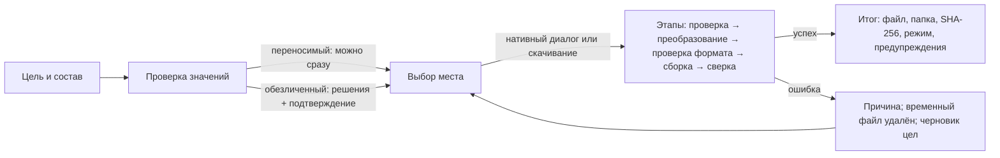

# P1-07 — экспорт, обезличивание и доверенный перенос

Статус: принято владельцем 25.10.2026 (решения по рекомендации). Это design specification, не реализованный экран. Реализация — P4-07 (экспорт и проверка значений), P4-08 (преобразование копии с сервера); доверенный перенос (P5-06) по решению O-011 в MVP не входит и перенесён после MVP (H3, ROADMAP F-09); библиотечные действия — P4-04, профили — P4-05.

Входы: формат `project/v2` и контейнер передачи (`docs/architecture/format_contract_v1_ru.md`, O-026), виджеты любых типов после P0-10 (O-034), правила DATA-ONLY ZIP и отсутствие отдельного manifest в MVP (O-021), владелец и доступ не переносятся (O-031), заявленная совместимость (O-029, вычисление — P0-09), страница как отдельный файл (O-027), выбор места сохранения (O-023, P1-01A §3), AGENTS.md §3 (переносимый файл не гарантированно обезличен; передача наружу — по правилам организации), P1-IN-02/03 (виды ссылок, статусы сопоставления), P1-01D/E (входы «Экспорт в файл…», «Сделать переносимой…»), P1-03 (импорт — проверка round-trip), P1-05 (роли и слоты), P1-11F (доступность).

Макеты (`docs/design/assets/13-export/`, только светлая тема, генератор `docs/design/tools/export_svg.py`):

| Файл | Подзадача | Экран |
|---|---|---|
| `13-01_P1-07A_export-goal.svg` | P1-07A/B/F | шаг «Цель и состав»: три цели, доверенный перенос недоступен (в MVP нет), что войдёт, что не входит никогда (включая профили и заготовки), заявленная совместимость, остаточный риск |
| `13-02_P1-07C_sensitive-review.svg` | P1-07C/D | шаг «Проверка значений»: найденные значения, замена на привязку к роли или псевдоним с «было — станет», подтверждение риска |
| `13-03_P1-07G_export-result.svg` | P1-07G/F | шаг «Сохранение»: этапы, файл, папка, контрольная сумма, режим, принятые предупреждения |
| `13-04_P1-07I_workcopy-convert.svg` | P1-07I | «Сделать переносимой»: корень, имя нового черновика, отчёт преобразования |

Экспорт — отдельный экран черновика (`/draft/:local_id/export`), путь из трёх шагов: **Цель и состав → Проверка значений → Сохранение**. Черновик при экспорте не меняется: все замены действуют на копию в памяти.

## P1-07A — цель передачи, состав и режим

| Цель (что выбирает пользователь) | Режим | Шаг «Проверка значений» |
|---|---|---|
| «Себе или коллегам в организации» | переносимый пакет | найденные значения показываются; замены необязательны |
| «Наружу: в Git, на форум, другой команде» | обезличенный пакет | замены предлагаются; каждое найденное значение получает решение; подтверждение риска обязательно |
| «На свою доверенную машину вместе с привязками» | доверенный перенос | в MVP отсутствует (решение O-011, P1-07E): показан недоступным с причиной и альтернативой |

- Ни один режим не выбран за пользователя по умолчанию, если ранее не было экспорта этого черновика; при повторном экспорте предлагается прошлый режим, кроме доверенного переноса.
- Что экспортируется: корень черновика целиком — панель или страница (страница — полноправный файл, O-027). Каталоги метрик, на которые ссылается черновик, добавляются автоматически; лишние не добавляются. Профили оформления и заготовки виджетов в пакет **не входят никогда**: они экспортируются из «Библиотеки» отдельными файлами (`zdashstitch.style-profile/v1`, `zdashstitch.widget-blueprint/v1`, P1-06C §5); черновик после применения профиля содержит обычные значения полей.
- Справа до продолжения: «Что войдёт» (файлы пакета с описанием), «Не входит никогда» и блок «Остаётся риск».
- **Заявленная совместимость** (O-029): по умолчанию — вычисленная по реестру P0-09 («Zabbix 7.4.0+ (вычислено)»); автор может только сузить диапазон; расширить за вычисленный — предупреждение `compatibility.declared_mismatch` (P0-09).

## P1-07B — переносимый пакет

| Состав | Когда |
|---|---|
| `project.yaml` (`zdashstitch.project/v2`) | всегда |
| `metrics/*.yaml` — ровно каталоги из `catalogs[]` | если черновик ссылается на каталоги |
| один файл `.yaml` вместо ZIP | черновик без каталогов (O-034) |

Не входит никогда: пароли, токены и данные входа; привязки к узлам сети этого компьютера (`local-bindings`, операции рабочей копии) и любые ID Zabbix; владелец и доступ; снимки, журнал, состояние публикации (`deployment-state`); исходные файлы экспорта шаблонов; профили оформления и заготовки виджетов (экспортируются из библиотеки отдельно, P1-06C); локальные метаданные о профилях (`profile-marks.json`, `blueprint-inserts.json`). Это совпадает с действующим контрактом (`format_contract_v1_ru.md`, «Контейнер передачи»); расширения схемы здесь нет.

Предупреждение всегда видно: «Переносимый пакет не гарантирует обезличивание…» (`export.scan.not_anonymous`). Слово «обезличенный» применяется только к режиму с заменами и только с оговоркой «не гарантированно».

## P1-07C — проверка чувствительных значений

Сканирование идёт локально в процессе приложения по копии черновика и каталогам; найденное не отправляется в сеть, не пишется в журнал и диагностику целиком (в отчёте — класс, место и замаскированный фрагмент).

| Класс | Где обычно встречается | Уверенность | Что предлагает обезличенный режим |
|---|---|---|---|
| имя узла сети | шаблоны узлов `svggraph` (`ds.N.hosts.N`), имена виджетов, фильтры виджетов неподдержанных типов | точно, если совпадает с узлом роли; иначе возможно | привязка к роли и слоту (лучший вариант) или псевдоним |
| маска узлов (`*`) | `svggraph`, `problemhosts` | возможно | псевдоним маски (`db-*`) или «оставить» |
| FQDN, IP, URL, путь | виджет «URL», тексты, поля строк | точно | псевдоним, «убрать виджет» или «оставить» |
| e-mail, имя пользователя | тексты, имена | точно / возможно | псевдоним или «оставить» |
| окружение и площадка (Prod, Pilot, имена ЦОД) | имена панели, страниц, виджетов | возможно (по словарю пользователя, P1-09G) | замена текста или «оставить» |
| ключ элемента данных и макрос | `metrics/*.yaml`, поля виджетов | возможно | только «оставить» или «убрать метрику/виджет»: изменение ключа ломает сопоставление |
| имена шаблонов и единицы | каталоги | возможно | «оставить» (обычно не чувствительны) |
| неизвестное поле или тип (O-034) | любые | не проверено | показывается; не изменяется |
| ID сервера | не должны встречаться | точно — ошибка | экспорт блокируется: это дефект преобразования; выход — «Убрать виджет из пакета» (виджет остаётся в черновике, в отчёте экспорта — строка «убран: найден ID сервера») (P1-11 G1b, M14) |

Таблица находок: значение (замаскировано при необходимости), класс и уверенность, место (объект → поле), решение. Фильтры «Все / Точно / Возможно / Не проверено». Значок и подпись дублируют цвет.

## P1-07D — обезличивание и параметризация

- **Привязка к роли** превращает шаблон узла сети в переносимую привязку (роль и слот, как в P1-05); это предпочтительная замена для узлов сети.
- **Псевдоним** — устойчивая замена значения (`pg-a-01` → `host-1`) во всех местах сразу; одинаковые значения объединяются, разные можно разделить вручную.
- **«Убрать виджет»** исключает объект из пакета (связи на него помечаются в итоге).
- **«Оставить как есть»** — осознанное решение; попадает в принятые предупреждения.
- Справа для выбранного значения — «Было — станет · N мест»; кнопка «Применить ко всем N».
- После замен пакет проверяется заново («Проверить пакет снова»): остаточные находки показываются тем же списком.
- «Далее: сохранение» доступно, когда по каждому точному значению принято решение и отмечено «Понимаю: пакет не гарантированно обезличен; передаю по правилам организации».
- Черновик не меняется; отдельная команда «Применить замены к черновику» в MVP не предлагается (можно сделать вручную в редакторе).

## P1-07E — доверенный перенос (решение O-011: в MVP нет)

**Решено (O-011, вариант 1):** в MVP контейнера доверенного переноса нет. Переносится только переносимый пакет; на другой машине узлы подбираются заново в «Привязках» по ролям. Ничего чувствительного не покидает машину, криптографии и ключей нет, мастер привязок уже спроектирован; цена — повторная привязка (минуты на панель). Зашифрованный контейнер (`project/v2` + `local-bindings` + по выбору снимки, без секретов; пароль → ключ, шифрование с проверкой целостности, manifest с хэшами) — направление после MVP (H3, ROADMAP F-09); незашифрованный контейнер отклонён. Задача P5-06 перенесена после MVP.

В интерфейсе режим виден и недоступен: подпись цели `export.goal.private` и подсказка `export.goal.private.hint` («Пока недоступно. Используйте переносимый пакет и заново привяжите узлы сети на другой машине.») — это единственный текст причины; прежний `export.mode.private_transfer_blocked` («…до утверждения защищённого формата») не используется (m-09). Внутренний номер решения в интерфейсе не показывается. При любом будущем варианте пароли, токены и данные входа не переносятся никогда; импорт контейнера — отдельный путь P1-03 с явной пометкой «доверенный».

## P1-07F — сводка, происхождение, лицензии и совместимость

По O-021 отдельного файла manifest в MVP-пакете нет. Сводка вычисляется при экспорте и показывается в итоге, а при импорте (P1-03D) — заново:

| Поле сводки | Пример |
|---|---|
| формат и версия приложения | `zdashstitch.project/v2`, ZDashstitch 0.1.0 |
| состав | 4 файла: `project.yaml`, 3 каталога |
| контрольные суммы | SHA-256 пакета и каждого файла |
| время и режим | 25.10.2026, 21:40; обезличенный, 4 замены |
| происхождение | «Локальная» / «мигрирован из v1» / «из копии с сервера» — без адреса сервера и ID |
| заявленная совместимость | Zabbix 7.4.0+ |
| нужные возможности | типы виджетов (для проверки при импорте по реестру получателя) |

Лицензии: пакет содержит пользовательские данные; лицензий ZDashstitch он не наследует, поле лицензии в MVP не пишется. Машиночитаемый `manifest.json` (поля выше + список замен без значений) — предложение для будущей версии контейнера вместе с O-011; изменение публичного контракта — отдельным решением.

## P1-07G — выполнение и результат

- Место — нативный диалог сохранения (O-023) или скачивание через браузер; путь браузеру не передаётся, в итоге показывается только имя файла и папка (локально).
- Перезапись существующего файла — только после подтверждения; иначе предлагается новое имя.
- Отмена возможна до атомарной записи (временный файл → `fsync` → переименование); после — нет.
- Ошибки: папка недоступна, нет места, имя занято, диалог недоступен (`dialog_*`), ошибка проверки формата (код `core`); временный файл удаляется, черновик не меняется.
- Итог: имя файла, папка, SHA-256 (сокращённо, полностью — в технических сведениях), режим, совместимость, принятые предупреждения; «Открыть папку», «Копировать отчёт». Пакет не открывается и не отправляется автоматически.

## P1-07I — преобразование копии с сервера в переносимый черновик

Вход: «Сделать переносимой для экспорта…» в «Черновиках» (02-01). Выбор корня: вся панель или одна страница. Имя нового черновика задаёт пользователь. Копия с сервера, её снимки и привязки не меняются.

| Что в копии | Что в новом черновике |
|---|---|
| конкретные узлы сети | роли и слоты: узлы группируются по набору шаблонов (подсказка имени роли — шаблон), порядок слотов — порядок узлов в копии; пользователь может переименовать роли |
| элементы данных (по ID) | метрики каталога по `key_` (P1-IN-03 `exact`); каталог — из библиотеки по шаблону-источнику |
| элементы данных по шаблону имени (`svggraph` `ds.N.items.N`, без `*`) | метрика каталога с тем же видимым именем (так сопоставляет фронтенд 7.4, P1-IN-02); нет такой метрики — «нужна привязка»; маски с `*` остаются строками (P1-11 G1b, M10) |
| элементы LLD | метрика-прототип; экземпляр выбирается при привязке |
| элементы без каталога | «нужна привязка» с подсказкой импортировать шаблон |
| классический график | «нужна привязка» к графику по имени |
| шаблоны узлов `svggraph`, равные имени узла | привязка к роли |
| маски узлов и шаблоны элементов | строки как есть; помечаются для проверки значений при экспорте |
| неизвестные типы и поля | как есть, с пометкой, без изменения (O-034) |
| связи между виджетами | как есть |
| владелец, доступ, снимки, журнал | не переносятся |

Происхождение нового черновика — `server_snapshot` без адреса, ID и имени подключения; цель публикации не задаётся (источник ≠ цель). Отчёт показывает все строки таблицы с количеством; всё неперенесённое видно и в «Проверках» нового черновика (P1-04F).

Записи применения профилей (`profile-marks.json`) и журнал вставок заготовок переносятся к новой локальной панели как локальные метаданные (они не входят в `project/v2`); профили и заготовки библиотеки при преобразовании не копируются и не нужны — виджеты содержат обычные значения полей. Сборка локальной панели из серверной страницы (P1-01I, решение 4) идёт через это же преобразование для одной страницы: узлы и элементы становятся «нужна привязка».

## P1-07H — handoff для P4-07, P4-08, P5-06 и проверки round-trip

| Команда | Предусловия | Успех | Ошибки (коды) |
|---|---|---|---|
| `export.prepare(local_id, goal)` | черновик сохранён | состав, исключения, вычисленная совместимость | `private_transfer_blocked` (цель «доверенный перенос» в MVP не поддерживается, O-011) |
| `export.scan` | подготовлено | находки (класс, уверенность, место, маска) | — |
| `export.decide(finding, decision)` | находка | решение и затронутые места | `alias_conflict`, `role_missing` |
| `export.rescan` | — | остаточные находки | — |
| `export.write(destination)` | все точные решены; подтверждение для обезличенного | этапы `scan/transform/validate/package/verify`, итог | `destination_unavailable`, `destination_exists`, `disk_full`, `dialog_*`, коды `core` |
| `convert.preview(local_id, root)` | копия с сервера | отчёт преобразования | — |
| `convert.run` | — | новый черновик `local_id` | коды `core` |

Round-trip (P1-03, для каждого режима):

- экспорт → импорт того же файла даёт черновик того же вида с тем же содержимым (с учётом замен) и тем же `declared_compatibility`;
- в пакете нет ни одного ID сервера, пароля, токена, `local-bindings`, владельца и доступа (отрицательный тест на каждый класс);
- обезличенный пакет при повторном сканировании не содержит заменённых значений;
- преобразование копии → экспорт → импорт: роли и слоты на месте, «нужна привязка» сохраняется;
- файл одной страницы импортируется отдельно и в составе сборки (P1-01I).

Доступность: шаги — ссылки в порядке табуляции; таблица находок — сетка; решения — группы переключателей; итог объявляется live-region; подтверждение риска — обычный флажок с подписью.

## Новые message IDs

Используются также существующие `export.*` из P1-00F (`export.title`, `export.mode.*` кроме `export.mode.private_transfer_blocked` — снят в пользу `export.goal.private.hint`, m-09; `export.scan.title`, `export.scan.not_anonymous`, `export.summary.files`, `export.action.save_portable`, `export.result.saved`), `drafts.action.export_file`, `drafts.action.make_portable`, `drafts.server_copy_export_hint`.

| ID | EN source | RU |
|---|---|---|
| `export.step.goal` | Goal and contents | Цель и состав |
| `export.step.review` | Value review | Проверка значений |
| `export.step.save` | Saving | Сохранение |
| `export.goal.title` | What is the export for | Для чего экспорт |
| `export.goal.internal` | For yourself or colleagues in your organisation | Себе или коллегам в организации |
| `export.goal.internal.hint` | A regular portable package. Host names, keys and texts stay as they are — share it under your organisation's rules. | Обычный переносимый пакет. Имена узлов сети, ключи и тексты остаются как есть — передавайте по правилам организации. |
| `export.goal.external` | Outside: Git, a forum, another team | Наружу: в Git, на форум, другой команде |
| `export.goal.external.hint` | A de-personalised package: found names and addresses are replaced with aliases or role bindings; you check every replacement. | Обезличенный пакет: найденные имена и адреса заменяются на псевдонимы или привязки к ролям; вы проверяете каждую замену. |
| `export.goal.private` | To your own trusted machine, with bindings | На свою доверенную машину вместе с привязками |
| `export.goal.private.hint` | Not available yet. Use a portable package and bind hosts again on the other machine. | Пока недоступно. Используйте переносимый пакет и заново привяжите узлы сети на другой машине. |
| `export.contents.included` | What is included | Что войдёт |
| `export.contents.never` | Never included | Не входит никогда |
| `export.contents.never.secrets` | passwords, tokens and sign-in data | пароли, токены и данные входа |
| `export.contents.never.bindings` | host bindings of this computer and Zabbix IDs | привязки к узлам сети этого компьютера и ID Zabbix |
| `export.contents.never.local_state` | dashboard owner and sharing, snapshots, operation journal | владелец и доступ панелей, снимки, журнал операций |
| `export.contents.never.sources` | original Zabbix template export files | исходные файлы экспорта шаблонов Zabbix |
| `export.contents.never.library_objects` | style profiles and widget blueprints (exported from the library separately) | профили оформления и заготовки виджетов (экспортируются из библиотеки отдельно) |
| `export.risk.title` | Remaining risk | Остаётся риск |
| `export.risk.body` | Widget and page names, host patterns in graphs, item keys and macros can reveal your infrastructure. They are found and shown on the next step; there is no anonymity guarantee. | Имена виджетов, страниц, шаблоны узлов в графиках, ключи элементов данных и макросы могут выдать вашу инфраструктуру. На следующем шаге они будут найдены и показаны; гарантии обезличивания нет. |
| `export.compat.computed` | Zabbix {range} (computed) | Zabbix {range} (вычислено) |
| `export.compat.hint` | Computed from widget types; you can narrow it manually. | Вычислено по типам виджетов; можно сузить вручную. |
| `export.scan.local_only` | Values are checked on this computer and are not sent anywhere. | Значения проверяются на этом компьютере и никуда не отправляются. |
| `export.scan.confidence.exact` | exact | точно |
| `export.scan.confidence.possible` | possible | возможно |
| `export.scan.confidence.unchecked` | not checked | не проверено |
| `export.scan.class.host` | host name | имя узла сети |
| `export.scan.class.host_mask` | host mask | маска узлов |
| `export.scan.class.url` | address (URL) | адрес (URL) |
| `export.scan.class.environment` | environment | окружение |
| `export.scan.class.key_part` | name in an item key | база в ключе |
| `export.scan.class.unknown_field` | unknown field | неизвестное поле |
| `export.scan.no_full_values` | Values are not stored in full in reports or the journal. | Значения в отчёте и журнале не сохраняются целиком. |
| `export.replace.title` | Replace {value} | Замена «{value}» |
| `export.replace.role` | Role binding | Привязка к роли |
| `export.replace.role.hint` | the series will look for hosts of the role — the best option for a host | ряд будет искать узлы роли — лучший вариант для узла сети |
| `export.replace.alias` | Alias | Псевдоним |
| `export.replace.keep` | Keep as is | Оставить как есть |
| `export.replace.remove_widget` | Remove widget | Убрать виджет |
| `export.replace.key_keep_only` | Changing an item key breaks matching: keep it or remove the widget. | Изменение ключа элемента данных ломает сопоставление: оставьте его или уберите виджет. |
| `export.replace.before_after` | {count, plural, one {Before — after · # place} other {Before — after · # places}} | {count, plural, one {Было — станет · # место} few {Было — станет · # места} many {Было — станет · # мест} other {Было — станет · # места}} |
| `export.replace.apply_all` | Apply to all {count} | Применить ко всем {count} |
| `export.replace.rescan` | Check the package again | Проверить пакет снова |
| `export.replace.draft_unchanged` | The draft does not change: replacements apply only to the package. | Черновик не меняется: замены действуют только на пакет. |
| `export.ack` | I understand: the package is not guaranteed to be anonymised; I share it under my organisation's rules. | Понимаю: пакет не гарантированно обезличен; передаю по правилам организации. |
| `export.stage.scan` | Value review | Проверка значений |
| `export.stage.transform` | Transformation | Преобразование |
| `export.stage.validate` | Format check | Проверка формата |
| `export.stage.package` | Building the package | Сборка пакета |
| `export.stage.verify` | Verification | Сверка |
| `export.result.mode_depersonalised` | de-personalised, {count, plural, one {# replacement} other {# replacements}} | обезличенный, {count, plural, one {# замена} few {# замены} many {# замен} other {# замены}} |
| `export.result.accepted_warnings` | {count, plural, one {Accepted warning: #} other {Accepted warnings: #}} | {count, plural, one {Принятое предупреждение: #} few {Принятые предупреждения: #} many {Принятых предупреждений: #} other {Принятые предупреждения: #}} |
| `export.result.not_sent` | The package was not sent anywhere and was not opened automatically. | Пакет не отправлялся в сеть и не открывался автоматически. |
| `export.action.open_folder` | Open folder | Открыть папку |
| `export.action.copy_report` | Copy report | Копировать отчёт |
| `export.error.destination_unavailable` | The folder is not available. Choose another place. | Папка недоступна. Выберите другое место. |
| `export.error.destination_exists` | A file with this name already exists. Replace it or choose another name. | Файл с таким именем уже есть. Замените его или выберите другое имя. |
| `export.error.disk_full` | Not enough disk space. Nothing was written. | Недостаточно места на диске. Ничего не записано. |
| `export.error.server_id_found` | A Zabbix ID was found in the package — this is a defect; export is blocked. | В пакете найден ID Zabbix — это дефект; экспорт заблокирован. |
| `convert.title` | Make {name} portable | Сделать «{name}» переносимой |
| `convert.subtitle` | A new local draft is created; the copy from server and its bindings stay as they are. | Создаётся новый локальный черновик; копия с сервера и её привязки остаются как есть. |
| `convert.root.dashboard` | The whole dashboard: {pages} pages, {widgets} widgets | Всю панель: страниц — {pages}, виджетов — {widgets} |
| `convert.root.page` | One page | Одну страницу |
| `convert.new_name` | New draft name | Имя нового черновика |
| `convert.provenance` | The new draft only remembers that it was made from a copy from server — without the server address, IDs or connection name. No publication target is set. | Новый черновик помнит только, что он сделан из копии с сервера — без адреса сервера, ID и имени подключения. Цель публикации не задаётся. |
| `convert.report.title` | Conversion report | Отчёт преобразования |
| `convert.report.hosts` | Hosts → roles and slots | Узлы сети → роли и слоты |
| `convert.report.items` | Items → catalog metrics: {by_key} by key, {by_name} by name | Элементы данных → метрики каталогов: по ключу — {by_key}, по имени — {by_name} |
| `convert.report.lld` | LLD items → prototype metric; instance chosen when binding | Элементы LLD → метрика-прототип; экземпляр — при привязке |
| `convert.report.no_catalog` | No catalog: «needs binding», import the template | Без каталога: «нужна привязка», импортируйте шаблон |
| `convert.report.classic_graphs` | Classic graphs: «needs binding» to a graph by name | Классические графики: «нужна привязка» к графику по имени |
| `convert.report.masks` | Host masks stay as strings; checked on export | Маски узлов остаются строками; проверка при экспорте |
| `convert.report.unknown` | Unknown fields and types: as is, marked, not editable | Неизвестные поля и типы: как есть, с пометкой, без изменения |
| `convert.report.profile_marks` | Profile and blueprint records: carried over as local metadata | Записи о профилях и заготовках: переносятся как локальные метаданные |
| `convert.report.not_transferred` | Owner, sharing and snapshots are not transferred | Владелец, доступ и снимки не переносятся |
| `convert.report.nothing_silent` | Nothing is lost silently: everything that did not become a role or a metric is marked and visible in Checks. | Ничего не теряется молча: всё, что не стало ролью или метрикой, помечено и видно в «Проверках». |
| `convert.action.create` | Create portable draft | Создать переносимый черновик |

Параметры `{name}`, `{value}` — пользовательские данные (значение маскируется по правилам P1-07C); `{range}` — технический; числа — целые, плюрализация ICU.

## Проверки приёмки P1-07

- Преобразование копии с сервера даёт полный отчёт о непереносимом; копия не меняется.
- Переносимый пакет совместим с действующим контрактом, не содержит секретов, ID сервера, привязок, владельца и доступа и не называется обезличенным.
- Обезличенный пакет показывает все замены и остаточный риск; продолжение — только с явным подтверждением.
- Доверенный перенос в MVP отсутствует (O-011) и не реализуется; профили и заготовки в пакет не попадают.
- Найденные значения не уходят в сеть и не попадают целиком в отчёты и журнал.
- Экспорт страницы — полноправный файл; заявленная совместимость по умолчанию вычислена.
- Внешняя передача требует человеческого решения по правилам организации; приложение ничего не отправляет само.
