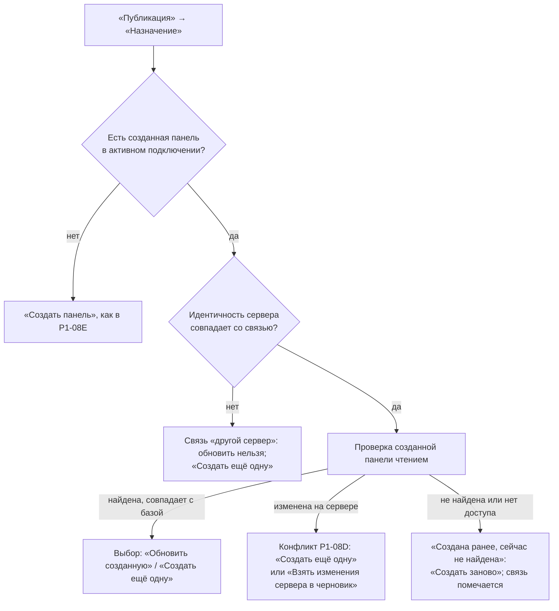

# P1-08 — дополнение: повторная публикация и выбор цели для добавления

Статус: принято владельцем 25.10.2026 в составе шлюза G1b (решение H5).

Входы: P1-08 (пять шагов «Публикации», одноразовый `VerifiedPlan`, ровно одна запись, повторное чтение), P1-01F §2 (операции и их статус в лаборатории), P1-01I (страницы), P1-03F («Создано из этой копии»), O-022 (связь рабочей копии с созданными панелями), `deployment-state/v1` (локальная связь черновика с опубликованным, `storage_scope: local_only`), O-031 (владелец и доступ), P1-IN-04 (append страниц и виджетов подтверждён: ID существующих сохраняются), P1-IN-11 (видимость и права), P0-09 (реестр возможностей).

## A. Повторная публикация черновика, уже создавшего панель

### A.1 Где хранится связь

| Вид черновика | Где хранится связь с созданной панелью | Что в ней | В переносимые файлы |
|---|---|---|---|
| Рабочая копия («Копия с сервера») | список созданных панелей рабочей копии (O-022) | подключение, `dashboardid`, отпечаток после повторного чтения, время | никогда |
| Локальный черновик панели | `deployment-state/v1` рядом с черновиком в хранилище приложения | `connection_id`, `server_identity_fingerprint`, версия сервера, `dashboardid`, отпечаток и страницы последнего подтверждённого состояния | никогда (`storage_scope: local_only`; экспорт P1-07 его не берёт) |
| Локальный черновик страницы | связь не ведётся: страница добавляется в чужую панель (раздел B), повторное добавление — новая операция | — | — |

Связь записывается только после итога «Проверено повторным чтением» или «Сверено: записано» (P1-08G). Снимок, прочитанный после записи, становится **базой** созданной панели для этого черновика: дальнейшие сравнения «На сервере: база → Zabbix сейчас» идут от него.

В «Черновиках» (02-01) блок «Создано из этой копии» показывается и для локальных черновиков с подписью «Создано из этого черновика» (одна строка на панель: имя, подключение, время, «проверено повторным чтением»).

### A.2 Выбор действия на шаге «Назначение»

Если у черновика есть созданная панель **в активном подключении**, шаг «Назначение» (компоновка 11-01/11-02) показывает выбор без варианта по умолчанию:

| Вариант | Когда доступен | Что произойдёт |
|---|---|---|
| «Обновить созданную панель «{dashboard_name}»» | подключение и идентичность сервера совпадают со связью; режим «Чтение-запись»; у учётной записи есть право записи панели | `dashboard.update` по базе созданной панели; передаются все страницы и `widgetid` (P1-IN-04); владелец и доступ не передаются, если их не меняли (O-031 п. 5) |
| «Создать ещё одну панель» | всегда при «Чтение-запись» | `dashboard.create`; новое имя обязательно; связь добавляется второй строкой |

Созданные панели в **других** подключениях показываются списком «Создано в других подключениях» только для справки: выбрать их целью нельзя (цель всегда в активном подключении, P1-08E).

### A.3 Свежесть, конфликт и пропажа

| Состояние созданной панели | Как обнаруживается | Что показывается | Выходы |
|---|---|---|---|
| совпадает с базой | чтение при открытии шага, перед подтверждением и перед записью (P1-08D) | «Созданная панель не менялась на сервере · проверено в {time}» | обновить; создать ещё одну |
| изменена на сервере | отпечаток ≠ базы | сравнение «На сервере: база → Zabbix сейчас» (11-05) | «Создать ещё одну»; «Взять изменения сервера в черновик» — новая база для этой связи и переигрывание правок как в P1-03E (07-02), без слияния молча; «Обновить поверх» недоступно (O-014) |
| не найдена или нет доступа | пустой ответ `dashboard.get` (P1-IN-08: «нет» и «нет прав» неразличимы) | «Создана ранее, сейчас не найдена или нет доступа» | «Создать заново» (новая связь); «Забыть связь» с подтверждением; черновик не меняется |
| другая идентичность сервера по тому же адресу | идентичность в профиле ≠ связи (P1-02D шаг 4) | «Связь относится к другому серверу» | только «Создать ещё одну»; связь остаётся для справки |
| незавершённая операция по этой цели | журнал (`Submitting`/`UnknownOutcome`) | баннер P1-01G §4 | сначала сверка или «Закрыть без сверки» |

Связь не удаляется автоматически ни в одном состоянии: пометка «не найдена» и «Забыть связь» — только действием пользователя.

### A.4 Что сравнивается

- «Мои изменения: база → черновик»: база — снимок созданной панели после записи; черновик — текущий локальный черновик, сопоставленный с ней по логическим ID страниц и виджетов, сохранённым в связи (`logical_id` → `widgetid`/`pageid`).
- «На сервере: база → Zabbix сейчас»: как в P1-08B.
- Виджет, добавленный в черновик после создания, — «Добавлен»; удалённый из черновика — «Удалён» (с явным подтверждением на шаге «Подтверждение», P1-08F).

## B. Выбор целевой панели и страницы для добавления

### B.1 Точки входа

| Действие | Откуда | Что выбрано заранее |
|---|---|---|
| «Добавить страницу в панель» | черновик страницы: «Обзор» (07-01, кнопка уже есть), «Публикация» → «Назначение»; «Структура» (08-01) — меню страницы | страница-источник |
| «Добавить виджеты на страницу» | редактор (12-01): выбранные виджеты → кнопка на панели инструментов «Добавить на страницу другой панели…» и пункт контекстного меню; «Структура» (08-01): выбранные строки виджетов → то же действие | набор виджетов (область действия, не вид черновика) |

Оба действия ведут в «Публикацию» с намерением `AppendPage`/`AppendWidgets`; на шаге «Назначение» открывается диалог выбора цели. Без подключения и в «Только чтение» действия видны и ведут в «Публикацию», где показаны требования (P1-01B §2).

### B.2 Диалог выбора целевой панели

Компоненты списка «Панели в Zabbix» (03-01) в диалоге:

| Колонка / элемент | Содержимое |
|---|---|
| Поиск, фильтры | по имени; «Все / Мои / Общие» |
| Имя, владелец, доступ | как в 03-01 («вы» / «другой пользователь», «Личная/Общая») |
| Страниц, виджетов | числа |
| Можно добавить | «да» — режим «Чтение-запись», право записи панели и подтверждённая операция append (P1-IN-04); «нет: только просмотр» — нет права записи; «нет: нужен режим «Чтение-запись»» |
| Исходная панель | панель, из которой взята страница или виджеты, помечена «источник»; выбрать её можно (добавление в ту же панель — явное решение), но подпись остаётся |

Пустой список — «Панели не найдены либо учётная запись не может их просматривать» (P1-IN-08). Панели других подключений не показываются.

### B.3 Выбор страницы и места (только `AppendWidgets`)

После выбора панели — список её страниц и предпросмотр выбранной страницы в пропорциях сетки (как 08-01): существующие виджеты — серым, добавляемые — пунктиром в первых свободных клетках (как 12-04). Пользователь может сменить место каждого добавляемого виджета клавиатурой или полями X/Y. Существующие виджеты **не сдвигаются никогда**; если свободного места нет — «На странице нет места для {count} виджетов» и выбор другой страницы или «Добавить новой страницей» (тогда это `AppendPage`).

Для `AppendPage` выбирается позиция новой страницы: «в конец» (по умолчанию) или после выбранной.

### B.4 Что на цели не меняется никогда

- Другие страницы панели, их порядок и периоды.
- Существующие виджеты: поля, геометрия, `widgetid`, связи (`reference`).
- Имя и свойства панели.
- Владелец и доступ: не передаются (O-031 п. 5).

Запрос — один `dashboard.update` со всеми страницами и всеми `widgetid` цели (P1-IN-04: непереданная страница удаляется, виджет без `widgetid` пересоздаётся — поэтому план всегда передаёт полный набор). Совпадающие `reference` добавляемых виджетов переименовываются вместе со всеми зависимыми (P1-01I §4); привязки узлов сети добавляемой страницы или виджетов разрешаются отдельно (P1-05), неразрешённая обязательная — блокировка P1-08C.

### B.5 Проверки и итог

Используются проверки P1-08C с двумя дополнениями: «Цель не изменилась после выбора» (отпечаток цели перед подтверждением и перед записью) и «Существующие виджеты цели не затронуты» (сравнение «Мои изменения» содержит только добавления). Итог после записи (P1-08G): «Добавлено: {count} …; остальное содержимое панели не изменилось» с проверкой повторным чтением, что прежние страницы и виджеты совпали с отпечатком до записи.

## C. Handoff

| Команда | Предусловия | Успех | Ошибки (коды) | Задача |
|---|---|---|---|---|
| `publication.links.list(local_id)` | черновик загружен | связи с созданными панелями (активное и другие подключения) | — | P5-04 |
| `publication.links.check(link)` | подключение | `current` / `changed` / `missing_or_denied` / `other_server` | `not_connected` | P5-04, P5-05 |
| `publication.links.forget(link)` | подтверждение | связь удалена локально | — | P5-04 |
| `publication.target.choose_existing(dashboardid)` | `read_write`; цель видима | цель выбрана, план недействителен | `target_not_writable`, `target_other_connection` | P5-03, P5-05 |
| `publication.target.choose_page(dashboardid, page)` | `AppendWidgets` | страница и предложенные места | `no_free_cells` | P5-03 |
| `publication.preview` для `UpdateCreated`, `AppendPage`, `AppendWidgets` | как P1-08H | как P1-08H; diff содержит только добавления для append | коды P1-08H | P5-02, P5-03, P5-05 |

Запись связи — только после `Verified`/`ReconciledVerified`; для локальных черновиков — атомарно в `deployment-state/v1` (O-018), для рабочих копий — в рабочей копии (O-022). Ни один из этих файлов не входит в экспорт (отрицательный тест P5-04).

## D. Новые message IDs

| ID | EN source | RU |
|---|---|---|
| `drafts.created_from_draft` | Created from this draft | Создано из этого черновика |
| `publication.republish.update_created` | Update the created dashboard {dashboard_name} | Обновить созданную панель «{dashboard_name}» |
| `publication.republish.create_another` | Create another dashboard | Создать ещё одну панель |
| `publication.republish.other_connections` | Created in other connections | Создано в других подключениях |
| `publication.republish.unchanged` | The created dashboard has not changed on the server · checked at {time} | Созданная панель не менялась на сервере · проверено в {time} |
| `publication.republish.missing` | Created earlier, now not found or not accessible | Создана ранее, сейчас не найдена или нет доступа |
| `publication.republish.other_server` | This link belongs to a different server | Связь относится к другому серверу |
| `publication.republish.take_server_changes` | Take server changes into the draft | Взять изменения сервера в черновик |
| `publication.republish.create_again` | Create again | Создать заново |
| `publication.republish.forget_link` | Forget link | Забыть связь |
| `publication.republish.forget_link.confirm` | Forget the link to {dashboard_name}? The dashboard on the server is not changed. | Забыть связь с панелью «{dashboard_name}»? Панель на сервере не изменится. |
| `publication.append.choose_dashboard` | Choose a target dashboard | Выберите целевую панель |
| `publication.append.choose_page` | Choose a page | Выберите страницу |
| `publication.append.can_add` | Can add | Можно добавить |
| `publication.append.cannot_view_only` | No: view only | Нет: только просмотр |
| `publication.append.needs_read_write` | No: read-write mode needed | Нет: нужен режим «Чтение-запись» |
| `publication.append.source_mark` | source | источник |
| `publication.append.position_end` | At the end | В конец |
| `publication.append.position_after` | After the page {page_name} | После страницы «{page_name}» |
| `publication.append.no_free_cells` | {count, plural, one {No room on this page for # widget} other {No room on this page for # widgets}} | {count, plural, one {На странице нет места для # виджета} few {На странице нет места для # виджетов} many {На странице нет места для # виджетов} other {На странице нет места для # виджета}} |
| `publication.append.as_new_page` | Add as a new page | Добавить новой страницей |
| `publication.append.untouched` | Other pages, existing widgets, dashboard properties, owner and sharing are not changed. | Другие страницы, существующие виджеты, свойства панели, владелец и доступ не изменяются. |
| `publication.append.result` | {count, plural, one {Added # widget; the rest of the dashboard did not change} other {Added # widgets; the rest of the dashboard did not change}} | {count, plural, one {Добавлен # виджет; остальное содержимое панели не изменилось} few {Добавлено # виджета; остальное содержимое панели не изменилось} many {Добавлено # виджетов; остальное содержимое панели не изменилось} other {Добавлено # виджета; остальное содержимое панели не изменилось}} |
| `editor.action.add_to_other_page` | Add to a page of another dashboard… | Добавить на страницу другой панели… |
| `publication.check.target_unchanged` | The target has not changed since it was chosen | Цель не изменилась после выбора |
| `publication.check.existing_untouched` | Existing widgets of the target are not affected | Существующие виджеты цели не затронуты |

Параметры `{dashboard_name}`, `{page_name}` — данные сервера; `{time}` — локализованное время. Дубликатов с реестром P1-00F §7 нет: префиксы `publication.republish.*` и `publication.append.*` ранее не использовались; `publication.target.*` не расширяется.

## Проверки приёмки

- Черновик, уже создавший панель, предлагает «Обновить созданную» и «Создать ещё одну» без варианта по умолчанию; обновление возможно только в том же подключении и на том же сервере.
- Изменённая на сервере созданная панель не перезаписывается; пропавшая не считается обновляемой; связь не удаляется молча.
- Связи с созданными панелями хранятся только локально и не попадают в экспорт.
- Для добавления страницы и виджетов цель выбирается явно в диалоге на компонентах 03-01; панель без права записи выбрать для записи нельзя.
- Существующие страницы и виджеты цели, её свойства, владелец и доступ не меняются; это проверяется повторным чтением после записи.
- Запись — один запрос через одноразовый план после пяти шагов «Публикации».
