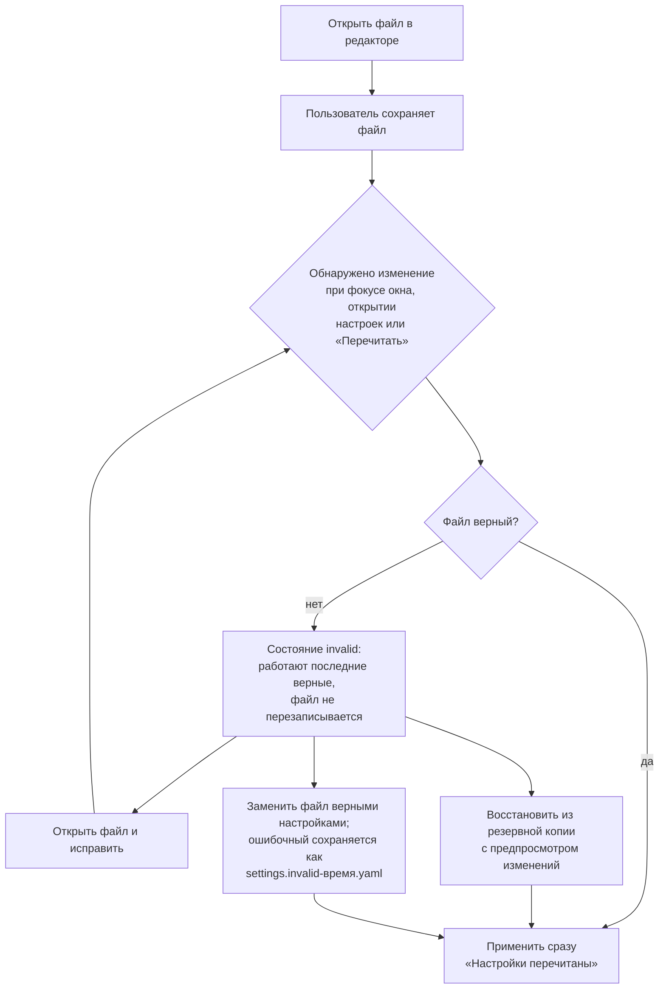

# P1-09B/C — файл настроек, язык, тема и доступность отображения

Статус: принято владельцем 25.10.2026. Это design specification, не реализованный экран. Реализация: минимальное хранение — P2-00E (сделано: `crates/application/src/settings.rs`, формат `zdashstitch-settings/v0`), полный GUI, импорт/экспорт и резервные копии — P4-06.

Входы: `docs/architecture/ui_i18n_theme_contract_v1_ru.md`, P1-00C (токены и темы), P1-00F (сообщения), P1-00G (доступность), P1-09A и принятый макет `06-settings/06-01_P1-09A_settings-appearance.svg`, O-018 (корень хранилища), O-032 (локальная сессия), ревью P2-00E от 25.10.2026 (окно потери файла при сохранении, сетевой корень хранилища).

Макеты (только светлая тема):

| Файл | Подзадача | Экран |
|---|---|---|
| `06-settings/06-01_P1-09A_settings-appearance.svg` (принят) | P1-09C | «Внешний вид»: язык, тема, анимация и контрастность, предпросмотр форматов, блок файла настроек |
| `06-settings/06-02_P1-09B_settings-file-error.svg` | P1-09B | «Общие» при ошибочном файле: работают последние верные настройки, ошибки по строкам, восстановление, резервные копии, перенос и сброс |

Генератор нового макета — `docs/design/tools/settings_yaml_svg.py`. Место пунктов «О программе» и «Завершить сеанс» решает P1-12; здесь они не проектируются.

## P1-09B — файл настроек и ручное редактирование

### Где файл и как его найти

| Платформа | Файл настроек | Корень хранилища по умолчанию |
|---|---|---|
| Windows | `%LOCALAPPDATA%\ZDashstitch\settings.yaml` | `%LOCALAPPDATA%\ZDashstitch` |
| Linux | `$XDG_CONFIG_HOME/zdashstitch/settings.yaml` (по умолчанию `~/.config/zdashstitch/`) | `$XDG_DATA_HOME/zdashstitch` (по умолчанию `~/.local/share/zdashstitch`) |

Путь виден в «Настройки → Общие» (полный локальный путь, моноширинным шрифтом) и коротко — в блоке «Файл настроек» каждого раздела (06-01). Действия: «Открыть файл» (системный редактор через локальный процесс, как нативный диалог O-023), «Открыть папку», «Копировать путь», «Перечитать». В отчётах и диагностике полный путь не показывается (`diagnostics.notice.sanitized`).

### Контракт ключей

Ключи и рабочие комментарии — английские; локализованные примеры — только в документации. Секретов в файле нет и быть не может: токены, пароли и сведения о сертификатах в настройки не входят (P1-09F, ADR-008).

```yaml
# ZDashstitch settings. Keys and comments are English on purpose.
# The application validates this file. If it is invalid, the last valid
# settings stay in use and this file is not overwritten.
# Comments you add are not kept when the application saves the file.
format: zdashstitch-settings/v0   # file format, do not change
locale: system                    # system | en | ru
theme: system                     # system | light | dark
reduced_motion: system            # system | reduce | no-preference
storage_root: 'C:\Users\me\AppData\Local\ZDashstitch'  # absolute local path, see P1-09D
```

- `locale` получает значение `system` (по умолчанию): язык берётся из браузера/системы с откатом на английский. Сейчас в P2-00E `locale` принимает только `en`/`ru` с умолчанием `en` — handoff ниже.
- Будущие разделы (`workspace`, `editor`, `export`, `diagnostics`) добавляют P1-09D/E/G; неизвестный ключ — ошибка, а не молчаливый пропуск (`deny_unknown_fields`). Переход на `v1` — вместе с P4-06 с явной миграцией.
- Значения перечислений — строчными латинскими словами, как в YAML; в интерфейсе показываются переведённые подписи.
- Лимит файла 64 КиБ; YAML без якорей и алиасов, без повторяющихся ключей (как строгий загрузчик форматов).

### Состояния файла

| Состояние | Когда | Что видит пользователь | Сохранение из интерфейса |
|---|---|---|---|
| `valid` | файл прочитан и прошёл проверку | обычный экран | сразу, атомарно |
| `missing` | файла нет (первый запуск) | умолчания; файл создаётся при первом изменении | создаёт файл |
| `invalid` | синтаксис YAML, неверное значение, неизвестный ключ, неверный формат, превышен размер | баннер (06-02): «Файл настроек содержит ошибки и не применён»; список ошибок «строка, столбец · ключ · причина»; работают последние верные настройки | только на время сеанса, с меткой «до перезапуска»; файл не перезаписывается |
| `changed_externally` | файл изменён вне приложения после последнего чтения | если новый файл верный — применяется, уведомление «Настройки перечитаны»; если нет — состояние `invalid` | см. конфликт ниже |
| `unreadable` | нет прав, путь занят символьной ссылкой или точкой повторной обработки | баннер с причиной и путём; работают умолчания или последние верные | недоступно, причина видна |

«Последние верные настройки» — копия последнего прошедшего проверку содержимого, которая держится в памяти и в резервных копиях; при запуске с ошибочным файлом используется самая свежая верная резервная копия, иначе умолчания (с явным баннером, а не молча).

### Поток редактирования и перечитывания



Изменение файла проверяется при открытии «Настроек», при возврате фокуса в окно, по «Перечитать» и перед каждым сохранением из интерфейса (отпечаток содержимого, оптимистичная проверка). Наблюдатель файловой системы не обязателен.

**Конфликт.** Если перед сохранением из интерфейса отпечаток файла не совпал с прочитанным, запись не выполняется: показывается «Файл настроек изменён вне приложения» с выбором «Перечитать файл» (изменение в интерфейсе отменяется, его значение видно в сообщении) или «Сохранить моё поверх» (внешняя версия уходит в резервные копии). Молча чужая правка не перезаписывается.

### Запись, резервные копии, перенос и сброс

- **Атомарная запись:** временный файл → `fsync` → одна замена поверх `settings.yaml` (на Linux плюс `fsync` каталога). Момента, когда `settings.yaml` нет на месте, быть не должно (находка ревью P2-00E). Права только владельца (Linux 0600; Windows — ACL профиля).
- **Резервные копии:** перед каждой записью предыдущая верная версия сохраняется; хранятся три последние верные версии с временем. «Восстановить» показывает, какие значения изменятся, и выполняется той же атомарной записью.
- **Экспорт настроек** сохраняет последние верные настройки в выбранный файл YAML (нативный диалог O-023 или загрузка через браузер). `storage_root` экспортируется с пометкой «путь этого компьютера»; при импорте он не применяется автоматически, а предлагается отдельно (перенос — P1-09D).
- **Импорт настроек** проверяет файл, показывает таблицу «параметр · сейчас · станет», заменяемая версия уходит в резервные копии. Неверный файл не импортируется и не применяется.
- **Сброс:** «Сбросить раздел» (в каждом разделе, 06-01) и «Сбросить все настройки…» (06-02). Перед сбросом — список параметров, которые вернутся к умолчаниям. Корень хранилища при сбросе не переносится и данные не удаляются; если сброс меняет корень, применяется только после подтверждения в P1-09D.
- **Сетевой корень хранилища** — решение владельца (ниже). Предлагается в MVP отклонять UNC-пути и сетевые диски (`storage_root_network`).

## P1-09C — язык, тема и доступность отображения

Экран — принятый макет 06-01. Правила применения:

| Настройка | Значения | Применение | Системное изменение |
|---|---|---|---|
| Язык | «Как в системе» (сейчас: …), English, Русский | сразу, без перезагрузки страницы и без потери введённого | при «Как в системе» новая системная или браузерная локаль применяется после перезапуска браузера/приложения (браузер не сообщает о смене); подсказка «применится после перезапуска» |
| Тема | «Как в системе», «Светлая», «Тёмная», «Высокая контрастность» (28.10.2026, O-038) | сразу, меняется только атрибут темы | при «Как в системе» переключение темы ОС — сразу; «Высокая контрастность» от ОС не зависит |
| Уменьшить анимацию | флажок поверх системного: «Как в системе: выключено/включено» | сразу | системное изменение — сразу, если не задано явно |
| Высокая контрастность | 28.10.2026, решение владельца O-038: тема «Высокая контрастность» в группе «Тема» (P1-00C §3.1); режим контрастности системы (`forced-colors`) тоже учитывается | сразу | сразу; токены уступают системным цветам |

- **28.10.2026, решение владельца O-038 (P2-00G).** В блоке «Движение и контраст» строка «Высокая контрастность» вместо «отдельного переключателя нет» поясняет, что тема выбирается в группе «Тема», а режим контрастности системы важнее любой темы (`settings.contrast.note`); макет 06-01 не перерисовывается. Сообщение `settings.contrast.system_only` не вводится.
- **Предпросмотр форматов** показывает дату и время, число и множественное число для выбранного языка (06-01: «25.10.2026, 14:30», «1 234 567,8», «5 виджетов · 1 страница · 22 виджета»). Он же — проверка, что форматирование по языку работает (находка ревью P2-00: сейчас числа и даты не форматируются).
- **Тема интерфейса и профиль оформления (`StyleProfile`, P1-06) не смешиваются:** тема меняет только приложение, не оформление виджетов на панели (подпись в 06-01).
- **Неполный каталог языка.** Для выпускаемых `en` и `ru` полнота проверяется при сборке (P2-00A), поэтому в работе пропусков нет. Для экспериментального языка недостающая строка показывается на английском; в «Диагностике» — «Строк без перевода: {count}». Пользовательские и серверные данные не переводятся никогда.
- **Недоступный язык или повреждённый каталог:** откат на английский с баннером «Не удалось загрузить язык {locale}; используется английский».
- **Длинные тексты.** Подписи переносятся, а не обрезаются; кнопки растут по высоте; проверка — набор P1-00F §5 на 200 % масштаба (P1-11F).
- **`lang` документа** выставляется по выбранному языку (находка ревью P2-00: сейчас захардкожен `ru`).
- **Восстановление умолчаний:** «Сбросить раздел» возвращает «Как в системе» для языка, темы и анимации.

## Handoff для P2-00E и P4-06

| Команда | Предусловия | Успех | Ошибки (коды) |
|---|---|---|---|
| `settings.get` | — | значения, состояние файла, путь, время последнего верного чтения, отпечаток | `settings_unreadable` |
| `settings.set` | состояние `valid`/`missing`; отпечаток совпадает | значение сохранено атомарно; событие `settings.changed` | `settings_changed_externally`, `settings_invalid_value`, `settings_write_failed` |
| `settings.set_session` | состояние `invalid` | значение применено до перезапуска | — |
| `settings.reload` | — | `valid` + применено / `invalid` + список ошибок `{line, column, key, code, params}` | — |
| `settings.backups.list` / `restore` | — | список; восстановление с предпросмотром изменений | `settings_backup_invalid` |
| `settings.replace_with_last_valid` | `invalid` | ошибочный файл сохранён как `settings.invalid-<время>.yaml`, записаны последние верные | `settings_write_failed` |
| `settings.export` / `import` | выбор файла (O-023) | файл / таблица изменений, затем запись | `settings_import_invalid` |
| `settings.reset` | раздел или всё | список изменившихся параметров | — |
| `settings.open_file` / `open_folder` | — | системное приложение открыто | `open_unavailable` |

Изменения к P2-00E (передать Codex): `locale: system` и умолчание `system`; атомарная замена без окна потери файла; при ошибочном файле — последние верные из резервной копии вместо молчаливых умолчаний; ошибки проверки — с номером строки, столбцом и ключом; запрет повторяющихся ключей; при принятии решения ниже — отказ на сетевой `storage_root`. UI не читает и не пишет файл напрямую, только через команды приложения. Ответы — коды и параметры, не готовый текст.

Доступность: баннер ошибки файла — `role="alert"` один раз при появлении; список ошибок связан с кнопкой «Открыть файл»; результат «Перечитать» объявляется live-region; переключатели языка и темы — группы радиокнопок со стрелками.

## Решения владельца

1. **Сетевой корень хранилища.** Предложение: в MVP запрещён (UNC `\\server\share`, сетевые диски Windows, сетевые файловые системы Linux при распознаваемости): журнал публикации O-018 полагается на `fsync` и атомарную замену, которые сетевые ФС не гарантируют, а данные с именами узлов сети могли бы оказаться в общей папке. Код ошибки `storage_root_network`. Альтернатива — разрешить с предупреждением.
2. **Комментарии пользователя в файле.** Предложение: приложение пишет файл по шаблону с английскими комментариями; добавленные пользователем комментарии при сохранении из интерфейса не сохраняются (так сказано в заголовке файла). Альтернатива — сохранять комментарии, что требует отдельного редактора YAML с сохранением форматирования.
3. **Изменения при ошибочном файле.** Предложение: действуют только до перезапуска (метка «до перезапуска»), файл не перезаписывается. Альтернатива — запретить изменения, пока файл не исправлен.

## Новые message IDs

Используются также `settings.title`, `settings.appearance.title`, `settings.theme.*`, `settings.language.title`, `settings.storage.title`, `settings.result.reloaded` (P1-00F).

| ID | EN source | RU |
|---|---|---|
| `settings.general.title` | General | Общие |
| `settings.general.subtitle` | Settings file, backups, transfer and reset. | Файл настроек, резервные копии, перенос и сброс. |
| `settings.language.system` | As in the system | Как в системе |
| `settings.language.current` | now: {language} | сейчас: {language} |
| `settings.language.after_restart` | Applies after restarting the browser or the application | Применится после перезапуска браузера или приложения |
| `settings.motion.title` | Motion and contrast | Движение и контраст |
| `settings.motion.reduce` | Reduce animation | Уменьшить анимацию |
| `settings.motion.system_state` | As in the system: {state} | Как в системе: {state} |
| `settings.contrast.system_only` | Taken from system settings; there is no separate switch. | Берётся из настроек системы; отдельного переключателя нет. |
| `settings.formats.title` | Format preview | Предпросмотр форматов |
| `settings.theme.not_widgets` | The interface theme does not change how widgets look on the dashboard. | Тема интерфейса не меняет оформление виджетов на панели. |
| `settings.data_not_translated` | Dashboard names, hosts and other Zabbix data are not translated. | Имена панелей, узлов сети и другие данные из Zabbix не переводятся. |
| `settings.file.title` | Settings file | Файл настроек |
| `settings.file.hint` | Settings are stored in a YAML file that you can edit by hand. An invalid file is not applied. | Настройки хранятся в YAML-файле, его можно править вручную. Ошибочный файл не применяется. |
| `settings.file.open` | Open file | Открыть файл |
| `settings.file.open_folder` | Open folder | Открыть папку |
| `settings.file.copy_path` | Copy path | Копировать путь |
| `settings.file.reload` | Reload | Перечитать |
| `settings.file.format` | Format | Формат |
| `settings.file.last_valid` | Last valid | Последнее верное |
| `settings.file.changed_outside` | {time}, outside the application | {time}, вне приложения |
| `settings.file.invalid.title` | The settings file has errors and was not applied | Файл настроек содержит ошибки и не применён |
| `settings.file.invalid.body` | The last valid settings from {time} are in use. Until the file is fixed, changes made in the interface are not saved: the invalid file is not overwritten. | Работают последние верные настройки (прочитаны {time}). Пока файл не исправлен, изменения в интерфейсе не сохраняются: файл с ошибкой не перезаписывается. |
| `settings.file.invalid.location` | Line {line}, column {column} | Строка {line}, столбец {column} |
| `settings.file.invalid.content_not_logged` | The file text is not saved in reports or the journal; only line, key and reason are shown. | Текст файла в отчётах и журнале не сохраняется; показаны только строка, ключ и причина. |
| `settings.file.replace_with_valid` | Replace the file with valid settings… | Заменить файл верными настройками… |
| `settings.file.invalid_kept` | The invalid file is not deleted: it is saved next to it as {file_name}. | Ошибочный файл не удаляется: он сохранится рядом как {file_name}. |
| `settings.file.session_only` | until restart | до перезапуска |
| `settings.file.changed_externally.title` | The settings file was changed outside the application | Файл настроек изменён вне приложения |
| `settings.file.changed_externally.reload` | Reload the file | Перечитать файл |
| `settings.file.changed_externally.keep_mine` | Save mine over it | Сохранить моё поверх |
| `settings.backups.title` | Backups | Резервные копии |
| `settings.backups.latest_valid` | latest valid | последняя верная |
| `settings.backups.restore` | Restore | Восстановить |
| `settings.transfer.title` | Transfer and reset | Перенос и сброс |
| `settings.transfer.export` | Export settings… | Экспорт настроек… |
| `settings.transfer.import` | Import settings… | Импорт настроек… |
| `settings.transfer.preview_changes` | Setting · now · becomes | Параметр · сейчас · станет |
| `settings.transfer.storage_root_local` | path of this computer | путь этого компьютера |
| `settings.reset.section` | Reset section | Сбросить раздел |
| `settings.reset.all` | Reset all settings… | Сбросить все настройки… |
| `settings.reset.preview` | These settings return to defaults: {settings} | Вернутся к значениям по умолчанию: {settings} |
| `settings.reset.no_data_removed` | The storage root is not moved and no data is deleted. | Корень хранилища не переносится, данные не удаляются. |
| `settings.locale.fallback` | Could not load the {locale} language; English is used. | Не удалось загрузить язык {locale}; используется английский. |
| `settings.locale.untranslated_count` | Strings without translation: {count} | Строк без перевода: {count} |
| `errors.settings.invalid_value` | The value {value} is not supported for {key}; allowed: {allowed}. | Значение «{value}» для {key} не поддерживается; допустимо: {allowed}. |
| `errors.settings.unknown_key` | Unknown key {key}: there is no such setting in format {format}. | Неизвестный ключ {key}: в формате {format} такого параметра нет. |
| `errors.settings.path_not_absolute` | The path must be absolute: {path} | Путь должен быть абсолютным: «{path}» |
| `errors.settings.storage_root_network` | Network folders cannot be the storage root. | Сетевую папку нельзя сделать корнем хранилища. |
| `errors.settings.yaml_syntax` | The file is not valid YAML. | Файл не является корректным YAML. |
| `errors.settings.unreadable` | The settings file cannot be read: {reason} | Файл настроек не читается: {reason} |

Параметры `{key}`, `{format}`, `{file_name}` — технические; `{value}`, `{path}` — данные пользователя; `{time}`, `{count}`, `{line}`, `{column}` — по правилам языка; `{reason}`, `{settings}`, `{state}`, `{language}` — message ID или их список.

## Проверки приёмки

- Путь к файлу находится без документации; «Открыть файл», «Перечитать» и восстановление доступны из «Общих».
- Ошибочный файл не применяется и не перезаписывается; работают последние верные настройки, ошибки показаны строкой, ключом и причиной.
- Внешняя правка не теряется молча: конфликт предлагает выбор.
- Запись атомарная, резервные копии восстанавливаются с предпросмотром; секретов в файле нет.
- Язык, тема и анимация применяются сразу без потери введённого; системная смена языка — после перезапуска с подсказкой; высокая контрастность — тема приложения и режим системы, режим системы важнее (O-038, 28.10.2026).
- Тема интерфейса не меняет оформление виджетов; форматы дат, чисел и множественного числа соответствуют языку.
