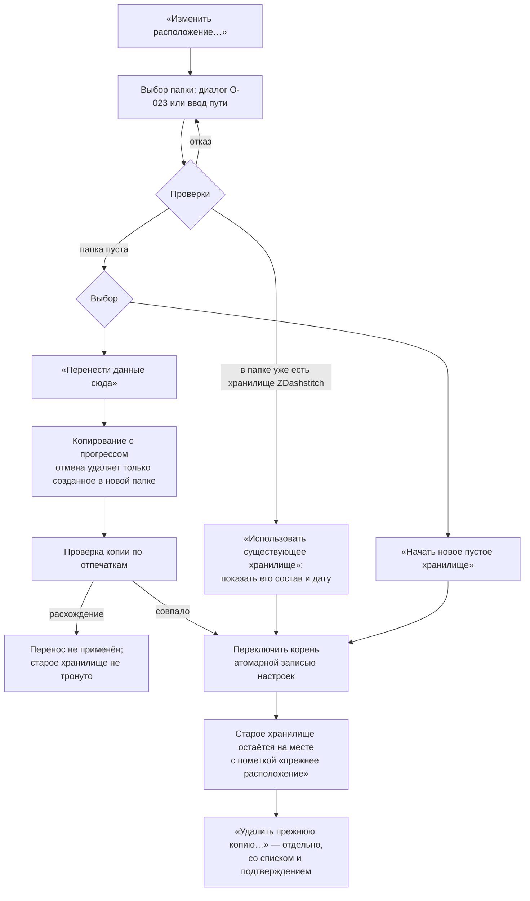

# P1-09D—H — рабочие каталоги, редактор, подключения, политики и Settings API

Статус: принято владельцем 25.10.2026 (решения по рекомендации); S-1 в части сетевого корня пересмотрен владельцем 25.10.2026 — см. ниже. Это design specification, не реализованный экран. Реализация — P4-06 (настройки и хранилище), P2-00E (минимальное хранение, уже есть), P2-01 (профили и хранилище учётных данных), P2-SEC-01E («Завершить сеанс»), P6-02 (пакет для поддержки).

Входы: P1-09A (разделы, 06-01), P1-09B/C (файл настроек `zdashstitch-settings`, 06-02, решения: сетевой корень запрещён, комментарии не сохраняются, правки при ошибочном файле — до перезапуска), P1-12 («О программе», «Завершить сеанс» в «Безопасность и экспорт»), P1-04F/G (автосохранение по умолчанию: 2 с паузы / 30 с правки; отмена после повторного открытия — только у рабочей копии), P1-04I (синтетика — настройка вида на время сеанса), P1-02 (профили, вход, сертификаты), P1-07 (экспорт, проверка чувствительных значений), O-011, O-018 (структура хранилища), O-023 (выбор папки нативным диалогом), O-032, P1-11F (доступность).

Макеты (`docs/design/assets/06-settings/`, только светлая тема, генератор `docs/design/tools/settings_rest_svg.py`):

| Файл | Подзадача | Экран |
|---|---|---|
| `06-03_P1-09D_storage-move.svg` | P1-09D | «Рабочие каталоги»: хранилище, размеры, автосохранение и диалог переноса корня хранилища |
| `06-05_P1-09G_security-export.svg` | P1-09G, O-032 | «Безопасность и экспорт»: «Завершить сеанс», политика экспорта, неотключаемые подтверждения, приватность |
| `06-06_P1-09G_diagnostics.svg` | P1-09G | «Диагностика»: уровень и срок хранения, пакет для поддержки с предпросмотром состава |

«Редактор» (P1-09E) и «Подключения и сертификаты» (P1-09F) описаны текстом: их компоновка повторяет 06-01 (переключатели и группы) и 05-01 (карточки профилей).

## Области действия (P1-09A)

| Область | Где хранится | Что в ней | Пример |
|---|---|---|---|
| Глобальная | `settings.yaml` | все настройки этого документа | язык, тема, автосохранение, политика экспорта |
| Сеанс | память процесса и браузера | значения, которые не должны переживать перезапуск | режим «Чтение-запись», галка синтетики (P1-04I), правки при ошибочном файле настроек (P1-09B), цель и план публикации |
| Вид черновика | локальные метаданные черновика в хранилище, не в переносимом файле | состояние интерфейса, а не настройки | последняя открытая страница и масштаб редактора |

Переопределений настроек на уровне отдельного черновика (`dashboard_project`, `page_project`, `workcopy`) в MVP нет: одинаковое поведение для всех черновиков проще и предсказуемее. Общей области «проект» нет (O-025). Если переопределение понадобится, оно добавляется только для конкретного ключа с показом «Для этого черновика: …» и не попадает в переносимый файл.

## P1-09D — рабочие каталоги, автосохранение и восстановление

**Один корень хранилища.** Всё локальное лежит под `storage_root` по структуре O-018: черновики, рабочие копии, снимки, журнал, библиотека (каталоги метрик, страницы, подсказки предпросмотра P1-04I), доверенные сертификаты УЦ (P2-01C). Отдельно выбирать каталоги черновиков или журнала нельзя: разнесённые части ломали бы связи «копия → снимок → журнал». Файл настроек — вне корня (P1-09B).

Раздел «Рабочие каталоги» (макет 06-03) показывает:

| Строка | Содержание |
|---|---|
| Корень хранилища | полный локальный путь моноширинным шрифтом, «Открыть папку», «Копировать путь», «Изменить расположение…» |
| Состав | «Черновики», «Рабочие копии», «Снимки», «Журнал операций», «Библиотека» — число объектов и размер |
| Место | занято хранилищем, свободно на диске; предупреждение при свободном месте меньше 500 МБ или меньше двойного размера хранилища |
| Состояние | «Доступно» / «Недоступно: {reason}» / «Только чтение: нет прав на запись» |

**Проверка нового расположения** (выбор папки — нативный диалог O-023, резерв — ввод пути):

| Проверка | Отказ (код) |
|---|---|
| путь абсолютный, локальный диск | `path_not_absolute`, `storage_root_network` (решение P1-09B) |
| нет символьных ссылок и точек повторной обработки в пути | `storage_root_linked` |
| папка доступна для записи (пробный файл создаётся и удаляется) | `storage_root_not_writable` |
| это не текущий корень и не папка внутри него, и текущий корень не внутри неё | `storage_root_nested` |
| папка пуста, или в ней уже есть хранилище ZDashstitch (по файлу-метке `zdashstitch-storage.json`), или в ней чужие файлы | чужие файлы — `storage_root_not_empty` (выбрать пустую папку) |
| хватает места для переноса: размер хранилища + 10 % | `storage_root_no_space` с числами |
| нет незавершённой операции журнала (`Submitting`, `UnknownOutcome`) | `storage_move_blocked_journal`: сначала сверка (P1-01G) |
| нет несохранённых изменений в открытых черновиках | предупреждение с «Сохранить все»; перенос не начинается, пока не сохранено |

**Поток смены расположения:**



- Данные никогда не удаляются молча: после переноса прежняя копия остаётся; удалить её можно только отдельным действием с перечнем папок и размером. Удаление ограничено прежним корнем хранилища.
- «Начать новое пустое хранилище» и «Использовать существующее» не копируют и не удаляют данные: прежние черновики остаются в прежнем месте и снова видны, если вернуть прежний корень.
- Переключение корня — одна атомарная запись `storage_root` в настройки; при сбое переключения работает прежний корень.
- Во время переноса правка черновиков и публикация недоступны; чтение и настройки доступны.

**Хранилище недоступно при запуске** (съёмный диск, нет прав): баннер «Хранилище недоступно: {reason}», «Черновики» и «Библиотека» показывают пустое состояние с той же причиной; действия «Повторить», «Выбрать другое расположение…» (поток выше, без копирования). Автоматического переключения на расположение по умолчанию нет — иначе появилось бы второе хранилище с пустыми черновиками, которое легко принять за потерю данных.

**Очистка.** «Очистить неиспользуемое…» показывает, что будет удалено, с размером: снимки, на которые не ссылаются копии и журнал (O-018 §5); завершённые записи журнала старше срока хранения (по умолчанию 90 дней); временные файлы прерванных записей. Никогда не удаляются: черновики, рабочие копии, незавершённые операции журнала, библиотека. Ничего не удаляется автоматически, кроме временных файлов прерванных записей и завершённых записей журнала публикации старше срока хранения — те и другие при запуске (изменено 28.10.2026 решением владельца, OPEN_DECISIONS «Вопросы 28.10.2026 (вечер)», п. 12).

**Автосохранение** (блок в «Рабочих каталогах», макет 06-03; поведение — P1-04G): «Автосохранение» включено по умолчанию; «Сохранять не реже чем раз в 30 / 60 / 120 секунд» (пауза 2 с — постоянная). При выключении — предупреждение, что несохранённые изменения пропадут при сбое, и индикатор «Изменена» в шапке черновика становится заметнее. Восстановление после сбоя — P1-04G §4.

## P1-09E — поведение редактора и подтверждения

| Настройка | Значения | По умолчанию | Где действует |
|---|---|---|---|
| Масштаб при открытии | «По ширине», «100 %» | «По ширине» | редактор (P1-04A) |
| Показывать сетку | да / нет | да | холст |
| Показывать линейки | да / нет | да | холст |
| Шаг перемещения с Shift | 6 ячеек (постоянный) | — | P1-04E: стрелки — 1 ячейка |
| Привязка к сетке | всегда (геометрия только целыми ячейками, P1-04A) — не настройка | — | — |

**Подтверждения:**

| Действие | Подтверждение | Можно отключить |
|---|---|---|
| удалить виджет | нет (отменяется Ctrl+Z) | можно включить «Спрашивать при удалении виджета» |
| удалить страницу | да, с числом виджетов | да |
| массовое действие (несколько виджетов, «Принять точные») | да, с числом объектов | да |
| сбросить раздел или все настройки | да, со списком параметров | **нет** |
| разрешить запись панелей (05-04) | да | **нет** |
| подтвердить запись в Zabbix (11-06) | да, одноразовый план | **нет** |
| «Закрыть без сверки» (P1-01G) | да | **нет** |
| экспорт: проверка чувствительных значений (P1-07) | да | **нет** |
| перенос и удаление хранилища (P1-09D) | да | **нет** |
| «Завершить сеанс» | да | **нет** |

Неотключаемые подтверждения в интерфейсе показаны строкой с замком и подписью «Нельзя отключить: защищает данные или сервер». «Сбросить раздел» в «Редакторе» показывает, какие из этих параметров вернутся к умолчаниям.

## P1-09F — подключения, хранилище учётных данных и сертификаты

Раздел «Подключения и сертификаты» — обзор, а не второй редактор: правка, проверка и вход ведут в P1-02 (05-02, 05-03).

**Профили** — карточки как в 05-01: имя, адрес, последняя проверенная версия и время, способ входа, где хранится секрет. Режим после подключения всегда «Только чтение» и настройкой не является (P1-02E).

| Секрет | Что видно | Действия |
|---|---|---|
| API-токен в системном хранилище | «Токен сохранён в системном хранилище» | «Забыть токен» — с пояснением, что токен не отзывается на сервере (`connection.forget_token.not_revoked`) |
| токен только в памяти | «Токен не сохраняется» | — |
| пароль | «Пароль не сохраняется» | — |
| системное хранилище недоступно или заблокировано | «Системное хранилище недоступно: {reason}» / «заблокировано» | «Повторить»; подключение возможно с вводом токена на сеанс |
| запись отсутствует (удалена вне приложения) | «Сохранённый токен не найден» | «Войти» (P1-02C1) |

**Доверенные сертификаты УЦ** — список файлов, добавленных в профилях (P1-02F, хранятся в хранилище приложения): кому выдан, кем, срок действия, отпечаток SHA-256 (сокращённо, полностью — в «Технических сведениях»), какие профили используют. Истекающий в течение 30 дней — предупреждение; истёкший — «Недействителен по сроку». «Убрать сертификат…» показывает профили, которые его используют: у них проверка TLS вернётся к системному хранилищу и потребует повторной проверки (P1-02G). Удаление профиля здесь не выполняется — только в редакторе профиля (05-02), и подтверждение говорит, что серверные токены не отзываются.

**Правила скрытия:** ни на экране, ни в буфере обмена, ни в диагностике нет токена, пароля, содержимого сертификата и закрытых ключей. Адрес сервера копируется только явным действием в редакторе профиля; в пакет для поддержки — только по флажку (P1-09G). Хранилище учётных данных интерфейс не читает: состояние приходит от приложения кодом.

## P1-09G — политики экспорта, приватности и диагностики

**Экспорт** (макет 06-05; сам поток — P1-07):

| Настройка | Значения | По умолчанию |
|---|---|---|
| Папка для экспорта | «Спрашивать каждый раз» (диалог открывается в последней использованной папке сеанса) / выбранная папка | «Спрашивать каждый раз» |
| Если файл уже есть | «Спросить» / «Сохранить под новым именем» | «Спросить» |
| Вид пакета | «Переносимый пакет только с данными» — единственный вариант | — |
| Доверенный перенос | недоступен до утверждения формата (O-011), назначить по умолчанию нельзя | — |
| Проверка чувствительных значений перед экспортом | всегда, нельзя отключить | — |

Молча существующий файл не перезаписывается ни при какой настройке. Настройки не отменяют требование согласовать передачу файла по правилам организации (`export.scan.not_anonymous`).

**Приватность:** у ZDashstitch нет телеметрии и отправки данных в сеть; приложение обращается только к серверам Zabbix из профилей подключений. Это строка-утверждение без переключателя.

**Сессия:** «Завершить сеанс» (O-032, P1-01G §5, решение P1-12) — в этом разделе, с подтверждением; недоступна во время этапа записи.

**Диагностика** (макет 06-06):

| Настройка | Значения | По умолчанию |
|---|---|---|
| Подробность журнала приложения | «Обычная» (коды, этапы) / «Подробная» (плюс время этапов и счётчики) | «Обычная» |
| Хранить журнал приложения | 1–30 дней | 7 дней |

Ни на каком уровне в журнал приложения не попадают секреты, тела ответов сервера, содержимое файлов и полные локальные пути (`diagnostics.notice.sanitized`).

**Пакет для поддержки** (реализация P6-02) создаётся только по действию пользователя и сохраняется локально (диалог O-023 или скачивание); никуда не отправляется.

| Входит | Не входит никогда | Только по флажку (выключен) |
|---|---|---|
| версия и сборка, ОС и платформа, версия формата настроек, адаптер и проверенная версия Zabbix | пароли, токены, сертификаты, cookie сессии | адреса серверов из профилей |
| настройки без пути хранилища (путь заменён на `<storage_root>`) | имена панелей, страниц, узлов сети, элементов данных, пользователей | — |
| коды ошибок и этапы из журнала приложения за срок хранения | содержимое черновиков, снимков, файлов импорта и экспорта | — |
| состояния операций журнала публикации (код, время, итог) без имён и ID сервера | тела запросов и ответов Zabbix | — |
| счётчики хранилища (число объектов, размеры) | полные локальные пути | — |

Перед сохранением показывается предпросмотр списка файлов пакета и их содержимого. Имя файла по умолчанию: `zdashstitch-support-<дата>.zip`.

## P1-09H — Settings API и handoff

**Ключи файла настроек.** Ключи P1-09B (`format`, `locale`, `theme`, `reduced_motion`, `storage_root`) остаются. Новые ключи этого документа добавляются в формат `zdashstitch-settings/v1` вместе с P4-06; при чтении `v0` отсутствующие разделы получают умолчания, файл переписывается в `v1` только при первом сохранении из интерфейса (с резервной копией `v0`).

```yaml
format: zdashstitch-settings/v1
# ... keys from v0 unchanged ...
workspace:
  journal_retention_days: 90       # 30..365; unfinished operations are never removed
editor:
  autosave: on                     # on | off
  autosave_max_interval_s: 30      # 30 | 60 | 120 (2 s pause is fixed)
  default_zoom: fit_width          # fit_width | actual_size
  show_grid: true
  show_rulers: true
  confirm_delete_widget: false
  confirm_delete_page: true
  confirm_bulk_apply: true
export:
  default_directory: ''            # empty = ask every time
  on_existing_file: ask            # ask | new_name
diagnostics:
  level: normal                    # normal | detailed
  retention_days: 7                # 1..30
```

Новые ключи: `show_mascot` (P1-10, решение M-1; по умолчанию `true`), `workspace.journal_retention_days`, `editor.autosave`, `editor.autosave_max_interval_s`, `editor.default_zoom`, `editor.show_grid`, `editor.show_rulers`, `editor.confirm_delete_widget`, `editor.confirm_delete_page`, `editor.confirm_bulk_apply`, `export.default_directory`, `export.on_existing_file`, `diagnostics.level`, `diagnostics.retention_days`. Неотключаемых подтверждений в файле нет — их нельзя выключить и вручную. Профили подключений, учётные данные и сертификаты в файле настроек не хранятся (отдельный репозиторий профилей P2-01H и системное хранилище).

**Данные для интерфейса** — `SettingsSnapshot`: `format`, `values` (типизированные разделы выше и P1-09B), `file_state` (P1-09B), `fingerprint`, `last_valid_at`, `session_overrides` (ключи, действующие до перезапуска), `storage` (`root_display`, `state`, `sizes`, `free_space`), `defaults` (для «Сбросить раздел»).

| Команда | Предусловия | Успех / события | Ошибки (коды) |
|---|---|---|---|
| команды P1-09B (`settings.get/set/set_session/reload/backups/export/import/reset/open_file`) | — | — | P1-09B |
| `storage.status` | — | состояние, размеры, свободное место | `storage_unavailable` |
| `storage.inspect_target(selection)` | выбор папки (O-023) | вид папки (пустая / хранилище ZDashstitch / чужие файлы), место | коды проверок P1-09D |
| `storage.move(target)` | проверки пройдены, нет незавершённых операций, всё сохранено | события `storage.move.progress`, `storage.move.verified`, `storage.root.changed` | `storage_move_verify_failed`, `storage_move_cancelled`, `storage_move_blocked_journal` |
| `storage.use_existing(target)` / `storage.start_empty(target)` | проверки пройдены | `storage.root.changed` | коды проверок |
| `storage.previous.delete` | прежняя копия есть, подтверждение со списком | удалено только в пределах прежнего корня | `storage_delete_outside_root` |
| `storage.cleanup.preview` / `apply` | — | список и размер / удалено | — |
| `connections.overview` | — | профили без секретов, состояние хранилища учётных данных | `credential_store_unavailable`, `credential_store_locked` |
| `credential.forget` (P1-02H) | — | — | ошибка хранилища |
| `trust.list` / `trust.remove(id)` | — | список; профили, вернувшиеся к системному хранилищу | — |
| `diagnostics.bundle.preview` / `save` | действие пользователя | состав / файл сохранён | `bundle_write_failed` |
| `session.end` (P2-SEC-01E) | подтверждение; нет этапа записи | все вкладки — сеанс завершён | `session_end_unavailable_writing` |

- Оптимистичная проверка внешнего изменения — отпечаток файла (P1-09B); все команды `set` передают отпечаток прочитанной версии.
- Граница: интерфейс → API приложения (под P2-SEC-01) → файловая система и системное хранилище учётных данных. Интерфейс не читает и не пишет файлы настроек и хранилища, не видит полных путей, кроме разделов «Рабочие каталоги», «Общие» и «О программе». Ответы — коды и параметры, не готовый текст.
- Тот же API пригоден для другого клиента (например, будущего отдельного окна), но серверного развёртывания в MVP нет.

**Доступность:** группы переключателей — радиогруппы со стрелками; прогресс переноса объявляется live-region с частотой не чаще раза в 5 секунд; блокирующие отказы — `role="alert"`; строки «Нельзя отключить» читаются вместе с причиной.

## Решения владельца

| # | Вопрос | Рекомендация | Альтернатива |
|---|---|---|---|
| S-1 | Один корень хранилища или отдельные папки черновиков, журнала, библиотеки | один корень (связи копия → снимок → журнал не рвутся) | раздельные папки |
| S-2 | Хранилище недоступно при запуске | баннер и выбор, без автоматического переключения на умолчание | временно работать в хранилище по умолчанию |
| S-3 | Удаление прежней копии после переноса | только отдельным действием пользователя, никогда автоматически | удалять после успешной проверки |
| S-4 | Переопределения настроек для отдельного черновика | в MVP нет | разрешить для автосохранения и масштаба |
| S-5 | Срок хранения завершённых записей журнала публикации | 90 дней; с 28.10.2026 (решение владельца, п. 12 «Вопросов 28.10.2026») — автоматически при запуске, незавершённые и повреждённые не трогаются | хранить бессрочно |

## Новые message IDs

Используются также `settings.storage.title`, `settings.editor.title`, `diagnostics.*` (P1-00F), `settings.file.*`, `settings.reset.*` (P1-09B), `session.action.end`, `session.end.*` (P1-01G), `connection.forget_token.not_revoked`, `connection.action.forget_token` (P1-02), `export.*` (P1-00F).

| ID | EN source | RU |
|---|---|---|
| `settings.workspace.title` | Working folders | Рабочие каталоги |
| `settings.workspace.subtitle` | Where drafts, copies, snapshots, the journal and the library are stored. | Где хранятся черновики, копии, снимки, журнал и библиотека. |
| `settings.storage.root` | Storage root | Корень хранилища |
| `settings.storage.change` | Change location… | Изменить расположение… |
| `settings.storage.part.drafts` | Drafts | Черновики |
| `settings.storage.part.workcopies` | Copies from server | Рабочие копии |
| `settings.storage.part.snapshots` | Snapshots | Снимки |
| `settings.storage.part.journal` | Operation journal | Журнал операций |
| `settings.storage.part.library` | Library | Библиотека |
| `settings.storage.used_free` | Used {used} · free on disk {free} | Занято {used} · свободно на диске {free} |
| `settings.storage.low_space` | Little free space on the disk | Мало свободного места на диске |
| `settings.storage.state.available` | Available | Доступно |
| `settings.storage.state.unavailable` | Unavailable: {reason} | Недоступно: {reason} |
| `settings.storage.state.read_only` | Writing not allowed: no permission | Запись запрещена: нет прав |
| `settings.storage.move.title` | Change storage location | Перенос хранилища |
| `settings.storage.move.checks` | Checks of the new location | Проверка нового расположения |
| `settings.storage.move.option_move` | Move data here | Перенести данные сюда |
| `settings.storage.move.option_move_hint` | Data is copied, the copy is verified, then the application switches to it. | Данные копируются, копия проверяется, затем приложение переключается на неё. |
| `settings.storage.move.option_empty` | Start a new empty storage | Начать новое пустое хранилище |
| `settings.storage.move.option_existing` | Use the existing storage | Использовать существующее хранилище |
| `settings.storage.move.previous_kept` | The previous copy stays in place; you can delete it separately after checking. | Прежняя копия остаётся на месте; удалить её можно отдельно после проверки. |
| `settings.storage.move.save_all` | Save all | Сохранить все |
| `settings.storage.move.progress` | Copied {done} of {total} | Скопировано {done} из {total} |
| `settings.storage.move.verified` | The copy is verified; storage switched to {path} | Копия проверена; хранилище переключено на «{path}» |
| `settings.storage.move.action` | Move | Перенести |
| `settings.storage.previous.delete` | Delete the previous copy… | Удалить прежнюю копию… |
| `settings.storage.cleanup` | Clean up unused… | Очистить неиспользуемое… |
| `settings.storage.cleanup.never` | Drafts, copies, the library and unfinished operations are never removed. | Черновики, копии, библиотека и незавершённые операции не удаляются никогда. |
| `settings.storage.unavailable.banner` | Storage is unavailable: {reason} | Хранилище недоступно: {reason} |
| `settings.storage.unavailable.choose_other` | Choose another location… | Выбрать другое расположение… |
| `settings.autosave.title` | Autosave | Автосохранение |
| `settings.autosave.max_interval` | Save at least every {seconds} s | Сохранять не реже чем раз в {seconds} с |
| `settings.autosave.off_warning` | Unsaved changes are lost if the application or the computer fails. | Несохранённые изменения пропадут при сбое приложения или компьютера. |
| `settings.editor.default_zoom` | Zoom when opening | Масштаб при открытии |
| `settings.editor.zoom.fit_width` | Fit width | По ширине |
| `settings.editor.zoom.actual` | 100% | 100 % |
| `settings.editor.show_grid` | Show grid | Показывать сетку |
| `settings.editor.show_rulers` | Show rulers | Показывать линейки |
| `settings.confirm.title` | Confirmations | Подтверждения |
| `settings.confirm.delete_widget` | Ask before deleting a widget | Спрашивать при удалении виджета |
| `settings.confirm.delete_page` | Ask before deleting a page | Спрашивать при удалении страницы |
| `settings.confirm.bulk_apply` | Ask before bulk actions | Спрашивать перед массовыми действиями |
| `settings.confirm.locked` | Cannot be disabled: protects data or the server | Нельзя отключить: защищает данные или сервер |
| `settings.connections.title` | Connections and certificates | Подключения и сертификаты |
| `settings.connections.edit_in_profile` | Edit, check and sign-in are in the connection profile. | Изменение, проверка и вход — в профиле подключения. |
| `settings.credentials.os_store` | Token saved in the system credential store | Токен сохранён в системном хранилище |
| `settings.credentials.memory_only` | Token is not saved | Токен не сохраняется |
| `settings.credentials.password_not_saved` | Password is not saved | Пароль не сохраняется |
| `settings.credentials.store_unavailable` | The system credential store is unavailable: {reason} | Системное хранилище недоступно: {reason} |
| `settings.credentials.store_locked` | The system credential store is locked | Системное хранилище заблокировано |
| `settings.credentials.entry_missing` | Saved token not found | Сохранённый токен не найден |
| `settings.trust.title` | Trusted CA certificates | Доверенные сертификаты УЦ |
| `settings.trust.expiring` | Expires in {days, plural, one {# day} other {# days}} | {days, plural, one {Истекает через # день} few {Истекает через # дня} many {Истекает через # дней} other {Истекает через # дня}} |
| `settings.trust.used_by` | Used by: {profiles} | Используют: {profiles} |
| `settings.trust.remove` | Remove certificate… | Убрать сертификат… |
| `settings.trust.remove.consequence` | These profiles return to the system certificate store and must be checked again: {profiles} | Эти профили вернутся к системному хранилищу сертификатов и потребуют повторной проверки: {profiles} |
| `settings.security.title` | Security and export | Безопасность и экспорт |
| `settings.security.session` | Local session | Локальный сеанс |
| `settings.security.session_hint` | Ends the session in all tabs and erases Zabbix secrets from memory. Saved drafts stay on disk. | Завершает сеанс во всех вкладках и стирает секреты Zabbix из памяти. Сохранённые черновики остаются на диске. |
| `settings.export.default_directory` | Export folder | Папка для экспорта |
| `settings.export.ask_each_time` | Ask every time | Спрашивать каждый раз |
| `settings.export.on_existing` | If the file already exists | Если файл уже есть |
| `settings.export.on_existing.ask` | Ask | Спросить |
| `settings.export.on_existing.new_name` | Save under a new name | Сохранить под новым именем |
| `settings.export.never_silent_overwrite` | An existing file is never overwritten silently. | Существующий файл никогда не перезаписывается молча. |
| `settings.export.scan_always` | Sensitive values are always reviewed before export | Чувствительные значения всегда проверяются перед экспортом |
| `settings.privacy.title` | Privacy | Приватность |
| `settings.privacy.no_telemetry` | ZDashstitch has no telemetry and sends nothing to the network; it connects only to Zabbix servers from your connection profiles. | У ZDashstitch нет телеметрии и отправки данных в сеть; приложение обращается только к серверам Zabbix из ваших профилей подключений. |
| `settings.diagnostics.level` | Application log detail | Подробность журнала приложения |
| `settings.diagnostics.level.normal` | Normal: codes and stages | Обычная: коды и этапы |
| `settings.diagnostics.level.detailed` | Detailed: also timings and counters | Подробная: также время этапов и счётчики |
| `settings.diagnostics.retention` | Keep the application log for {days, plural, one {# day} other {# days}} | {days, plural, one {Хранить журнал приложения # день} few {Хранить журнал приложения # дня} many {Хранить журнал приложения # дней} other {Хранить журнал приложения # дня}} |
| `settings.diagnostics.bundle.title` | Support package | Пакет для поддержки |
| `settings.diagnostics.bundle.create` | Create a support package… | Создать пакет для поддержки… |
| `settings.diagnostics.bundle.includes` | Included | Входит |
| `settings.diagnostics.bundle.excludes` | Never included | Не входит никогда |
| `settings.diagnostics.bundle.include_addresses` | Include server addresses | Включить адреса серверов |
| `settings.diagnostics.bundle.local_only` | The package is saved on this computer and is not sent anywhere. | Пакет сохраняется на этом компьютере и никуда не отправляется. |
| `settings.diagnostics.bundle.save` | Save package… | Сохранить пакет… |
| `errors.storage.linked` | The path contains a symbolic link or junction. | Путь содержит символьную ссылку или точку повторной обработки. |
| `errors.storage.not_writable` | The folder is not writable. | В папку нельзя записывать. |
| `errors.storage.nested` | The new location cannot be inside the current storage or contain it. | Новое расположение не может быть внутри текущего хранилища или содержать его. |
| `errors.storage.not_empty` | The folder contains other files. Choose an empty folder. | В папке есть другие файлы. Выберите пустую папку. |
| `errors.storage.no_space` | Not enough space: {required} needed, {free} free. | Не хватает места: нужно {required}, свободно {free}. |
| `errors.storage.blocked_journal` | Finish checking the unfinished operation first. | Сначала проверьте результат незавершённой операции. |
| `errors.storage.move_verify_failed` | The copy did not match; the move was not applied and the current storage is unchanged. | Копия не совпала; перенос не применён, текущее хранилище не изменено. |
| `errors.storage.unavailable` | Storage is unavailable: {reason} | Хранилище недоступно: {reason} |

Параметры: `{path}`, `{profiles}` — данные пользователя; `{used}`, `{free}`, `{required}` — размеры по правилам языка; `{done}`, `{total}`, `{days}`, `{seconds}` — числа; `{reason}` — message ID.

## Проверки приёмки P1-09

- Все несекретные настройки доступны в интерфейсе и в понятном YAML; новые ключи перечислены и проверяются (`deny_unknown_fields`).
- Корень хранилища меняется с проверками, переносом с проверкой копии или переключением; данные никогда не удаляются молча; прежняя копия удаляется только отдельным действием в её пределах.
- Недоступное хранилище не подменяется автоматически пустым.
- Подтверждения, защищающие данные и сервер, нельзя отключить ни в интерфейсе, ни в файле.
- В разделе подключений нет токенов, паролей и содержимого сертификатов; правка ведёт в P1-02; «Забыть токен» не выдаётся за отзыв.
- Доверенный перенос нельзя назначить по умолчанию; существующий файл не перезаписывается молча; телеметрии нет.
- Пакет для поддержки создаётся только по действию, сохраняется локально, показывает состав до сохранения и не содержит секретов, имён объектов, содержимого и полных путей; адреса — только по флажку.
- Интерфейс не читает и не пишет файлы напрямую; ответы API — коды и параметры.

## Пересмотр S-1 (25.10.2026)

Владелец: где хранить данные — решение пользователя. Сетевой корень хранилища (UNC, подключённый диск, путь через символьную ссылку) **разрешён**. При выборе такого места в диалоге переноса вместо красной строки проверки — предупреждение `settings.storage.network_warning`: «Сетевое хранилище: при обрыве связи изменения могут не сохраниться, а публикация в Zabbix будет недоступна, пока журнал не запишется.» Перенос не блокируется. Публикация по-прежнему требует подтверждённой записи журнала (P1-08G, O-018).

| ID | EN source | RU |
|---|---|---|
| `settings.storage.network_warning` | Network storage: if the connection drops, changes may not be saved, and publishing to Zabbix stays unavailable until the journal is written. | Сетевое хранилище: при обрыве связи изменения могут не сохраниться, а публикация в Zabbix будет недоступна, пока журнал не запишется. |

