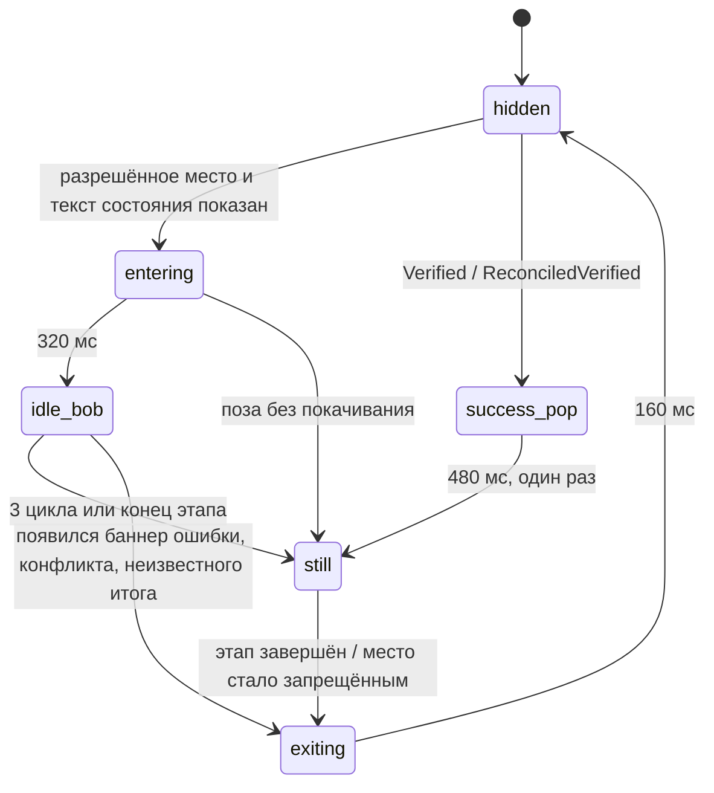

# P1-10 — Стежик: роль, состояния и движение

Статус: принято владельцем 25.10.2026 (решения по рекомендации). Это design specification, не реализованный код. Реализация — P2-00 (компонент и токены), P6-01 (производные изображения, упаковка, проверка лицензий).

Входы: `assets/brand` (существующие изображения), AGENTS.md (логотип и Стежик — собственная графика, не Tabler; новые изображения роботов не создаются), P1-00A §6–7 (риски визуального направления), P1-00C (glow не является цветом состояния), P1-00E (пороги ожидания: > 2 с — этап и «Отмена»), P1-00G и P1-11F (доступность), P1-09B/C (`reduced_motion`, «Внешний вид»), P1-08G (успех только после повторного чтения), P1-01G (неизвестный итог, конфликт), CSP P2-SEC-01 (`default-src 'self'`).

Макет: [`assets/00-foundations/00-02_P1-10_mascot-states.svg`](assets/00-foundations/00-02_P1-10_mascot-states.svg) — раскадровка разрешённых состояний, токены времени и запреты. Генератор `docs/design/tools/motion_svg.py`. В рамках эпика ни одно изображение не создано и не изменено.

## P1-10A — аудит изображений

| Файл | Размер | Прозрачность | Что изображено | Решение |
|---|---|---|---|---|
| `mascot/stezhik-wave.png` | 1254×1254, 1,2 МБ | да (RGBA) | приветствие рукой | **reuse**: приветствие, пустые черновики |
| `mascot/stezhik-chart.png` | 1254×1254, 1,2 МБ | да | держит график | **reuse**: долгая безопасная операция, пустая библиотека |
| `mascot/stezhik-compare.png` | 1254×1254, 1,3 МБ | да | две карточки со стрелками | **reuse**: пустые «Привязки» (смысл «сопоставить») |
| `mascot/stezhik-inspect.png` | 1254×1254, 1,4 МБ | да | лупа, карточка с зелёной галочкой | **adapt**: только «Находок нет» — галочка на рисунке не должна появляться рядом с незавершённой проверкой |
| `mascot/stezhik-success.png` | 1254×1254, 1,3 МБ | да | палец вверх, зелёная галочка | **reuse**: только после проверенного итога |
| `icons/stezhik-head-1024.png` | 1024×1024, 0,7 МБ | да | голова | **reuse**: логотип в шапке и «О программе»; персонажем-«состоянием» не используется |
| `icons/zdashstitch.ico` | — | — | значок приложения | вне эпика (P6-01) |
| `banners/readme-en.png`, `readme-ru.png` | 2172×724, 1774×887 | нет | баннеры README | **forbidden** в интерфейсе: концепт-арт, содержит текст и вымышленные экраны |
| `overview/product-vision-en.png` | 1536×1024 | нет | видение продукта | **forbidden** в интерфейсе: не снимок продукта (README) |

Общее для всех поз: оранжевое свечение по контуру нарисовано под тёмный фон и выходит почти к краям кадра; безопасное поле при обрезке — не меньше 8 % с каждой стороны. Мелкие детали (глаза, графики на карточках) читаются от 96 CSS px; ниже 64 px персонаж не используется — только голова-логотип.

Других утверждённых «роботов» в репозитории нет; сторонних или неподтверждённых изображений для интерфейса нет.

**Происхождение.** Изображения — собственная графика проекта; по AGENTS.md оригинальная графика лицензируется `CC-BY-4.0`. Записи о происхождении (автор, инструмент, исходники) в репозитории нет — это решение владельца M-4.

## P1-10B — роль и правила

Стежик — необязательный декоративный слой. Он помогает сориентироваться в пустом месте, скрашивает долгое безопасное ожидание и отмечает уже проверенный результат. Он никогда не передаёт состояние сам: всё, что он «говорит», уже сказано текстом рядом.

| Вид | Где | Правило |
|---|---|---|
| декоративный | приветствие, пустые состояния | скрыт от экранного диктора; убирается настройкой без потери информации |
| рядом с состоянием | долгая операция, «Находок нет», «Проверено» | появляется только после текста состояния; смысл — в тексте; скрыт от диктора |
| информирующий | — | не используется: у персонажа нет собственного смысла и своих message IDs |

Частота: приветствие — при первом запуске и не чаще раза за сеанс в пустых «Черновиках»; «Проверено» — один раз на операцию, при возврате на экран не повторяется. Одновременно на экране не больше одного персонажа. Кнопки «закрыть» у персонажа нет: его отключает настройка «Показывать Стежика» (решение M-1).

**Запрещено** (персонажа нет совсем): ошибки и сбой сохранения, отказ импорта, конфликт (11-05), неизвестный итог (11-08), ошибка после ответа сервера, подтверждение записи (11-06), «Разрешить запись панелей» (05-04), удаление и другие опасные подтверждения, этапы записи и повторного чтения, редактор и холст (12-01…12-04), сравнение и таблицы (11-04, 09-01…09-06), проверки с блокировками, «Нет связи» и «Нужен вход», диалоги входа и ввода секретов, баннер незавершённой операции. Если на экране виден любой баннер ошибки, конфликта, неизвестного итога или восстановления — персонаж скрывается, даже если его место разрешено.

## P1-10C — состояния и переходы

Используются только существующие состояния продукта; новых статусов backend нет.

| Состояние продукта | Поза | Повод | Движение | Конец |
|---|---|---|---|---|
| `idle`: первый запуск, пустые «Черновики» | wave | экран открыт, черновиков нет | вход, покачивание × 3 | статичный кадр; уходит, когда появился первый черновик |
| `import`: копирование с сервера, импорт файлов, экспорт шаблона | chart | этап длится > 2 с (P1-00E) | вход, покачивание до 3 циклов | уход при завершении или отмене этапа; итог показывает текст |
| `mapping`: «Привязки» пусты | compare | соответствий ещё нет | вход | статично; уходит при первом соответствии |
| `mapping`: таблицы, кандидаты, кардинальность | — | — | — | персонажа нет |
| `validation`: «Проверки», находок нет | inspect | после текста «Находок нет» | вход | статично |
| `validation`: есть находки | — | — | — | персонажа нет |
| `publish`: `Planned`…`Submitting`, повторное чтение | — | — | — | персонажа нет |
| `success`: `Verified`, `ReconciledVerified` | success | после баннера «Проверено повторным чтением» / «Сверено: записано» | однократный подъём | статично; не повторяется |
| `FailedBeforeSend`, `FailedAfterResponse`, `Conflict`, `UnknownOutcome`, `ClosedManually`, `ReconciledFailed` | — | — | — | персонажа нет; нейтральный текст и баннер P1-08 |
| `warning`, `error`, `offline`, `auth_required`, `context_changed` | — | — | — | персонажа нет |

При уменьшенной анимации все переходы мгновенные, состояния `idle_bob` и `success_pop` пропускаются.

## P1-10D — размещение и размеры

| Контекст | Экран (макет) | Место | Размер | Узкое окно (< 1024 px), масштаб 200 % |
|---|---|---|---|---|
| приветствие | «Начало» 01-01, первый запуск | правый край приветственной карточки | 160 px (до 200) | персонажа нет |
| пустое состояние | «Черновики» 02-01, «Библиотека» 04-01, «Привязки» | над текстом пустого состояния, по центру | 160 px | 96 px; при 400 % — нет |
| долгая операция | 03-03, 02-02, 03-02 (область этапа) | слева от текста этапа, внутри области прогресса | 96 px | персонажа нет |
| «Находок нет» | «Проверки» (P1-04F) | рядом с итогом | 96 px | персонажа нет |
| «Проверено» | 11-07 | справа от баннера итога, вне баннера | 96 px | персонажа нет |
| логотип | шапка всех экранов, 06-04 | как сейчас | 36 px, 96 px | без изменений |

Правила: персонаж не перекрывает кнопки, фокус, таблицы, технические сведения и live-region; место под него закладывается в компоновку заранее, поэтому появление и исчезновение не сдвигают содержимое; при выключенной настройке место не резервируется. Длинный текст RU/EN сжимает персонажа до 96 px, а затем убирает его, но не переносит текст под него.

## P1-10E — время и формат

| Токен | Значение | Кривая | Что делает |
|---|---|---|---|
| `--mascot-enter` | 320 мс | `cubic-bezier(.2, .8, .2, 1)` | прозрачность 0 → 1, сдвиг вверх на 8 px |
| `--mascot-idle` | 2400 мс × 3 | `ease-in-out` | покачивание ±4 px по вертикали, затем статично |
| `--mascot-success` | 480 мс × 1 | `cubic-bezier(.3, 1.4, .5, 1)` | подъём на 6 px и возврат |
| `--mascot-exit` | 160 мс | `ease-in` | исчезновение |
| `--mascot-delay` | 2000 мс | — | персонаж долгой операции — не раньше кнопки «Отмена» |

Анимируются только `transform` и `opacity`. Анимация не изображает ход операции и не подгоняется под её длительность; бесконечных циклов нет. При скрытой вкладке (`document.hidden`) анимация не идёт.

Сравнение форматов:

| Вариант | Плюсы | Минусы | Решение |
|---|---|---|---|
| CSS-движение готового растрового кадра | нет новых изображений, нет скриптов, работает под CSP | движение простое | **выбрано** |
| Спрайт или последовательность кадров (WebP/PNG) | выразительнее | нужны новые кадры — их нельзя создавать в эпике | нет |
| Векторная анимация | масштабируется | нет векторных исходников | нет |

Доставка: производные изображения 192 и 384 px (WebP без потерь или PNG) создаются из `assets/brand/mascot` воспроизводимым скриптом сборки и лежат внутри приложения; внешних ресурсов нет (CSP `img-src 'self'`). Бюджет: до 80 КБ на позу в размере 384 px, всего на персонажа — до 450 КБ; загрузка ленивая (`loading="lazy"`, `decoding="async"`); простой процессора вне анимации — без нагрузки (нет `requestAnimationFrame`, `will-change` только на время перехода). Если производное изображение не загрузилось — персонажа нет, место схлопывается без ошибки.

## P1-10F — темы, контраст и доступность

| Условие | Поведение |
|---|---|
| светлая тема | подложка `surface.sunken`, чтобы свечение по контуру не выглядело грязным краем на белом (как в 00-02) |
| тёмная тема | без подложки: рисунок рассчитан на тёмный фон |
| `forced-colors: active` (высокая контрастность Windows) | персонажа нет: растровое изображение не подчиняется системным цветам |
| `prefers-reduced-motion: reduce` или «Уменьшить анимацию» | статичный кадр без движения и переходов |
| экранный диктор | `alt=""`, `aria-hidden="true"`; персонаж не попадает в дерево доступности и не говорит в live-region |
| цвет и глаза | смысл не передаётся ни цветом, ни выражением лица; зелёная галочка на рисунке — украшение рядом с текстом |
| вспышки | нет: максимум один плавный подъём, амплитуда ≤ 8 px |
| фокус | персонаж не получает фокус и не перехватывает его |

Отрицательные проверки: при уменьшенной анимации вычисленный стиль не содержит анимации; при `forced-colors` элемент не отображается; на экранах из списка запретов персонажа нет; экран полностью понятен с выключенной настройкой.

## P1-10G — недостающие изображения

**Бриф, не выполнен и в продукт не добавлен.** Пробел один, и он не обязательный:

- нейтральная поза «работает / ждёт» без галочек и без выраженной радости — для долгой операции. Сейчас её заменяет `stezhik-chart.png`; она подходит, но слегка «празднична».
- Требования к заказу: тот же персонаж (форма головы, оранжевый модуль на голове, наушники, свечение, пропорции), прозрачный фон, 1254×1254, безопасное поле 8 %, без текста, интерфейсов третьих сторон и логотипов, исходник в слоях, запись о происхождении и подтверждение лицензии `CC-BY-4.0` владельцем.
- Поза для предупреждения, ошибки, конфликта, «нет связи» **не нужна**: в этих состояниях персонажа нет по решению P1-10B.

Рекомендация M-3: для MVP новые изображения не нужны.

## P1-10H — handoff для P2-00 и P6-01

- Компонент `MascotSlot`: свойства `pose` (`wave/chart/compare/inspect/success`) и `placement` (`welcome/empty/progress/checks_clear/result`) — только из перечня §P1-10D; места из списка запретов в перечень не входят, поэтому вызвать персонажа там нельзя типом. Компонент сам скрывается при выключенной настройке, `forced-colors`, узком окне и при видимом баннере ошибки, конфликта, неизвестного итога или восстановления.
- Токены `--mascot-*` добавляются в `ui/src/tokens.css` и обнуляются в блоке `prefers-reduced-motion` вместе с `--motion-*`.
- Настройка «Показывать Стежика» (решение M-1): ключ `show_mascot: true` в файле настроек P1-09B (`zdashstitch-settings`), в «Настройки → Внешний вид» рядом с «Уменьшить анимацию». Ключ добавлен в список ключей `zdashstitch-settings/v1` (P1-09D-H, принято 25.10.2026); реализация — вместе с P4-06.
- События: нет. Персонаж реагирует только на уже существующие состояния интерфейса.
- P6-01: скрипт производных изображений (воспроизводимо, без сети), бюджет размера в проверке сборки, запись о происхождении в `assets/brand` (решение M-4), уведомление `CC-BY-4.0` в окне «О программе и лицензии» (P1-12).
- Тесты P2-00: компонент недоступен для запрещённых мест (тип), скрыт при уменьшенной анимации и `forced-colors`, `aria-hidden`, отсутствие сдвига компоновки при появлении.

## Решения владельца

| # | Вопрос | Рекомендация |
|---|---|---|
| M-1 | Нужна ли настройка «Показывать Стежика» | да, включена по умолчанию; ключ `show_mascot` в P1-09B, строка в «Внешний вид» (06-01 не перерисовывается) |
| M-2 | Где Стежик допустим | только пять мест из P1-10C; в «О программе» — только голова-логотип |
| M-3 | Новые изображения | для MVP не нужны; бриф нейтральной позы остаётся на будущее |
| M-4 | Происхождение изображений | владелец подтверждает авторство и лицензию `CC-BY-4.0`; запись о происхождении (автор, инструмент, дата, исходники) добавляется в `assets/brand` до выпуска |

## Новые message IDs

Изображения персонажа декоративны и не имеют альтернативного текста; новые ID — только для настройки.

| ID | EN source | RU |
|---|---|---|
| `settings.appearance.mascot` | Show Stezhik | Показывать Стежика |
| `settings.appearance.mascot.hint` | A decorative character in empty states and results. Screens are fully clear without it. | Декоративный персонаж в пустых состояниях и итогах. Без него экраны полностью понятны. |

## Проверки приёмки P1-10

- У каждого состояния персонажа есть статичный вариант и вариант «без персонажа»; статус понятен без него.
- Публикация, конфликт и неизвестный итог не показываются персонажем; «Проверено» — только после повторного чтения.
- Внешние ресурсы и исполняемые файлы не нужны; анимация — только CSS `transform`/`opacity`.
- Ни одного нового изображения в рамках эпика не создано.
